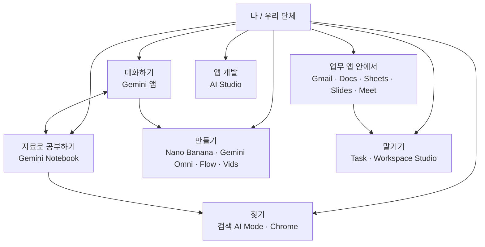

> **구글 AI, 일하는 방식으로 연결하기** 1편 / 전 12편 · 2026년 11월 기준
> 난이도: 초급 · 필요한 플랜: 무료 (일부 기능은 AI Plus / AI Pro / AI Ultra / Workspace 에디션)
> 개인 계정: ✅ · 기관(Workspace) 계정: ⚠️ · 한국어: ⚠️
>
> 기관 계정은 에디션과 관리자 설정에 따라 쓸 수 있는 기능이 다릅니다. 한국어는 Gemini 앱·Gemini Notebook·Workspace 앱 대부분이 "Available now"로 안내되지만, 신기능 일부는 영어·미국부터 열립니다.

> **한 줄 요약**
> 2026년 구글 AI는 이름도, 자리도, 요금 방식도 크게 바뀌었습니다. 이 글은 "무엇이 어디에 있고, 내 계정으로 무엇을 쓸 수 있는지"를 한 장의 지도로 정리하는 첫걸음입니다.

## 이 시리즈는 이렇게 읽으세요

이 시리즈는 구글 AI를 조금 써 본 분, 그리고 도구는 하나씩 쓰는데 서로 연결하지 못하던 분을 위해 썼습니다. 교회, 작은 비영리 단체, 소규모 기관에서 일하는 실무자와 개인 사용자를 염두에 두었습니다. 순서는 이렇습니다.

1. 서비스가 무엇인지 알아본다.
2. 서비스끼리 **연결**하는 법을 익힌다.
3. 바로 쓰는 **실무 레시피**로 마무리한다.

모든 편에서 **개인 계정**과 **기관 계정(Google Workspace, 비영리 Workspace 포함)**을 나눠 설명합니다. 같은 이름의 기능도 어느 계정에서 되는지가 다르기 때문입니다.

| 편 | 제목 | 난이도 |
| --- | --- | --- |
| 1 | 2026 구글 AI 지도 — 무엇이 바뀌었나 | 초급 |
| 2 | Gemini 앱 제대로 쓰기 | 초급 |
| 3 | Skills — 나만의 업무 비서 | 초급 |
| 4 | Gemini Notebook — 내 자료로 공부하고 정리하기 | 초급 |
| 5 | Workspace 속 Gemini — Gmail·Docs·Sheets·Slides | 초급 |
| 6 | 회의가 달라진다 — Meet와 Calendar | 초급 |
| 7 | 시너지 ① 노트북 × Gemini 앱 × 검색 | 중급 |
| 8 | 시너지 ② Workspace Studio로 자동화 | 중급 |
| 9 | 홍보물 만들기 — 이미지·영상·SNS | 중급 |
| 10 | 검색과 브라우저 — AI Mode, Search Live, Chrome | 중급 |
| 11 | 개인 에이전트와 앱 만들기 — Task, AI Studio | 중급 |
| 12 | 실무 레시피 북 — 조합으로 일하기 | 중급 |

> 🔒 **개인정보 원칙 (모든 편 공통)**
> 성도·후원자의 개인정보(연락처, 건강 정보, 헌금 내역 등)를 AI에 넣어야 할 때는 개인 계정이 아니라 **기관 계정**을 쓰세요. 그리고 꼭 필요한 만큼만, **이름은 지운 뒤** 넣으세요. 이 원칙은 12편 안전 체크리스트에서 다시 정리합니다.

## 먼저 큰 그림: 구글 AI는 "역할별 가게"가 모인 시장입니다

구글 AI는 하나의 프로그램이 아닙니다. 동네 시장을 떠올리면 쉽습니다. 정육점, 채소가게, 분식집이 한 골목에 모여 있고, 각 가게는 따로 문을 엽니다. 어느 가게에서 무엇을 사야 하는지만 알면 장보기는 어렵지 않습니다. 다만 2026년에는 가게 간판이 여러 번 바뀌었고, 문을 닫은 가게도 있습니다. 그래서 지도가 필요합니다.



각 칸이 앞으로 12편에서 어디에 나오는지 표로 보겠습니다.

| 하고 싶은 일 | 쓰는 서비스 | 다루는 편 |
| --- | --- | --- |
| 물어보고, 글·표·슬라이드 만들기 | Gemini 앱 | 2편 |
| 나만의 지시문 묶음 만들기 | Skills | 3편 |
| 내 자료에 근거해 정리·학습 | Gemini Notebook | 4편, 7편 |
| 메일·문서·표·슬라이드 안에서 AI 쓰기 | Workspace 속 Gemini | 5편 |
| 회의 기록·통역 | Meet | 6편 |
| 반복 업무 자동화 | Workspace Studio | 8편 |
| 이미지·영상·SNS 홍보물 | Nano Banana, Gemini Omni, Vids, Flow | 9편 |
| 검색·브라우저에서 AI 쓰기 | AI Mode, Search Live, Chrome | 10편 |
| 개인 에이전트, 작은 앱 | Task, AI Studio | 11편 |

## 🔄 이름이 바뀌었어요

> 🔄 **이름이 바뀌었어요**
> 인터넷에서 옛 강좌나 블로그를 보다가 "이 메뉴가 없는데요?" 하고 막히는 가장 큰 이유가 이름 변경입니다. 아래 표를 책갈피처럼 두고 쓰세요.

### 지금 쓰는 이름과 옛 이름

| 옛 이름 | 지금 이름 | 언제 | 쉽게 말하면 |
| --- | --- | --- | --- |
| NotebookLM | **Gemini Notebook** | 2026-07-16 | 같은 서비스의 새 이름입니다. "Google Notebook"이 아니라 **Gemini Notebook**입니다. 독립 앱으로 계속 있고 주소는 [notebook.google.com](http://notebook.google.com/)입니다. |
| Gems | **Skills** | 2026-09-30 발표 | 내가 만든 맞춤 지시문 도구의 후속입니다. 3편에서 자세히 다룹니다. |
| Gemini Spark | **Task** | 2026년 10월 중순 | 백그라운드에서 일하는 개인 에이전트입니다. 프롬프트창 옆 "Chat / Task" 토글로 바꿉니다. 도움말 일부는 아직 "Spark"라고 적혀 있습니다. 정확한 개명일은 출처마다 10월 12~13일과 18일로 달라 날짜는 단정하지 않습니다. |
| Google Workspace Flows | **Google Workspace Studio** | 2025-12 (보도) | 노코드 자동화 도구입니다. 8편에서 다룹니다. |
| Whisk, ImageFX | **Google Flow**에 통합 | 통합 2026-02-25, Whisk 종료 2026-04-30 (보도) | 이미지·창작 도구가 Flow 하나로 모였습니다. |
| Imagen (이미지 모델 브랜드) | **Nano Banana** 계열 | 2026년 (API 종료 날짜 미확인) | 이미지 생성은 Nano Banana라는 이름으로 부릅니다. |
| Veo (영상 모델 브랜드) | **Gemini Omni** 계열이 주력 | Omni는 2026-05-19 | 영상 생성·편집의 새 주력입니다. Veo 3.1이 일부 제품에 남아 있다고 합니다. Veo의 공식 종료 발표는 확인하지 못했습니다. |
| Gemini 앱의 "Past chats" | **memories** | 2026-03-26 | 지난 대화를 기억하는 기능의 이름입니다. |
| Gemini CLI | **Antigravity CLI** (이전 권장) | 2026-05-20 | 개발자용 도구입니다. 이 시리즈에서는 이름만 알아 두세요. |

모델 이름도 알아 둘 만합니다. 2026-10-13에 **Gemini 4 Argon**이 나왔고, Gemini 앱의 모델 선택창에는 **3.6 Flash**(2026-07-21)도 있습니다. I/O에서 예고됐던 Gemini 3.5 Pro는 출시되지 않았고 대신 Argon이 나왔습니다. 이 둘을 언제 고르는지는 2편에서 다룹니다.

### 문을 닫은 서비스와 대체 방법

닫는 날짜보다 **그다음에 무엇을 쓸지**가 중요하므로 대체 방법을 앞에 적었습니다.

| 서비스 | 대체 방법 | 날짜 |
| --- | --- | --- |
| **Opal** (노코드 미니앱 빌더) | 일상용 도구는 Skills, 업무 자동화는 Workspace Studio, 앱 제작은 AI Studio | **2026-11-17 종료.** 자동 이전은 없습니다. Drive의 "Opal" 폴더에 있는 파일은 보존됩니다. |
| **개인 계정의 Gems** | Skills로 옮기기 (3편) | 2026-11-17 읽기 전용, 2026-12-17 삭제(자동으로 skill 변환) |
| **Jules** (코딩 에이전트) | Antigravity | 세션은 2026-11-11경까지, 이후 읽기 전용, 2026-12-31 종료 |
| **Mixboard** (무드보드) | 별도 대체 안내는 확인하지 못했습니다 | 2026-09-28 종료 (보도) |
| **Project Mariner** (브라우저 에이전트 실험) | Gemini Agent, Chrome auto browse로 기술 흡수 | 2026-05-04 종료 (보도) |

> ⚠️ **날짜가 이미 지났을 수 있습니다**
> 이 글은 2026년 11월 기준입니다. 읽는 시점에 따라 위 날짜가 지났을 수 있으니, 지난 항목은 "이미 끝난 일"로 보고 대체 방법만 챙기세요. Opal을 새로 배울 필요는 없습니다.

## 개인 계정과 기관 계정: 이것만은 꼭 구분하세요

같은 구글 로그인이라도 **개인 계정**([gmail.com](http://gmail.com/))과 **기관 계정**(교회나 단체가 가진 Google Workspace 계정)은 전혀 다른 집입니다. 개인 계정은 내가 사는 집, 기관 계정은 직장 사무실입니다. 사무실에는 관리자(열쇠를 가진 사람)가 있어서, 어떤 기능을 켤지 정할 수 있습니다.

> 🏢 **기관 계정이라면**
> 비영리 단체나 교회가 구글에서 Workspace for Nonprofits를 받아 쓴다면 이 글의 "기관(Workspace) 계정" 항목이 해당합니다. 비영리 무료 에디션이 AI 기능을 어디까지 포함하는지는 공식 문구가 모호합니다. **관리자 콘솔에서 직접 확인**하는 습관을 들이세요. 5편에서 한 번 더 정리합니다.

| 항목 | 개인 계정 | 기관(Workspace, 비영리 포함) 계정 |
| --- | --- | --- |
| 요금 | Google AI 플랜(무료, Plus, Pro, Ultra) | 에디션별 요금. 비영리는 $0부터 |
| 기능을 켜고 끄는 사람 | 본인 | 관리자 (정책, 관리자 콘솔) |
| Task(개인 에이전트) | AI Pro 또는 Ultra에서 가능, 18세 이상 | **업무·학교 계정에서는 사용 불가** |
| Gems → Skills 전환 | 2026-11-17 읽기 전용, 12-17 삭제·변환 | 비즈니스·엔터프라이즈·비영리는 이르면 2027-03 이후, 교육은 2027-06 이후. 그때까지 Gems 계속 사용 가능 |
| Chrome auto browse | 미국 AI Pro/Ultra, 데스크톱 | 관리자 정책으로 켜야 하고 기본값은 꺼짐 |
| Personal Intelligence(Gmail·Photos 등 연결) | 기본 꺼짐, 켜면 맥락을 반영한 답변 | 초기 버전은 Workspace 미지원으로 시작 |
| 민감한 성도·후원자 정보 | 넣지 않는 것이 원칙 | 필요한 만큼만, 이름을 지우고 |

핵심은 이것입니다. **Task 같은 신기능은 개인 계정이 먼저**입니다. 반대로 기관 계정은 관리자가 통제하는 대신, Gems 같은 기존 기능이 더 오래 유지됩니다. 교회 이름으로 만든 Workspace 계정에서 "Task가 안 보이는데요?"라는 질문이 나오면 버그가 아니라 정책입니다.

## 요금제 한눈에 보기 (미국, USD, 2026-11 기준)

### 개인 Google AI 플랜

| 플랜 | 월 가격 | 저장공간 | 핵심 |
| --- | --- | --- | --- |
| 무료 | $0 | 15GB | 표준 한도. Gemini Notebook, Search Live, AI Mode, 채팅 안 파일 편집 |
| **Google AI Plus** | **$4.99~$7.99로 안내가 엇갈림 — 가입 화면에서 확인** | 400GB 안내(표에 2TB도 표기되어 확인 필요) | Deep Research, Notebook 확대, Gmail의 Gemini, Daily Brief, Nano Banana Pro, Omni. 포함 모델은 안내가 엇갈립니다 |
| **Google AI Pro** | $19.99 (연 $199.99) | 5TB | Gemini 4 Argon, Tasks in Gemini, Chrome auto browse, Flow 월 1,000 크레딧, Antigravity |
| **Google AI Ultra** | $99.99 (페이지 표기) | 20TB | Gemini Agent(미국·영어), Flow 월 10,000 크레딧 |
| Google AI Ultra 상위 | 공식 페이지에서 확인하지 못해 가격은 적지 않습니다 | 보도로는 30TB | 최고 한도 |

> 💡 **학생이라면**
> 미국 대학생은 AI Pro를 1년 무료로 받을 수 있고 등록 마감은 2026-12-31입니다.

### Workspace (기관) 요금

| 구분 | Starter | Standard | Plus | Enterprise |
| --- | --- | --- | --- | --- |
| 일반 (사용자당 월) | $7 | $14 | $22 | 문의 |
| 프로모션 (첫 20명, 12개월) | $3.50 | $7 | $11 | 해당 없음 |
| **비영리** | **Workspace for Nonprofits $0** | Business Standard $3.50 (연약정, 월 결제 $4.20) | Business Plus $6.16 (연약정, 월 결제 $7.40) | 70% 이상 할인 |

- 프로모션 기간은 2026-11-15부터 2027-02-15까지로 표기되어 있습니다.
- Starter에서 Plus까지는 최대 300명, 비영리는 최대 2,000명(Enterprise 제외)입니다.
- 별도 애드온 **AI Expanded Access**가 있습니다. 자동화 확대, 이미지·영상 생성, 실시간 통역 등이 해당하는데 가격은 확인하지 못했습니다.
- 비영리 무료 플랜에서 Gemini 앱과 Gemini Notebook을 쓸 수 있고, 유료 비영리 에디션에서 Gmail·Docs·Sheets·Meet 등의 Gemini를 쓸 수 있다고 구글이 안내합니다. 무료 플랜에 Docs·Sheets의 Gemini가 들어 있다고 쓴 2차 사이트도 있지만 구글 문구와 맞지 않습니다. 실제 범위는 관리자 콘솔에서 확인하세요.

## 사용 한도가 "개수"에서 "컴퓨트"로 바뀌었습니다

예전에는 "하루에 몇 번"이라는 식의 고정 한도가 흔했습니다. 지금 Gemini Notebook은 **컴퓨트 기반 한도**로 바뀌었습니다(2026-09-02 시행). 컴퓨트는 AI가 일하는 데 쓰는 계산량입니다. 휴대폰 데이터 요금제에 비유하면, "문자 몇 통"이 아니라 "데이터 몇 GB"로 계산하는 방식과 비슷합니다. 짧은 질문은 적게, 긴 영상이나 슬라이드 생성은 많이 씁니다.

- 한도는 **5시간마다 다시 채워지고**, **주간 상한**이 따로 있습니다.
- 무료는 표준, Plus는 2배, Pro는 4배입니다. Ultra는 Pro의 5배 또는 20배입니다.
- Gemini Notebook에서는 설정의 사용량 메뉴에서 확인하고, 스튜디오에서 무언가 생성할 때 예상 사용량 막대가 보입니다. 한도가 다 차면 웹에서 "나중에 생성"을 고를 수 있습니다.
- Gemini 앱도 컴퓨트 방식으로 보도되며 [gemini.google.com/usage에서](http://gemini.google.com/usage%EC%97%90%EC%84%9C) 볼 수 있다고 하지만, 앱 한도에 대한 공식 도움말은 확인하지 못했습니다(보도 기준).
- Workspace 가격 페이지는 Notebook을 "Basic(Audio Overview 하루 최대 3개)", "Expanded(하루 최대 20개)"처럼 일일 개수로 적어 둡니다. 소비자 쪽 방식과 달라서 Workspace 계정이 별도 체계일 가능성이 있지만 확인하지 못했습니다.

결론은 하나입니다. **사용량 화면을 확인하는 습관**을 들이세요. 행사 직전에 영상을 여러 번 만들다 한도가 바닥나는 일을 막을 수 있습니다.

## 한국어 지원: 어디까지 되고, 무엇은 영어로 시작하나요

- Workspace 언어 지원표에 따르면 Gmail(사이드패널, Help me write, 스레드 요약), Docs, Sheets, Slides, Meet(통역, Take notes for me), Vids(AI 보이스오버, 이미지), Chat(자동 번역·요약), Drive, **Gemini 앱**, **Gemini Notebook**이 모두 한국어 "Available now"입니다.
- 반면 **Task, 연결 앱 40개 이상, 공유 아바타, Antigravity** 같은 신기능은 영어·미국 우선으로 시작했습니다. 한국어 화면으로 쓰면 메뉴가 안 보일 수 있습니다.
- Workspace Studio는 언어 지원표에 없습니다. 한국어 지원 여부는 확인하지 못했습니다.
- Search Live는 AI Mode가 제공되는 모든 언어·지역으로 확대되었고, AI Mode가 한국어를 지원하므로 한국어도 될 것으로 추론할 수 있습니다. 다만 한국어가 명시된 자료는 확인하지 못했습니다.

> 💡 **팁**
> 한국어로 질문해도 대부분의 핵심 기능은 됩니다. 어떤 기능 메뉴가 안 보이면 계정 언어를 영어로 바꿔 보거나, 그 기능이 "영어·미국 한정"인지 먼저 의심하세요.

## 따라 하기 실습: 내 계정 5분 점검표

지도를 봤으니 이제 내 집 주소를 확인할 차례입니다. 종이나 메모 앱에 아래 항목을 적으며 진행하세요.

1. **어떤 계정인지 확인합니다.** [gemini.google.com](http://gemini.google.com/)에 접속하고 오른쪽 위 프로필 사진을 눌러 이메일 주소를 봅니다. [gmail.com](http://gmail.com/)이면 개인 계정, 단체 도메인이면 기관 계정입니다. 메모에 "개인" 또는 "기관"이라고 적습니다.
2. **플랜을 확인합니다.** 개인 계정은 [one.google.com](http://one.google.com/)의 Google AI 플랜 페이지에서 현재 플랜(무료, Plus, Pro, Ultra)을 확인합니다. 기관 계정은 관리자에게 어떤 Workspace 에디션인지, 비영리 에디션인지 물어봅니다. 관리자라면 관리자 콘솔에서 직접 봅니다. 메뉴 이름은 계정 종류와 언어 설정에 따라 다를 수 있습니다.
3. **언어 설정을 확인합니다.** 계정 언어가 한국어인지 영어인지 적습니다. 신기능이 안 보일 때 영어로 바꿔 시도하기 위해서입니다.
4. **모델 선택창을 확인합니다.** Gemini 앱 대화 화면에서 모델 선택창을 열어 어떤 이름들(예: 3.6 Flash, Gemini 4 Argon)이 보이는지 적습니다. Argon은 Pro·Ultra 구독자에게 먼저 열렸으므로, 안 보여도 이상한 것이 아닙니다.
5. **사용량 화면을 찾습니다.** [gemini.google.com/usage를](http://gemini.google.com/usage%EB%A5%BC) 열어 봅니다. Gemini Notebook은 [notebook.google.com](http://notebook.google.com/) 설정의 사용량 메뉴를 봅니다. 화면이 없거나 열리지 않으면 그 사실도 메모합니다.
6. **연결 앱 상태를 확인합니다.** Gmail, Calendar 같은 연결 앱이 켜져 있는지 보고, 켜져 있다면 켠 사람이 누구인지 적습니다. Personal Intelligence는 기본 꺼짐입니다.
7. **Gems가 있는지 확인합니다.** 개인 계정에 직접 만든 Gem이 있다면 2026-11-17부터 읽기 전용이 됩니다. 목록을 적고 3편으로 이동합니다.

**완료 기준:** 메모에 (1) 개인/기관, (2) 플랜, (3) 언어, (4) 보이는 모델 이름, (5) 사용량 화면 위치, (6) 연결 앱, (7) 기존 Gems 목록이 모두 적혀 있으면 끝입니다. 이 메모는 12편까지 계속 참고합니다.

## 복사해 쓰는 프롬프트

아래 프롬프트는 괄호 부분만 바꾸면 됩니다. Gemini 앱 새 대화에 그대로 붙여 넣으세요.

**1) 이름 바뀐 서비스 찾기**

```
옛날 자료에서 "(옛 이름)"이라는 기능을 봤어요.
2026년 11월 기준으로 이 기능이 지금 어떤 이름으로 바뀌었는지, 사라졌다면 무엇으로 대체하면 되는지 알려 주세요.
확실하지 않은 부분은 확실하지 않다고 표시해 주세요.
```

**2) 내 상황에 맞는 서비스 고르기**

```
저는 (교회 / 비영리 단체)의 (역할)입니다. 계정은 (개인 / Workspace 기관 계정)이고 플랜은 (무료 / AI Plus / AI Pro / 비영리 Workspace)입니다.
이번 주에 (하고 싶은 일)을 하려고 합니다.
구글 AI 서비스 중 무엇을 쓰면 좋을지 이유와 함께 2가지만 추천해 주세요.
그 서비스가 제 계정에서 안 될 수 있는 이유도 함께 알려 주세요.
```

**3) 점검표 정리**

```
아래는 제 구글 계정 점검 메모입니다.
(메모 내용 붙여넣기)
이 메모를 보고 앞으로 할 일을 우선순위 순서로 5개 이내의 체크리스트로 정리해 주세요.
```

**4) 어려운 안내문 쉽게 풀기**

```
아래는 구글의 안내문입니다. 초등학생도 이해할 수 있게 쉬운 한국어로 설명해 주세요.
그리고 "그래서 제가 지금 해야 할 일"을 마지막에 한 줄로 적어 주세요.
(안내문 붙여넣기)
```

> 🔒 **주의**
> 프롬프트에 이름, 연락처, 헌금 내역 같은 개인정보를 넣지 마세요. 예시는 "한 소규모 교회", "한 비영리 단체"처럼 일반화해서 쓰는 것이 좋습니다.

## 시너지 연결: 이 지도를 어떻게 쓸까

연결은 7편 이후에 본격적으로 다루지만, 맛보기를 알려 드립니다.

- **Gemini 앱 × Gemini Notebook**: 앱에서 만든 노트북이 Notebook에 그대로 나타나고 반대도 됩니다. 양방향 동기화입니다(7편).
- **Meet × Workspace Studio**: 회의가 끝나면 후속 메일 초안과 Tasks 동기화를 원클릭 루틴으로 돌릴 수 있습니다(6편, 8편).
- **Skills × 업무 글쓰기**: 단체의 말투와 용어를 한 번 만들어 두고 소식지나 감사 메일에서 "/"로 불러옵니다(3편).

## 주의할 점

> ⚠️ **사실 확인**
> AI 답변은 틀릴 수 있습니다. 특히 가격, 날짜, 기능 범위는 가입 화면과 공식 도움말에서 직접 확인하세요. 이 글에서 "보도에 따르면", "확인 필요"라고 적은 부분은 공식 확인이 안 된 항목입니다.

> ⚠️ **롤아웃은 계정마다 다릅니다**
> 같은 기능도 지역, 계정 종류, 플랜, 언어에 따라 나타나는 시점이 다릅니다. 내 화면에 없다고 해서 기능이 없는 것은 아닙니다.

> 🔒 **개인정보**
> 개인 계정에는 성도·후원자 정보를 넣지 마세요. 기관 계정에서도 꼭 필요한 만큼만, 이름은 지운 뒤 넣으세요.

## 중급자 팁

- **릴리스 노트를 북마크하세요.** Gemini 릴리스 노트([gemini.google/release-notes)와](http://gemini.google/release-notes)%EC%99%80) Workspace Updates 블로그에는 날짜와 대상이 정리되어 있습니다. 이름이 바뀐 시점도 여기서 가장 정확하게 확인할 수 있습니다.
- **"메뉴가 없다"는 말 대신 세 가지를 확인하세요.** 계정이 개인인지 기관인지, 플랜이 맞는지, 영어·미국 한정 기능인지입니다. 이 세 가지로 대부분의 "안 보여요"가 해결됩니다.
- **Gems는 지금 백업하세요.** 개인 Gems는 읽기 전용이 되었다가 삭제됩니다. 지시문을 복사해 문서로 저장해 두면 어떤 일이 생겨도 다시 만들 수 있습니다(3편).

## 다음 편 예고

2편에서는 오늘 지도에서 가장 큰 가게, **Gemini 앱**을 제대로 쓰는 법을 배웁니다. 웹·모바일·Mac·Windows 앱의 차이, 모델 고르기(3.6 Flash와 Gemini 4 Argon), 채팅 안에서 문서·표·슬라이드를 만들고 고치는 방법, Deep Research, 그리고 켜고 끌 수 있는 memories와 Personal Intelligence까지 다룹니다.
