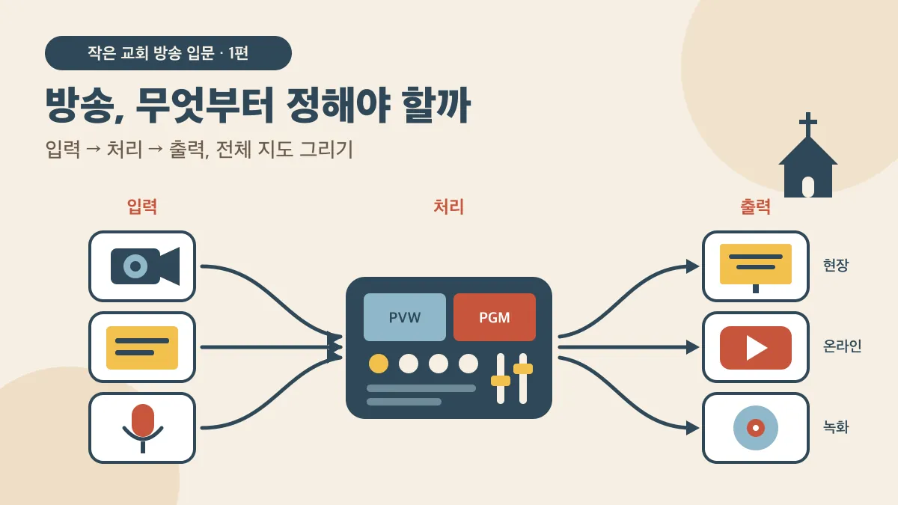
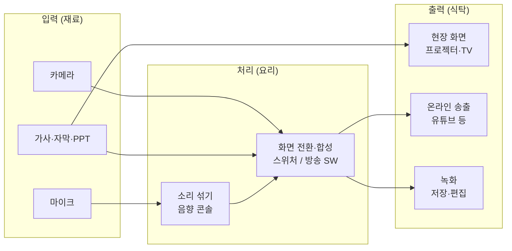

> **작은 교회 방송 입문** 1편 / 전 9편 + 부록
> 대상: 방송을 처음 맡았거나 장비 구입을 검토하는 소규모 교회·기관 담당자

## 시리즈 목차

| 편 | 제목 | 핵심 질문 |
| --- | --- | --- |
| **1** | **방송, 무엇부터 정해야 할까** | 우리는 왜 방송하나? ← 현재 문서 |
| 2 | 카메라 — 눈의 역할 | 어떤 카메라가 맞을까? |
| 3 | 소리 — 방송 품질의 절반 | 왜 화면보다 소리가 먼저인가? |
| 4 | 화면 전환과 합성 — 스위처 | 카메라 여러 대를 어떻게 바꾸나? |
| 5 | 컴퓨터와 방송 소프트웨어 | PC 한 대로 어디까지 되나? |
| 6 | 가사·자막·프레젠테이션 | 회중 화면과 방송 화면은 같아야 할까? |
| 7 | 연결 — 케이블과 네트워크 | 이 선은 다 뭐지? |
| 8 | 송출과 녹화 | 유튜브에는 어떻게 올라가나? |
| 9 | 예산별 구성과 운영 | 우리는 어디서 시작할까? |
| 부록 | 방송 용어 사전 | 찾아보기용 |

> 🎯 **한 줄 요약**
>
> 장비를 고르기 전에 "무엇을, 누구에게 보여주려는가"를 먼저 정해야 합니다. 방송 장비는 모두 **입력 → 처리 → 출력**이라는 하나의 지도 위에 있습니다.

---

## 1. 방송은 사실 세 가지 일입니다

"교회 방송"이라고 한마디로 부르지만, 실제로는 성격이 다른 세 가지 일이 섞여 있습니다.

| 일 | 누구를 위해 | 예시 | 꼭 필요한 것 |
| --- | --- | --- | --- |
| **① 현장 화면** | 예배당 안의 회중 | 찬양 가사, 성경 본문, 광고 | 프레젠테이션 PC, 프로젝터나 TV |
| **② 온라인 송출** | 집에서 보는 성도 | 유튜브 실시간 예배 | 카메라, 소리 연결, 송출 장비, 인터넷 |
| **③ 녹화** | 나중에 보는 사람, 기록 | 설교 영상 업로드, 행사 기록 | 카메라, 저장 장치 |

많은 교회가 ①은 이미 하고 있습니다. 문제는 ②와 ③을 시작하면서 **①에 쓰던 장비와 화면을 그대로 방송에 쓰려 할 때** 생깁니다. 세 가지는 보는 사람이 다르기 때문에, 보여줄 내용도 조금씩 달라야 합니다.

> 💡 **먼저 정할 것**: 우리 교회는 이 셋 중 **어디까지** 하려고 하나요? 셋 다 할 필요는 없습니다. "녹화만 해서 나중에 올린다"도 훌륭한 출발입니다.

---

## 2. 전체 지도 — 입력, 처리, 출력

방송 장비가 아무리 많아 보여도, 결국 세 칸 중 하나에 들어갑니다.

**요리에 비유하면** 이렇습니다.

- **입력**은 재료입니다. 카메라가 찍은 영상, 프레젠테이션 화면, 마이크로 들어온 소리.
- **처리**는 요리입니다. 여러 카메라 중 하나를 고르고, 영상 위에 자막을 얹고, 여러 마이크 소리를 알맞게 섞습니다.
- **출력**은 식탁입니다. 완성된 화면과 소리를 현장 화면, 온라인, 녹화 파일로 내보냅니다.

그리고 이 지도에는 **두 개의 줄기**가 흐릅니다.

| 줄기 | 출발 | 중간 | 도착 |
| --- | --- | --- | --- |
| **영상 줄기** | 카메라, 프레젠테이션 | 스위처 또는 방송 소프트웨어 | 송출, 녹화 |
| **소리 줄기** | 마이크, 악기 | 음향 콘솔 | 영상과 합쳐져 송출, 녹화 |

두 줄기는 **마지막에 한 번 만납니다.** 어디서 만나게 할지가 방송 설계의 중요한 결정 중 하나이고, 3편과 5편에서 자세히 다룹니다.

> 📌 이 시리즈의 모든 글은 이 지도에서 시작합니다. 각 편 첫머리에 "지금은 지도의 어느 부분 이야기인지"를 표시해 두겠습니다.

---

## 3. 장비 한눈에 보기 — 기본 권장 사양

아래 표는 "이런 장비가 있다"는 지도입니다. 지금 모두 살 필요는 없습니다. 각 장비의 **기본 권장 사양**은 소규모 예배당(50~200석)에서 몇 년 쓸 수 있는 수준을 기준으로 했습니다. 링크는 Amazon에서 해당 종류의 제품을 모아 보는 검색 페이지입니다.

### 입력 장비

| 장비 | 하는 일 | 기본 권장 사양 | 둘러보기 | 자세히 |
| --- | --- | --- | --- | --- |
| **PTZ 카메라** | 원격으로 좌우·상하·줌 조작하는 카메라 | 4K 센서(송출은 1080p60), 광학 **20~30x 줌**, SDI·HDMI·IP 출력, PoE+ 지원, 프리셋 저장 | [PTZ Camera](https://www.amazon.com/s?k=ptz%20camera%204k%2030x) | 2편 |
| **캠코더** | 사람이 옆에서 조작하는 일반 카메라 | 1080p60 이상, **클린 HDMI 출력**(화면 표시 없는 출력), 장시간 연속 촬영, AC 전원 사용 가능 | [Camcorder](https://www.amazon.com/s?k=camcorder%20clean%20hdmi%20output) | 2편 |
| **웹캠 / AI 추적 카메라** | USB로 PC에 바로 연결 | 1080p60 이상, USB-C, **UVC 지원**(드라이버 없이 인식), 자동 추적은 선택 | [Streaming Webcam](https://www.amazon.com/s?k=ai%20tracking%20webcam%201080p60) | 2편 |
| **삼각대** | 카메라를 안정적으로 고정 | 최대 높이 **6ft(약 183cm) 이상**, 하중은 카메라 무게의 2배, 부드러운 회전 헤드 | [Video Tripod](https://www.amazon.com/s?k=heavy%20duty%20video%20tripod%20fluid%20head) | 2편 |
| **무선 마이크** | 설교자·인도자 목소리 | 디지털 또는 UHF 방식, 수신기 **XLR 출력**, 동시 사용 채널 수 = 마이크 수 | [Wireless Microphone System](https://www.amazon.com/s?k=wireless%20microphone%20system%20xlr) | 3편 |

### 처리 장비

| 장비 | 하는 일 | 기본 권장 사양 | 둘러보기 | 자세히 |
| --- | --- | --- | --- | --- |
| **음향 콘솔(믹서)** | 여러 마이크·악기 소리를 섞음 | 마이크 입력 = 사용 마이크 수 + 4 여유, **AUX(보조) 출력 2개 이상**, USB 녹음 기능은 선택 | [Audio Mixer](https://www.amazon.com/s?k=audio%20mixer%20aux%20send) | 3편 |
| **오디오 인터페이스** | 콘솔 소리를 PC로 보냄 | 2입력 이상, USB-C, **24bit/48kHz**, 팬텀 파워(48V) | [Audio Interface](https://www.amazon.com/s?k=usb%20c%20audio%20interface%202x2) | 3편 |
| **비디오 스위처** | 여러 카메라 중 하나를 고르고 자막을 얹음 | 입력 4개 이상(HDMI 또는 SDI), PGM/PVW 화면, **멀티뷰**, 크로마·루마 키, **USB-C(UVC) 출력**, 내장 녹화 | [Video Switcher](https://www.amazon.com/s?k=live%20streaming%20video%20switcher%204%20input) | 4편 |
| **PTZ 컨트롤러** | PTZ 카메라를 조이스틱으로 조작 | 조이스틱, **VISCA over IP** 지원, 프리셋 버튼, 카메라 4대 이상 제어 | [PTZ Controller](https://www.amazon.com/s?k=ptz%20camera%20controller%20joystick%20ip) | 2편 |
| **캡처 카드** | 카메라·스위처 영상을 PC로 넣음 | USB 3.0 이상, **UVC 지원**, 1080p60 입력, 패스스루(그대로 내보내기) 출력 | [Capture Card](https://www.amazon.com/s?k=hdmi%20capture%20card%20usb%203.0%201080p60) | 5편 |
| **방송용 컴퓨터** | 방송 소프트웨어로 송출·녹화 | 8코어 이상 CPU, 메모리 **16GB 이상(32GB 권장)**, 하드웨어 영상 인코더 내장 칩 또는 그래픽카드, SSD 1TB, USB-C/Thunderbolt 포트 여러 개 | [Laptop for Live Streaming](https://www.amazon.com/s?k=laptop%20for%20live%20streaming%2032gb) | 5편 |

### 출력·연결 장비

| 장비 | 하는 일 | 기본 권장 사양 | 둘러보기 | 자세히 |
| --- | --- | --- | --- | --- |
| **HDMI 분배기** | 한 화면을 여러 TV·프로젝터로 | 1입력 2~4출력, 4K60, **EDID 관리** 기능 | [HDMI Splitter](https://www.amazon.com/s?k=hdmi%20splitter%201x4%204k60%20edid) | 6편 |
| **HDMI 익스텐더** | 랜선으로 HDMI를 멀리 보냄 | Cat6 케이블 사용, **최대 230ft(약 70m)**, HDBaseT 방식 | [HDMI Extender](https://www.amazon.com/s?k=hdmi%20extender%20over%20cat6%20hdbaset) | 7편 |
| **PoE 스위치** | 랜선 하나로 카메라 전원과 제어 신호 공급 | 기가비트, 포트 8개, 카메라에 맞는 **PoE+ 또는 PoE++**, 총 전력 = 카메라 소비전력 합 × 1.3 | [PoE Switch](https://www.amazon.com/s?k=poe%2B%2B%20switch%208%20port%20gigabit) | 7편 |
| **하드웨어 인코더** | PC 없이 영상을 인터넷으로 송출 | HDMI 입력, 1080p60, **RTMP·SRT** 지원 | [Live Streaming Encoder](https://www.amazon.com/s?k=hdmi%20live%20streaming%20encoder%20rtmp%20srt) | 8편 |
| **녹화 장치** | 방송 화면을 파일로 저장 | 1080p60, SD카드나 USB SSD 저장, 스위처 내장 녹화로 대신 가능 | [Video Recorder](https://www.amazon.com/s?k=hdmi%20video%20recorder%201080p60) | 8편 |

> ⚠️ **사양표를 읽는 법**: 표의 숫자는 "이보다 낮으면 곧 아쉬워지는" 기준선입니다. 더 높은 사양이 항상 더 좋은 것은 아닙니다. 특히 카메라를 바꾸기 전에 **소리와 조명**을 먼저 점검하세요.

---

## 4. 규모 4단계 — 작게 시작해서 늘리기

방송은 한 번에 완성하는 것이 아니라 **단계적으로 키우는 것**입니다. 앞 단계 장비가 다음 단계에서도 대부분 그대로 쓰이도록 고르는 것이 요령입니다.

| 단계 | 구성 | 대략 예산 (2026년 기준) | 이런 곳에 |
| --- | --- | --- | --- |
| **0단계** 스마트폰 | 스마트폰 + 삼각대 + 콘솔 소리 연결 케이블 | $100~300 | 일단 시작해 보고 싶은 곳 |
| **1단계** 카메라 1대 + PC | 캠코더나 웹캠 1대 + 방송용 PC + 오디오 인터페이스 | $1,000~2,500 | 설교 중심 송출, 운영자 1명 |
| **2단계** 카메라 여러 대 + 스위처 | 카메라 2~3대 + 비디오 스위처 + PC | $3,000~6,000 | 찬양·설교·회중을 나눠 보여주고 싶은 곳 |
| **3단계** PTZ 시스템 | PTZ 카메라 3대 이상 + 컨트롤러 + PoE 스위치 + 스위처 + 전용 송출 PC | $8,000 이상 | 정기 송출과 행사 중계를 함께 하는 곳 |

> 📖 **한 소규모 교회의 경우**: PTZ 카메라 1대에서 시작해 스위처·컨트롤러 일체형 장비, 방송용 노트북, PoE 스위치, HDMI 분배기를 갖추는 데 약 $4,000이 들었습니다. 2단계와 3단계 사이의 구성으로, 카메라를 나중에 추가할 수 있도록 **카메라 4대까지 제어되는 장비**를 골랐습니다. 9편에서 자세히 다룹니다.

---

## 5. 처음에 흔히 하는 오해 세 가지

**오해 1. "좋은 카메라부터 사야 한다."**
온라인 시청자가 가장 먼저 떠나는 이유는 화질이 아니라 **소리**입니다. 설교가 또렷하게 들리면 화면이 조금 어두워도 끝까지 봅니다. 반대로 화면이 선명해도 소리가 웅웅거리면 금방 창을 닫습니다.

**오해 2. "현장 화면을 그대로 방송에 내보내면 된다."**
회중용 화면은 가사가 화면 가득 나옵니다. 이것을 그대로 방송에 넣으면 온라인 성도는 찬양 시간 내내 **가사만 보고 사람은 보지 못합니다.** 방송에는 카메라 영상 위에 **하단 자막**으로 얹는 방식이 맞습니다. 6편에서 다룹니다.

**오해 3. "한 사람이 PC 한 대로 다 할 수 있다."**
처음에는 가능합니다. 하지만 가사 넘기기와 방송 조작을 한 사람, 한 PC가 동시에 하면 **둘 다 실수하기 쉽고, PC가 멈추면 현장 화면과 방송이 함께 멈춥니다.** 규모가 커지면 프레젠테이션 PC와 방송 PC를 나누는 것을 목표로 삼으세요.

---

## 6. 우리는? — 시작 전에 답해 볼 질문

아래 질문에 답을 적어 두면, 다음 편부터 장비를 고를 때 기준이 됩니다.

1. **목적**: 현장 화면, 온라인 송출, 녹화 중 무엇을 하나요? 우선순위는?
2. **공간**: 예배당 크기와 강단까지의 거리는 얼마나 되나요? 방송 자리는 어디에 둘 수 있나요?
3. **사람**: 예배 중에 방송을 맡을 사람은 몇 명인가요? 매주 같은 사람인가요, 돌아가며 하나요?
4. **소리**: 지금 음향 콘솔에 남는 출력(AUX)이 있나요?
5. **인터넷**: 예배당에서 업로드 속도가 얼마나 나오나요? (8편에서 측정 방법을 다룹니다)
6. **예산**: 올해 쓸 수 있는 금액과, 몇 년에 걸쳐 늘릴 계획인지?

---

## 7. Tips

> 💡 **Tip 1 — 사람이 장비보다 중요합니다** 가장 좋은 장비는 "우리 봉사자가 매주 실수 없이 다룰 수 있는 장비"입니다. 조작이 단순한 것을 고르세요.
>
> **Tip 2 — 확장성을 보고 고르세요** 지금은 카메라 1대여도, 스위처나 컨트롤러는 입력 수에 여유가 있는 것을 고르면 나중에 다시 사지 않아도 됩니다.
> 
> **Tip 3 — 시험 방송을 먼저** 유튜브는 "비공개"나 "일부 공개"로 송출해 볼 수 있습니다. 실제 예배 전에 2~3주 시험 방송을 해 보세요.
> 
> **Tip 4 — 찬양 저작권을 확인하세요** 예배당에서 가사를 띄우는 허락과 **온라인으로 송출하는 허락은 별개**입니다. 8편에서 다룹니다.

---

## 8. 이번 편의 용어

| 용어 | 뜻 |
| --- | --- |
| **입력 / 처리 / 출력** | 재료(카메라·마이크) → 요리(전환·믹싱) → 식탁(화면·송출·녹화) |
| **PTZ** | Pan(좌우), Tilt(상하), Zoom(확대). 원격으로 움직이는 카메라 |
| **스위처** | 여러 영상 중 하나를 골라 내보내고, 자막 등을 합성하는 장비 |
| **PGM / PVW** | 지금 나가는 화면(Program) / 다음에 내보낼 화면(Preview) |
| **AUX** | 음향 콘솔의 보조 출력. 방송용 소리를 따로 만들 때 씀 |
| **UVC** | USB로 연결하면 웹캠처럼 바로 인식되는 규격 |
| **PoE** | 랜선으로 전원까지 보내는 기술 |
| **송출** | 완성된 방송을 유튜브 같은 플랫폼으로 보내는 일 |

---

## 다음 편 예고

**2편 「카메라 — 눈의 역할」**: 스마트폰부터 PTZ 카메라까지, 카메라 종류별 장단점과 우리 예배당에 몇 대가 필요한지 정하는 법을 다룹니다.
