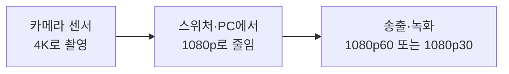
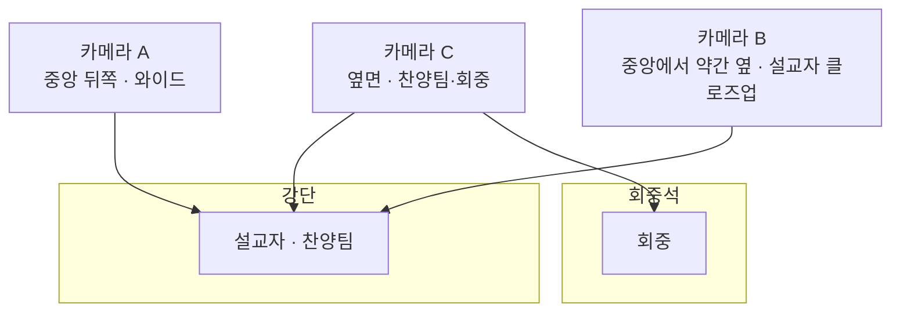
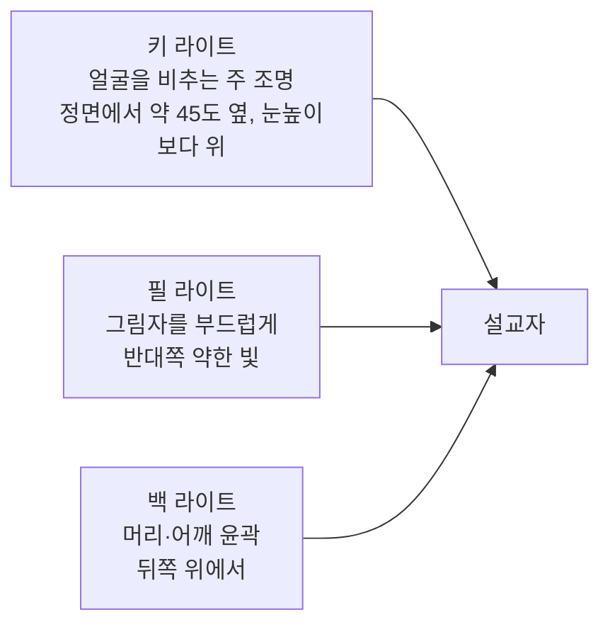

> **작은 교회 방송 입문** 2편 / 전 9편 + 부록
> 지도에서의 위치: **입력** 칸, **영상 줄기**의 출발점 (카메라와 조명)

> **한 줄 요약**
> 카메라는 방송의 "눈"입니다. 비싼 카메라를 고르기 전에 **강단까지의 거리, 카메라 대수, 조명**부터 정하면 실패가 크게 줄어듭니다.

---

## 1. 지도에서의 위치

1편의 지도에서 이번 편은 가장 왼쪽, 영상이 태어나는 곳입니다.

카메라 앞에는 **조명**이 있고, 카메라 뒤에는 **출력 단자**가 있습니다. 이 세 가지(조명 → 카메라 → 단자)를 한 세트로 생각하는 것이 이번 편의 핵심입니다.

---

## 2. 쉬운 비유 — 카메라는 "사람의 눈"입니다

사람의 눈을 떠올려 보세요.

- 눈동자가 빛을 모으는 것이 **렌즈**입니다.
- 망막이 빛을 받아 신호로 바꾸는 것이 **센서**입니다.
- 어두운 방에서 잘 안 보이는 것은 **빛이 부족해서**입니다. 눈이 나빠서가 아닙니다.

그래서 "화면이 어둡고 지저분하다"는 문제는 카메라를 바꾸기 전에 **방에 불을 켜는 것**으로 해결되는 경우가 많습니다. 이 편의 마지막 절에서 조명을 따로 다루는 이유입니다.

---

## 3. 카메라 종류 다섯 가지

소규모 교회에서 실제로 쓰이는 카메라는 크게 다섯 종류입니다.

| 종류 | 조작 방식 | 장점 | 단점 | 이런 곳에 |
| --- | --- | --- | --- | --- |
| **스마트폰** | 사람이 들거나 거치 | 이미 가지고 있음, 화질이 의외로 좋음 | 배터리·발열, 장시간 촬영 중 전화·알림 방해, 줌이 약함 | 0단계 시작, 시험 방송 |
| **웹캠 / AI 추적 카메라** | USB로 PC에 직결, 자동 추적 | 가장 쉬움, 저렴, 드라이버 없이 인식(UVC) | 렌즈가 작아 어두운 곳에 약함, 광학 줌이 짧거나 없음 | 설교자 1명 중심, 운영자 1명 |
| **캠코더** | 사람이 옆에서 조작 | 광학 줌이 길고 장시간 촬영에 강함, 클린 HDMI | 카메라 담당자가 필요함 | 사람이 있는 1~2대 구성 |
| **미러리스 / 시네마 카메라** | 사람이 조작 | 큰 센서, 배경 흐림, 저조도에 강함 | 장시간 촬영 중 과열·시간 제한 가능, 줌이 짧은 렌즈가 많음, 렌즈 비용 | 화질이 중요한 행사·녹화 |
| **PTZ 카메라** | 컨트롤러나 PC로 원격 조작 | 한 사람이 여러 대 조작, 고정 설치, 프리셋 | 센서가 작아 어두운 곳에 약함, 설치 공사 필요 | 정기 송출, 카메라 여러 대 |

### 종류별로 조금 더 풀어서

**캠코더.** "방송용 일반 카메라"입니다. 줌이 길고, 몇 시간을 계속 찍어도 안정적이며, AC 전원을 꽂아 두고 쓸 수 있습니다. 단점은 사람이 있어야 한다는 것입니다. 예배 시간에 카메라만 담당하는 봉사자가 필요합니다.

**미러리스 / 시네마 카메라.** 센서가 커서 어두운 곳에서도 부드러운 화면을 만들고 배경을 은은하게 흐려 줍니다. 그러나 **방송용으로 쓸 때는 주의할 점이 세 가지** 있습니다.

> ⚠️ **미러리스 카메라 주의점 세 가지**
>
> 1. **장시간 촬영**: 1시간 이상 계속 켜 두면 과열되거나 촬영 시간이 제한되는 모델이 있습니다. 구입 전 "연속 촬영 시간"을 꼭 확인하세요.
> 2. **클린 HDMI**: 화면에 배터리 표시, 초점 박스 같은 글자가 같이 나오면 방송에 그대로 찍힙니다. 이런 표시가 없는 **클린 HDMI 출력**이 되는지 확인하세요.
> 3. **전원**: 배터리로는 한 예배를 못 버티는 경우가 많습니다. 외부 전원(더미 배터리 등)을 연결할 수 있는지 확인하세요.

**PTZ 카메라.** 1편에서 소개한 대로 좌우(Pan), 상하(Tilt), 확대(Zoom)를 원격으로 조작합니다. 소규모 교회가 정기 송출을 시작할 때 가장 많이 선택하는 형태입니다. 한 번 설치하면 사람이 카메라 옆에 서 있지 않아도 됩니다.

---

## 4. 해상도와 프레임 — 숫자 읽는 법

### 해상도: 1080p와 4K

카메라 사양에 가장 먼저 나오는 숫자입니다.

| 이름 | 화면 크기(점 개수) | 메모 |
| --- | --- | --- |
| **1080p** (Full HD) | 1920 × 1080 | 유튜브 송출의 표준. 대부분의 시청자에게 충분 |
| **4K** (UHD) | 3840 × 2160 | 1080p의 가로·세로가 각각 2배, 점은 4배 |

### 프레임: 30과 60

**프레임(fps)** 은 1초에 몇 장의 사진을 보여주는가입니다. 영화처럼 보이는 30(실제로는 약 30장)과, 움직임이 아주 부드러운 60이 있습니다.

- **1080p30**: 설교처럼 사람이 크게 움직이지 않는 장면에 충분합니다. 데이터가 적어 인터넷이 약해도 안정적입니다.
- **1080p60**: 찬양 인도자가 움직이거나 카메라가 좌우로 돌 때 더 부드럽습니다. 대신 데이터가 약 1.5~2배 필요합니다.

### 왜 4K로 찍고 1080p로 보낼까?

카메라 사양에 "4K"가 있으면 4K로 송출해야 한다고 생각하기 쉽습니다. 하지만 실제 운영은 대개 이렇습니다.

이유는 세 가지입니다.

1. **줄이면 더 선명합니다.** 4K 원본을 1080p로 줄이면 같은 1080p 카메라보다 결과가 또렷한 경우가 많습니다. 물을 큰 컵에서 작은 컵으로 옮기는 것과 비슷합니다.
2. **디지털 확대가 가능합니다.** 4K로 찍어 두면 화면 일부를 확대해도 1080p 화질이 유지됩니다. 광학 줌이 모자랄 때 일부 보완됩니다.
3. **시청자 환경 때문입니다.** 4K 송출은 업로드 속도, 컴퓨터 성능, 시청자 기기 모두에 부담입니다. 소규모 교회에서는 1080p로 안정적으로 보내는 것이 먼저입니다.

> 📌 정리: **센서는 4K, 송출은 1080p**가 가장 균형 잡힌 선택입니다. 4K 송출은 인터넷·PC·스위처가 모두 4K를 지원할 때 나중에 생각해도 늦지 않습니다. 송출 설정은 5편과 8편에서 다룹니다.

---

## 5. 줌과 거리 — 카메라를 어디에 두어야 하나

### 광학 줌과 디지털 줌

| 구분 | 방식 | 화질 |
| --- | --- | --- |
| **광학 줌** | 렌즈가 실제로 움직여 확대 | 화질 손실 없음 |
| **디지털 줌** | 영상 일부를 잘라서 키움 | 확대할수록 거칠어짐 |

사양을 볼 때는 **광학 줌 배율만** 보세요. 제품 설명에 "디지털 줌 최대 16x" 같은 문구가 크게 적혀 있어도 방송 품질과는 거의 관계가 없습니다.

### 거리별로 필요한 줌 (대략)

설교자를 **허리 위**(약 3ft(약 91cm) 폭 정도)로 화면에 가득 채우려면 필요한 광학 줌은 대략 이렇습니다. 일반적인 PTZ 카메라의 가장 넓은 화각(약 60~70도)을 기준으로 한 어림값입니다.

| 강단까지 거리 | 필요한 광학 줌 (대략) | 추천 |
| --- | --- | --- |
| 약 15ft(약 4.5m) | 약 6x | 웹캠·캠코더·10x PTZ로 충분 |
| 약 30ft(약 9m) | 약 12~13x | 12x 이상 |
| 약 45ft(약 14m) | 약 18~19x | 20x |
| 약 60ft(약 18m) | 약 25x | 25~30x |
| 약 80ft(약 24m) 이상 | 약 33x 이상 | 30x 이상 또는 캠코더·미러리스 망원 렌즈 |

**간단한 어림 공식**: 허리 위 화면 기준으로 **거리(ft) ÷ 2.4 ≈ 필요한 줌 배율**입니다.

- 얼굴과 어깨만 더 크게 잡고 싶다면 위 배율에 **1.5배**를 곱하세요.
- 넓은 화면으로 강단 전체를 보여주려면 줌은 거의 필요 없습니다. 그래서 **와이드 카메라**는 줌이 짧아도 괜찮습니다.

> 📖 **한 소규모 교회의 경우**: 강단까지 거리가 길어서 4K 센서에 광학 30x 줌인 PTZ 카메라를 골랐습니다. 줌이 넉넉해서 뒤쪽에 두고도 설교자 얼굴을 잡을 수 있었고, 4K 센서 덕분에 1080p 송출 화질도 좋았습니다.

---

## 6. 어두운 곳과 센서

예배당은 분위기를 위해 조명이 어두운 곳이 많습니다. 카메라에게 어두운 곳은 가장 어려운 환경입니다.

| 요소 | 쉬운 설명 | 확인법 |
| --- | --- | --- |
| **센서 크기** | 빛을 받는 면적. 클수록 어두운 곳에 강함 | 웹캠 < PTZ < 캠코더 < 미러리스 순서가 보통 |
| **렌즈 밝기(F값)** | 숫자가 **작을수록** 밝음 | 렌즈가 교체되는 카메라는 F2.8 이하가 유리 |
| **자동 노출 / 수동 노출** | 밝기를 카메라가 알아서 / 사람이 고정 | 예배는 **수동 고정**이 안정적 |

> ⚠️ **자동 노출의 함정**: 흰 가운을 입은 사람이 어두운 배경 앞에 서면, 자동 노출이 밝기를 계속 흔들어 화면이 깜빡입니다. 예배 중에는 밝기를 **고정**해 두는 것이 좋습니다.

그래서 센서가 작은 카메라(웹캠, PTZ)를 쓸수록 **조명이 더 중요**해집니다. 이 부분은 마지막 절에서 다시 다룹니다.

---

## 7. 출력 단자 — 영상을 어떻게 내보내나 (개요)

카메라 뒷면에는 영상이 나가는 단자가 있습니다. 어떤 단자가 있는지에 따라 연결 방법이 달라집니다. 자세한 케이블 길이와 변환은 7편에서 다룹니다.

| 단자 | 모양과 특징 | 대표 거리 | 이런 곳에 |
| --- | --- | --- | --- |
| **HDMI** | 가전제품과 같은 일반 단자 | 약 25~50ft(약 7.5~15m) | 가깝게 연결, 가장 흔함 |
| **SDI** | 동그란 BNC 커넥터, 잠금식 | 약 300ft(약 90m) | 멀리 연결, 방송용 표준 |
| **USB** | 웹캠처럼 PC에 직결 | 약 15ft(약 4.5m) | 카메라 1대, PC 직결 |
| **IP (네트워크)** | 랜선 하나로 영상·제어·(PoE는) 전원 | 328ft(약 100m) | PTZ 카메라 여러 대, 설치형 |

> 📌 **PTZ 카메라는 대개 여러 단자가 함께 달려 있습니다.** HDMI·SDI·IP가 한 대에 모두 있는 경우가 많아서, 처음에는 HDMI로 시작하고 나중에 IP로 바꿀 수도 있습니다. 구입 전에 "내 스위처와 맞는 단자가 있는가"만 확인하세요.

---

## 8. 카메라는 몇 대가 필요할까

카메라 대수는 "많을수록 좋다"가 아닙니다. **조작할 사람이 있어야 의미가 있습니다.**

| 구성 | 보여주는 것 | 필요한 사람 | 장점 | 한계 |
| --- | --- | --- | --- | --- |
| **1대 고정 와이드** | 강단 전체 | 0~1명 | 가장 간단, 실수가 적음 | 설교자 표정이 작음 |
| **2대: 설교 + 와이드** | 설교자 확대 + 전체 | 1명 | 화면에 변화가 생김, 설교 전달력 | 찬양 때 와이드만 사용 |
| **3대 이상: 찬양팀·회중 추가** | 찬양팀, 회중, 특별 순서 | 1~2명 | 풍성한 방송 | 스위처·컨트롤러·인원 필요 |

처음에는 **1대로 시작하는 것을 권합니다.** 2대째를 추가할 때 스위처가 필요하고, 3대째부터는 PTZ 컨트롤러(조이스틱)가 있어야 한 사람이 감당할 수 있습니다.

> 💡 **확장 요령**: 1대를 살 때 이미 **스위처 입력 수와 컨트롤러 제어 대수에 여유가 있는지**를 함께 보세요. 카메라 4대까지 제어되는 장비를 골라 두면 나중에 카메라만 추가하면 됩니다.

---

## 9. 카메라 배치 위치

카메라는 어디에 두느냐가 화면의 절반을 결정합니다. 가장 먼저 지켜야 할 원칙은 **회중의 시선을 막지 않는 것**입니다.

| 위치 | 용도 | 주의 |
| --- | --- | --- |
| **정면 중앙 뒤쪽** | 와이드 또는 설교자 정면 | 통로·시선을 막지 않도록 높이 확보 |
| **중앙에서 약간 옆으로 비킨 자리** | 설교자 클로즈업 | 완전히 정면은 아니어도 자연스러움 |
| **옆면 벽** | 찬양팀·회중 | 벽 마운트가 필요, 케이블 경로 고려 |

**눈높이를 지키세요.** 카메라가 너무 높으면 사람들을 내려다보게 되어 어색하고, 너무 낮으면 앞사람에 가립니다. 대체로 **설교자의 눈높이에서 약간 높은 정도**가 자연스럽습니다.

---

## 10. 삼각대와 마운트

카메라가 흔들리면 방송 전체가 불안해 보입니다.

### 삼각대

| 항목 | 기준 |
| --- | --- |
| **높이** | 최대 **6ft(약 183cm) 이상**. 회중석 뒤에서 앞사람 머리 위로 찍으려면 필요 |
| **하중** | 카메라 무게의 **2배 이상** |
| **헤드** | 부드럽게 도는 **유체 헤드**(fluid head). 일반 사진용 헤드는 뚝뚝 끊김 |
| **다리** | 넓게 벌어져도 걸림돌이 되지 않는지, 바퀴는 선택 |

### 벽·천장 마운트

PTZ 카메라는 삼각대 대신 **벽이나 천장에 고정**하는 경우가 많습니다.

- **벽 마운트**: 옆면 카메라에 적합. 벽의 재질(콘크리트·석고보드)에 맞는 고정 방법이 필요합니다.
- **천장 마운트**: 와이드 카메라에 적합. 거꾸로 달아도 화면을 뒤집는 설정이 있습니다.
- **안전**: 무거운 카메라가 떨어지면 큰 사고입니다. 고정 부위가 하중을 버티는지 확신이 없다면 **전문 시공자나 건물 담당자에게 확인**하세요.

---

## 11. PTZ 컨트롤러와 프리셋

PTZ 카메라를 여러 대 쓸 때는 **컨트롤러**가 큰 힘을 발휘합니다.

### 컨트롤러가 하는 일

- **조이스틱**으로 카메라를 좌우·상하·줌 조작합니다. 마우스로 소프트웨어를 누르는 것보다 훨씬 부드럽습니다.
- **프리셋 버튼**으로 저장해 둔 위치를 한 번에 불러옵니다.
- 여러 대의 카메라를 **버튼 하나로 전환**하며 조작합니다.

### 프리셋이란?

"설교 강단 클로즈업", "찬양팀 전체", "회중석 와이드" 같은 **카메라 위치와 줌을 기억해 두는 버튼**입니다. 라디오의 즐겨찾기 채널과 같습니다.

| 프리셋 이름 예시 | 용도 |
| --- | --- |
| 1. 와이드 | 강단 전체 |
| 2. 설교자 | 허리 위 클로즈업 |
| 4. 찬양팀 | 밴드 전체 |
| 5. 회중 | 회중석 와이드 |

> 💡 **프리셋 운영 요령**
>
> - 프리셋은 **예배 전에 미리** 저장하고 번호와 이름을 종이에 적어 컨트롤러 옆에 붙이세요.
> - 컨트롤러를 선택할 때는 **VISCA over IP** 같은 네트워크 방식을 지원하는지 확인하세요. 카메라와 같은 랜(LAN)에서 동작합니다. 네트워크는 7편에서 다룹니다.

---

## 12. 조명 기초 — 카메라보다 조명이 먼저인 경우

화면이 어둡고 지저분하면 카메라를 바꾸기 전에 **조명**을 점검하세요. 같은 카메라라도 빛이 충분하면 훨씬 선명합니다.

### 조명의 세 가지 개념

**1) 밝기(충분한 빛)**
카메라는 사람 눈보다 어두운 곳에 훨씬 약합니다. 눈에는 "충분히 밝다"고 느껴져도 카메라에는 어두울 수 있습니다.

**2) 색온도 (켈빈, K)**
빛의 색입니다. 숫자가 낮을수록 노랗고(따뜻함), 높을수록 파랗습니다(차가움).

| 색온도 | 느낌 | 예 |
| --- | --- | --- |
| 약 3,000K | 주황빛 | 백열등, 따뜻한 실내등 |
| 약 4,000K | 중간 | 일부 형광등 |
| 약 5,600K | 흰색~약간 푸른빛 | 한낮의 햇빛 |

**섞이면 안 됩니다.** 주황빛 천장 조명과 푸른 LED 조명이 같은 얼굴에 닿으면 피부색이 얼룩덜룩해집니다. 카메라 **화이트 밸런스**를 한 값으로 고정하고, **같은 색온도의 조명**으로 맞추세요.

**3) 연색성 (CRI)**
빛이 색을 얼마나 자연스럽게 보여주는가입니다. 방송용 조명은 **CRI 95 이상**을 권합니다. 낮으면 피부가 창백하거나 누렇게 보입니다.

### 3점 조명 — 기본 배치

소규모 교회에서는 처음부터 3개를 갖출 필요 없습니다. **키 라이트 1~2개**만 설교자 정면 위쪽에서 비춰도 화면이 크게 좋아집니다.

### LED 패널 조명 고르기

| 항목 | 기본 권장 |
| --- | --- |
| **색온도** | 3,200~5,600K 조절 가능(양색) |
| **CRI** | 95 이상 |
| **밝기 조절** | 0~100% 조절, **깜빡임(플리커) 없음** |
| **설치** | 스탠드 또는 천장·트러스 고정 |

> ⚠️ **조명 주의점**
>
> - **눈부심**: 설교자 눈에 직접 쏘면 설교하기 어렵습니다. 얼굴 위쪽 각도에서 비추세요.
> - **플리커**: 싼 조명은 카메라에서 줄무늬가 나올 수 있습니다. 시험 촬영으로 반드시 확인하세요.

---

## 13. 기본 권장 사양 표

소규모 예배당(50~200석)에서 몇 년 쓸 수 있는 수준을 기준으로 했습니다. 링크는 Amazon에서 해당 종류의 제품을 모아 보는 검색 페이지입니다. 가격은 (2026년 기준 대략)입니다.

| 장비 | 하는 일 | 기본 권장 사양 | 둘러보기 |
| --- | --- | --- | --- |
| **PTZ 카메라** | 원격 조작 카메라, 정기 송출용 | 4K 센서, 광학 **20~30x 줌**, HDMI·SDI·IP 출력, PoE+ 지원, 프리셋 저장, 가격대 약 $400~1,500 | [PTZ Camera](https://www.amazon.com/s?k=ptz%20camera%204k%2030x) |
| **캠코더** | 사람이 조작하는 일반 방송 카메라 | 1080p60 이상, **클린 HDMI**, 광학 줌 20x 이상, AC 전원, 연속 촬영 제한 없음 | [Camcorder](https://www.amazon.com/s?k=camcorder%20clean%20hdmi%20output) |
| **웹캠 / AI 추적 카메라** | USB로 PC에 직결 | 1080p60, USB-C, **UVC 지원**, 광각 약 80도 이하, 자동 추적(선택) | [Streaming Webcam](https://www.amazon.com/s?k=ai%20tracking%20webcam%201080p60) |
| **미러리스 카메라** | 큰 센서, 화질 중시 녹화 | **클린 HDMI**, 연속 촬영 제한 없음, 외부 전원 가능, 줌 렌즈 | [Mirrorless Camera for Streaming](https://www.amazon.com/s?k=mirrorless%20camera%20clean%20hdmi%20live%20streaming) |
| **삼각대** | 카메라 안정 고정 | 최대 높이 **6ft(약 183cm) 이상**, 하중 카메라의 2배, 유체 헤드 | [Video Tripod](https://www.amazon.com/s?k=heavy%20duty%20video%20tripod%20fluid%20head) |
| **PTZ 벽/천장 마운트** | 카메라를 벽·천장에 고정 | 카메라 무게의 **3배 이상** 하중, 각도 조절, 금속 재질 | [PTZ Camera Wall Mount](https://www.amazon.com/s?k=ptz%20camera%20wall%20mount%20ceiling) |
| **PTZ 컨트롤러** | 조이스틱으로 카메라 조작 | 조이스틱, **VISCA over IP**, 프리셋 버튼, 카메라 4대 이상 제어 | [PTZ Controller](https://www.amazon.com/s?k=ptz%20camera%20controller%20joystick%20ip) |
| **LED 조명 패널** | 얼굴을 밝게 | 색온도 3,200~5,600K 조절, **CRI 95 이상**, 밝기 조절, 플리커 없음, 스탠드 포함 | [LED Video Light Panel](https://www.amazon.com/s?k=led%20video%20light%20panel%20bi%20color%20cri%2095) |

---

## 14. 우리는? — 카메라를 고르기 전에 답해 볼 질문

1. **거리**: 카메라를 둘 자리에서 강단까지 몇 ft(m)인가요? 줄자나 보폭으로 재어 보세요. (1걸음 ≈ 2.5ft)
2. **조명**: 예배당이 지금 얼마나 밝은가요? 휴대폰으로 설교 자리를 찍어서 어둡고 지저분한지 확인해 보세요.
3. **사람**: 카메라를 조작할 봉사자가 매주 있나요, 아니면 혼자서 모두 해야 하나요?
4. **대수**: 처음에는 1대, 나중에 몇 대까지 늘리고 싶은가요?
5. **연결**: 카메라 위치에서 방송 자리까지 케이블을 어디로 돌릴 수 있나요? 거리는 얼마인가요?

---

## 15. 흔한 실수 / Tips

> ⚠️ **실수 1 — 줌만 보고 고른다**
> 광학 줌이 길어도 센서가 작으면 어두운 곳에서 흔들림과 노이즈가 커집니다. 줌과 센서를 함께 보세요.
>
> ⚠️ **실수 2 — 카메라 위치를 나중에 생각한다**
> 구입한 뒤 둘 곳이 없어서 시선을 막거나, 케이블이 모자라는 일이 가장 흔합니다. **자리부터 정하고** 장비를 고르세요.
> 
> ⚠️ **실수 3 — 자동 모드로 방치한다**
> 자동 노출·자동 화이트밸런스는 예배 중 화면 색과 밝기를 흔듭니다. 시험 촬영 후 수동으로 고정하세요.
> 
> 💡 **Tip 1 — 스마트폰으로 미리 시험**
> 카메라를 사기 전에 스마트폰을 후보 위치에 세워 두고 찍어 보면 구도와 거리, 조명 문제가 미리 드러납니다.
> 
> 💡 **Tip 2 — 조명이 싸게 먹힙니다**
> 같은 예산이라면 카메라를 한 단계 올리는 것보다 **조명을 추가하는 쪽이 화질 개선 폭이 큰 경우**가 많습니다.

---

## 16. 이번 편의 용어

| 용어 | 뜻 |
| --- | --- |
| **센서** | 빛을 받아 영상 신호로 바꾸는 부품. 클수록 어두운 곳에 강함 |
| **광학 줌 / 디지털 줌** | 렌즈로 실제 확대 / 영상을 잘라서 키움(화질 손해) |
| **1080p / 4K** | 해상도 1920×1080 / 3840×2160 |
| **fps (프레임)** | 1초에 보여주는 사진 장수. 30 또는 60 |
| **클린 HDMI** | 화면 표시(배터리·초점 박스)가 없는 깨끗한 HDMI 출력 |
| **HDMI / SDI** | 가전용 영상 단자 / 방송용 동축 영상 단자(더 멀리 감) |
| **IP 영상** | 랜선으로 영상·제어를 보내는 방식 |
| **프리셋** | PTZ 카메라의 위치·줌을 저장해 두는 버튼 |
| **화이트 밸런스** | 흰색을 흰색으로 보이게 맞추는 색 보정 |
| **색온도 (K)** | 빛의 색. 낮으면 주황, 높으면 푸른빛 |
| **CRI** | 빛이 색을 얼마나 자연스럽게 보여주는지 나타내는 값 |
| **키 라이트 / 필 라이트 / 백 라이트** | 주 조명 / 그림자 완화 / 윤곽 조명 |

---

## 다음 편 예고

**3편 「소리 — 방송 품질의 절반」**: 시청자가 가장 먼저 떠나는 이유는 화질이 아니라 소리입니다. 마이크 종류, 음향 콘솔 기본, 그리고 **현장 소리와 방송 소리가 왜 달라야 하는지**를 다룹니다.
