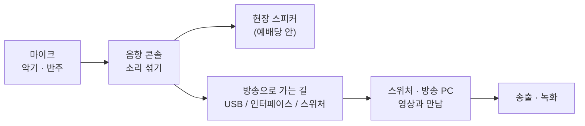
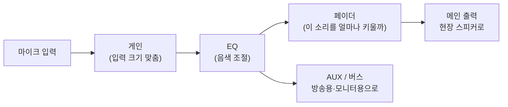
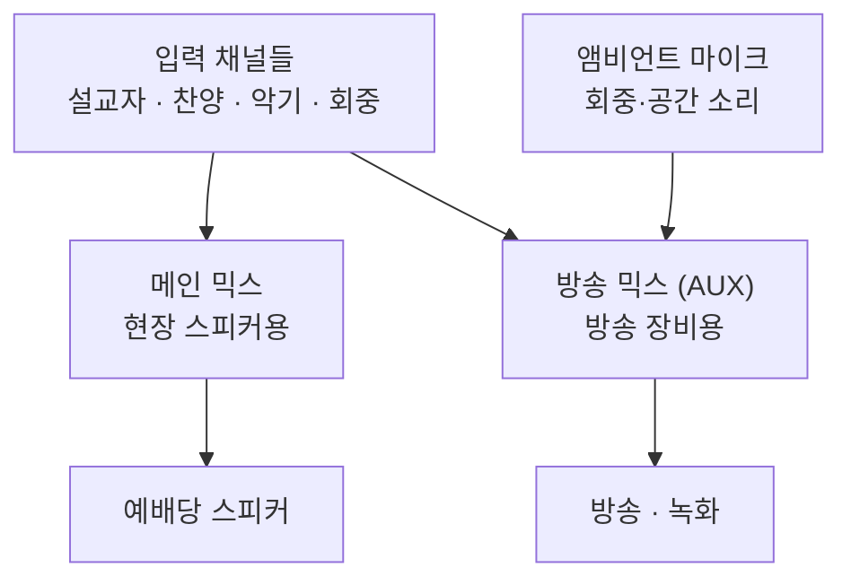
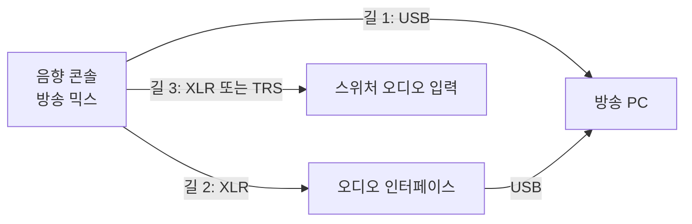

> **작은 교회 방송 입문** 3편 / 전 9편 + 부록
> 지도에서의 위치: **입력**(마이크)에서 **처리**(음향 콘솔)까지, **소리 줄기** 전체

> **한 줄 요약**
> 시청자는 화면이 조금 흐려도 참지만, 소리가 나쁘면 떠납니다. 방송 소리는 **현장 소리와 따로 만드는 것**이 핵심이고, 소리가 방송 장비로 들어가는 **길**을 미리 정해 두어야 합니다.

---

## 1. 왜 소리가 먼저인가

1편에서 "소리가 화면보다 중요하다"고 했습니다. 이유를 조금 더 구체적으로 보겠습니다.

| 상황 | 시청자 반응 |
| --- | --- |
| 화면은 어둡지만 설교가 또렷하다 | 끝까지 듣습니다. 라디오처럼 듣기도 합니다 |
| 화면은 선명하지만 소리가 웅웅거리거나 작다 | 몇 분 안에 창을 닫습니다 |
| 소리가 끊기거나 지직거린다 | 화질과 무관하게 방송 전체를 불안하게 여깁니다 |

설교는 **말씀을 듣는 일**입니다. 눈보다 귀가 중심인 방송이라는 점을 기억하세요. 같은 예산이라면 카메라를 올리기 전에 **마이크와 믹서, 소리 연결**을 먼저 점검하는 쪽이 만족도가 훨씬 큽니다.

---

## 2. 지도에서의 위치

소리 줄기는 마이크에서 시작해 음향 콘솔에서 섞이고, **두 갈래**로 나뉩니다. 한 갈래는 예배당 안 스피커로, 다른 갈래는 방송 장비로 갑니다. 이 두 갈래가 **같은 소리가 아니어야 한다**는 것이 이번 편의 가장 중요한 내용입니다.

> 📖 **비유 — 소리는 수돗물 같습니다**: 마이크는 수원지, 콘솔은 정수·분배 시설, 스피커와 방송 장비는 각 가정의 수도꼭지입니다. 수원지가 더러우면 아무리 좋은 배관을 써도 물이 맑아지지 않습니다.

---

## 3. 마이크 종류

마이크는 **작동 원리**, **모양과 착용 방식**, **연결 방식** 세 가지 기준으로 나눠 볼 수 있습니다.

### 3-1. 작동 원리: 다이내믹과 콘덴서

| 구분 | 특징 | 장점 | 주의점 | 이런 곳에 |
| --- | --- | --- | --- | --- |
| **다이내믹** | 튼튼하고 소리가 큰 곳에 강함, 전원 불필요 | 하울링(삐-)에 강함, 거친 사용에 견딤 | 아주 작은 소리는 덜 잡음 | 찬양 인도자, 악기, 일반 핸드헬드 |
| **콘덴서** | 섬세하고 넓은 범위의 소리를 잡음, **팬텀 파워(48V) 필요** | 작은 소리까지 또렷, 합창·회중 소리에 적합 | 습기·충격에 약함, 하울링이 쉬움 | 앰비언트(공간) 마이크, 합창단, 조용한 환경 |

> 💡 **팬텀 파워란?** 콘덴서 마이크에 전원을 공급하는 방식으로, 콘솔이나 오디오 인터페이스의 "+48V" 버튼을 켜서 사용합니다. **다이내믹 마이크에는 필요 없으며**, 연결하는 순서를 지키지 않으면 "퍽" 소리가 날 수 있으니 소리를 끈 뒤 켜세요.

### 3-2. 모양과 착용 방식

| 종류 | 설명 | 장점 | 단점 |
| --- | --- | --- | --- |
| **핸드헬드** | 손으로 쥐고 입 가까이 | 소리가 가장 안정적, 조작이 쉬움 | 한 손이 묶임 |
| **핀 마이크 (라발리에)** | 옷깃에 꽂는 작은 마이크 | 두 손이 자유로움, 눈에 안 띔 | 옷 스침 소리, 위치 조절 필요 |
| **헤드셋 마이크** | 머리에 걸어 입 옆에 위치 | 입과의 거리가 늘 일정, 하울링에 강함 | 보이는 모습, 착용 불편 |

설교자에게는 보통 **핀 마이크나 헤드셋**을 권합니다. 움직이며 말하는 분이 많고, 핸드헬드는 입에서 멀어지면 소리가 급격히 작아지기 때문입니다.

> ⚠️ **핀 마이크의 흔한 문제**: 옷깃에 달면 고개를 돌릴 때마다 소리가 달라집니다. 가슴 한가운데(턱 아래 약 6in(약 15cm))에 달고, 옷이나 액세서리와 스치지 않게 고정하세요.

### 3-3. 연결 방식: 유선과 무선

| 방식 | 설명 | 장점 | 단점 |
| --- | --- | --- | --- |
| **유선** | 케이블(XLR)로 연결 | 가장 안정적, 지연 없음, 배터리 걱정 없음 | 움직임 제한 |
| **무선 UHF** | 무선 주파수로 전송 | 오래 쓰여 온 방식, 안정적 | 주파수 간섭 관리 필요 |
| **무선 디지털** | 디지털 신호로 전송 | 설정이 쉽고 간섭에 비교적 강함 | 기종에 따라 지연이나 호환 문제 |

무선 마이크를 고를 때는 다음을 확인하세요.

- **채널 수**: 한 번에 쓸 마이크 수보다 **1~2개 여유** 있게 고르세요.
- **수신기 출력**: 콘솔로 연결하려면 **XLR 출력**이 있어야 합니다.
- **배터리**: 예배 전에 새 배터리로 교체하세요. 중간에 끊기는 가장 흔한 원인입니다.

---

## 4. 음향 콘솔(믹서) 기본

### 4-1. 콘솔이 하는 일

음향 콘솔은 **여러 마이크와 악기의 소리를 섞어 하나의 소리로 만드는 장비**입니다. 방송에서는 이 콘솔이 소리 줄기의 중심입니다.

### 4-2. 한 채널의 흐름

콘솔은 같은 모양의 "채널"이 줄지어 있습니다. 한 채널에는 마이크 하나가 연결됩니다.

| 용어 | 쉬운 설명 | 사용 요령 |
| --- | --- | --- |
| **게인 (Gain)** | 마이크 소리를 콘솔 안으로 **받아들이는 크기** | 가장 먼저 맞춥니다. 너무 작으면 잡음이 커지고, 너무 크면 소리가 찌그러집니다 |
| **EQ** | 소리의 저음·중음·고음을 조절 | 저음을 줄이면 웅웅거림이 줄고, 중음을 조금 올리면 말이 또렷해집니다 |
| **페이더 (Fader)** | 이 채널의 **현장 음량** | 마지막에 맞춥니다 |
| **AUX (보조 출력)** | 메인과 **다른 믹스**를 따로 만드는 출구 | 방송용 소리나 연주자 모니터용에 사용 |

**게인 맞추는 순서**: ① 페이더를 내린다 → ② 마이크에 실제 크기로 말하게 한다 → ③ 게인을 올려 콘솔의 표시등이 **가끔 노란색**이 될 정도로 맞춘다 → ④ 빨간 불이 들어오면 줄인다.

### 4-3. 아날로그 콘솔과 디지털 콘솔

| 구분 | 아날로그 | 디지털 |
| --- | --- | --- |
| **조작** | 손잡이마다 기능이 있어 한눈에 보임 | 화면·메뉴로 조작, 저장 가능 |
| **장점** | 직관적, 고장이 적음, 가격이 저렴 | 설정 저장, 이펙트·EQ 내장, **방송용 믹스 쉽게 따로 구성** |
| **단점** | 설정 저장 안 됨, 방송용 믹스를 따로 만들려면 AUX가 모자랄 수 있음 | 처음 배우는 데 시간이 걸림, 메뉴 속에서 헤맬 수 있음 |
| **가격대 (2026년 기준 대략)** | 소규모용 약 $200~800 | 소규모용 약 $500~2,500 |
| **이런 곳에** | 채널 수가 적고 운영자가 바뀌지 않는 곳 | 방송을 본격적으로 하거나 여러 팀이 쓰는 곳 |

> 💡 **어느 쪽이 좋을까?** 이미 있는 아날로그 콘솔에 **AUX 출력이 남아 있다면** 그대로 방송에 쓸 수 있습니다. 새로 사야 한다면 방송을 앞으로 계속 확장할 계획이라면 디지털 콘솔이 훨씬 유연합니다.

---

## 5. 현장 믹스와 방송 믹스는 달라야 합니다

이 편에서 가장 중요한 절입니다.

### 5-1. 왜 다른가

예배당에서 듣는 소리는 이렇게 만들어집니다.

- 설교자의 **실제 목소리**(마이크 없이도 들림)
- 스피커에서 나오는 **확성된 소리**
- 예배당 벽에서 **울려 돌아오는 소리**(잔향)

즉 **현장에서는 스피커 소리가 "보태지는" 것**입니다. 그래서 마이크 소리를 너무 크게 키우지 않아도 충분히 들립니다.

반면 **방송은 콘솔에서 나온 신호만** 시청자에게 갑니다. 설교자의 실제 목소리, 벽의 울림, 회중의 박수 모두 **마이크에 잡히지 않으면 방송에 없습니다.** 그 결과가 이렇게 나타납니다.

| 현장 믹스를 그대로 방송에 보내면 | 원인 |
| --- | --- |
| 설교자 소리가 작게 들린다 | 현장은 실제 목소리가 보태졌지만 방송에는 없음 |
| 찬양 때 악기만 크고 보컬이 안 들린다 | 현장에서는 보컬이 실제 목소리로 들려서 마이크를 작게 맞춘 상태 |
| 회중 찬양이 안 들린다 | 현장은 회중 소리가 귀로 들리지만, 마이크에 안 잡힘 |
| 드럼·앰프 소리가 압도적이다 | 현장에서는 악기 소리가 직접 들리지만 방송에서는 마이크로만 들림 |

### 5-2. 방송용 믹스를 따로 만든다

그래서 방송에는 **AUX 출력으로 별도의 믹스**를 만들어 보냅니다.

방송 믹스에서 하는 조정은 대략 이렇습니다.

- **말하는 소리(설교자·인도자)는 현장보다 올립니다.**
- **악기와 드럼은 현장보다 줄입니다.** 현장에서는 이미 크게 들리기 때문입니다.
- **앰비언트 마이크**를 더해 회중과 공간의 소리를 보태서 "그 자리에 있는" 느낌을 만듭니다.
- 방송 믹스의 **전체 음량은 현장 스피커 음량과 무관**합니다. 현장은 큰 소리로, 방송은 적정 레벨로 따로 맞춥니다.

> ⚠️ **AUX가 한 개도 남지 않는다면**: 방송용 믹스를 따로 만들 수 없어 현장 믹스를 그대로 써야 하고, 결과는 위 표처럼 됩니다. 이럴 때는 ① 디지털 콘솔로 교체하거나, ② 방송 전용 소형 믹서를 별도로 추가하는 방법을 고려하세요.

---

## 6. 소리를 방송으로 보내는 세 가지 길

콘솔에서 만든 방송 믹스를 영상 쪽으로 넘기는 방법은 크게 세 가지입니다.

| 길 | 방법 | 장점 | 단점 | 이런 곳에 |
| --- | --- | --- | --- | --- |
| **1. 콘솔 USB** | 콘솔에 USB 오디오 기능이 있으면 PC에 바로 연결 | 장비 추가 비용 없음, 간단 | 콘솔마다 지원 채널·설정이 다름, 지연 설정 확인 필요 | 디지털 콘솔을 쓰고 PC로 송출하는 곳 |
| **2. 오디오 인터페이스** | 콘솔 AUX 출력 → 인터페이스 → USB로 PC | 거의 모든 콘솔에서 가능, 레벨 조절이 쉬움 | 장비 추가($100~300 대략) | 아날로그 콘솔 + PC 송출 |
| **3. 스위처 오디오 입력** | 콘솔 AUX → 스위처의 XLR·오디오 입력 | 영상과 소리가 **스위처 안에서 합쳐져** 구성이 단순, 지연 맞춤 쉬움 | 스위처에 오디오 입력이 있어야 함 | 스위처 중심 구성 |

> 💡 **길 3이 가장 깔끔한 이유**: 스위처가 영상과 소리를 함께 받으면 **카메라 전환 시 소리와 영상이 함께 지연**되어 어긋남이 거의 없습니다. 스위처에서 USB 출력(UVC)으로 PC나 송출 장비에 넘기면 영상과 소리가 한 줄로 갑니다. 스위처는 4편에서 다룹니다.

> ⚠️ **콘솔 AUX 레벨을 확인하세요**: 콘솔의 출력 레벨(프로용 레벨과 일반 레벨)과 받는 쪽의 입력 레벨이 맞지 않으면 소리가 너무 작거나 찌그러집니다. 연결 후 **송출 소프트웨어 미터를 보며** 조정하세요. 소프트웨어는 5편에서 다룹니다.

---

## 7. 회중과 공간의 소리 — 앰비언트 마이크

설교자 마이크만 방송에 보내면 소리가 **너무 깨끗하고 허전합니다.** 마치 아무도 없는 방에서 녹음한 것처럼 들립니다. 박수, "아멘" 소리, 회중 찬양이 들려야 **함께 예배드리는 느낌**이 전달됩니다.

### 앰비언트 마이크 두는 법

| 위치 | 설명 | 주의점 |
| --- | --- | --- |
| **천장에 매다는 방식** | 회중석 위쪽 중앙에 1~2개 | 설치 공사와 케이블 경로 필요 |
| **회중석 앞쪽 스탠드** | 강단과 회중 사이 | 시선을 가리거나 걸려 넘어지지 않도록 |

- 마이크는 보통 **콘덴서 방식**을 씁니다(작은 소리를 넓게 잡기 위해).
- **현장 스피커 앞이나 바로 아래에 두지 마세요.** 스피커 소리를 다시 잡아 하울링이 생깁니다.
- 방송 믹스에 **작게만** 섞으세요. 설교자 소리보다 한참 작은 정도면 충분합니다.

---

## 8. 레벨 기준 — 얼마나 크게 보내야 하나

소리는 "크게" 보낸다고 좋은 것이 아닙니다. 너무 크면 찌그러지고, 너무 작으면 잡음이 커집니다.

### 8-1. 디지털 소리의 천장: 0 dBFS

방송 장비·PC 안의 소리는 **0 dBFS**를 넘으면 안 됩니다. 넘는 순간 소리가 "퍽" 찌그러지고 되돌릴 수 없습니다. 그래서 **0 dBFS에서 충분히 떨어뜨려** 둡니다.

| 지표 | 목표 (대략) | 의미 |
| --- | --- | --- |
| **피크 (가장 큰 순간)** | 약 **-6 dBFS** | 천장에서 6 dB 여유. 큰 박수·찬양에도 찌그러지지 않음 |
| **평균 (보통 크기)** | 약 **-18 ~ -12 dBFS** | 말할 때의 일반적인 크기. 시청자가 편하게 듣는 정도 |

> 📌 **실전 기준**: 방송 소프트웨어의 오디오 미터를 보면서 **말할 때 미터가 대체로 초록색 중간**에 있고, **가장 큰 순간에도 노란색 정도**(빨간색 닿지 않음)가 되도록 맞추세요.

### 8-2. 맞추는 순서

1. 콘솔의 방송 믹스 출력 레벨을 **중간 위치**로 둔다.
2. 설교자가 평소처럼 말하게 하고 PC 소프트웨어 미터를 본다.
3. 평균이 -18~-12 dBFS 근처가 되도록 **콘솔 출력**을 조정한다.
4. 찬양 때 가장 큰 순간이 -6 dBFS를 넘는지 확인하고, 넘으면 **전체 출력을 줄인다.**
5. 한번 정하면 **예배마다 건드리지 않습니다.** 마이크 수와 입력만 조정합니다.

---

## 9. 립싱크와 오디오 딜레이

영상과 소리가 어긋나는 현상을 **립싱크 문제**라고 합니다. 입 모양과 소리가 맞지 않으면 시청자가 즉시 알아챕니다.

### 왜 생기나

- 영상은 카메라, 스위처, 소프트웨어를 지나며 **조금씩 늦어집니다.** 대략 수십~수백 ms(1ms = 0.001초) 정도 걸립니다.
- 소리는 상대적으로 **빨리** 도착합니다.

그래서 보통은 **소리가 영상보다 먼저** 나옵니다.

### 어떻게 맞추나

| 항목 | 설명 |
| --- | --- |
| **측정** | 설교자가 손뼉을 치는 장면을 녹화해서, 손이 닿는 순간과 소리의 차이를 눈으로 본다 |
| **보정** | 소리를 **의도적으로 지연(딜레이)** 시켜 영상과 맞춘다 |
| **어디서** | 스위처나 방송 소프트웨어의 오디오 지연 설정 (ms 단위 입력) |

> 💡 **빠른 점검법**: 설교자가 "짝" 하고 손뼉을 치게 하고 녹화본을 한 프레임씩 넘겨 보세요. 소리가 먼저 보이면 **소리 지연을 늘리고**, 소리가 늦으면 줄입니다. 5편에서 소프트웨어 설정을 다룹니다.

> ⚠️ **현장 스피커와 혼동하지 마세요**: 현장에서 소리가 늦게 들리는 문제(뒤쪽 스피커 지연)는 별개입니다. 소리는 약 1ft당 1 ms 정도 걸려 가므로, 앞쪽 스피커와 먼 뒤쪽 스피커의 소리가 겹치지 않게 맞추는 것은 **음향 설치 담당자의 일**입니다.

---

## 10. 헤드폰 모니터링

방송 소리는 **직접 들어보지 않고는 알 수 없습니다.** 예배당 스피커 소리로는 방송이 어떻게 나가는지 알 수 없기 때문입니다.

- 방송 담당자는 **방송으로 나가는 소리를 헤드폰으로 늘 확인**해야 합니다.
- **밀폐형(귀를 감싸는)** 헤드폰이 좋습니다. 예배당 소리가 새어 들어오지 않아 방송 소리를 구별하기 쉽습니다.
- 헤드폰 연결은 **방송 PC나 스위처의 헤드폰 출력**에서 합니다. 콘솔의 현장 소리가 아니라 **실제 송출되는 소리**를 들어야 합니다.

---

## 11. 기본 권장 사양 표

소규모 예배당(50~200석)에서 몇 년 쓸 수 있는 수준의 기준입니다. 링크는 Amazon에서 해당 종류의 제품을 모아 보는 검색 페이지입니다. 가격은 (2026년 기준 대략)의 범위입니다.

| 장비 | 하는 일 | 기본 권장 사양 | 둘러보기 |
| --- | --- | --- | --- |
| **무선 마이크 (핸드헬드·바디팩)** | 설교자·인도자 소리 | 디지털 또는 UHF, **XLR 출력** 수신기, 채널 수 = 마이크 수 + 1, 가격대 약 $200~700 | [Wireless Microphone System](https://www.amazon.com/s?k=wireless%20microphone%20system%20xlr) |
| **핀 / 헤드셋 마이크** | 손이 자유로운 착용형 | 무선 바디팩 호환 커넥터 확인, 헤드셋은 **귀걸이형**, 땀·습기에 강함 | [Headset Lavalier Microphone](https://www.amazon.com/s?k=wireless%20headset%20microphone%20lavalier%20bodypack) |
| **아날로그 콘솔** | 소리를 섞는 기본형 | 마이크 입력 = 마이크 수 + 4 여유, **AUX 2개 이상**, EQ 3밴드 이상, 팬텀 파워 | [Analog Mixer](https://www.amazon.com/s?k=analog%20mixer%20aux%20send%20phantom%20power) |
| **디지털 콘솔** | 저장·이펙트가 가능한 믹서 | 마이크 입력 = 마이크 수 + 4 여유, **AUX/버스 4개 이상**, 설정 저장, USB 오디오, 터치·태블릿 조작 | [Digital Mixer](https://www.amazon.com/s?k=digital%20mixer%20usb%20audio%20aux%20buses) |
| **오디오 인터페이스** | 콘솔 소리를 PC로 | 2입력 이상, USB-C, **24bit/48kHz**, 팬텀 파워 48V, 헤드폰 출력 | [Audio Interface](https://www.amazon.com/s?k=usb%20c%20audio%20interface%202x2) |
| **앰비언트 콘덴서 마이크** | 회중·공간 소리 | 소형 다이어프램 콘덴서 **한 쌍**, 팬텀 48V, 천장·스탠드 설치용 | [Condenser Microphone Pair](https://www.amazon.com/s?k=small%20diaphragm%20condenser%20microphone%20pair%20ambient) |
| **XLR 케이블** | 마이크·콘솔 연결 | **3핀 균형(balanced) 방식**, 길이는 실제 거리 + 여유 3ft(약 91cm), 튼튼한 커넥터 | [XLR Cable](https://www.amazon.com/s?k=xlr%20cable%20balanced%2025%20ft) |
| **모니터링 헤드폰** | 방송 소리 확인 | **밀폐형**, 임피던스 약 30~80옴, 케이블 길이 약 10ft(약 3m) 이상, 평평한 음색 | [Closed Back Monitoring Headphones](https://www.amazon.com/s?k=closed%20back%20studio%20monitor%20headphones) |
| **DI 박스** | 악기·PC 소리를 균형 신호로 | **패시브 또는 액티브**, 입력 1/4in·RCA, 출력 XLR, 그라운드 리프트 스위치 | [DI Box](https://www.amazon.com/s?k=direct%20box%20di%20box%20ground%20lift) |

> 📌 **DI 박스는 왜 필요한가?** 키보드·기타·PC에서 나오는 소리는 긴 케이블에서 잡음이 생기기 쉽습니다. DI 박스가 이 신호를 **잡음에 강한 방식**으로 바꿔 콘솔로 보냅니다. 특히 **윙 하는 험 노이즈**가 날 때 그라운드 리프트 스위치가 도움이 됩니다.

---

## 12. 우리는? — 소리를 정비하기 전에 답해 볼 질문

1. **콘솔**: 지금 콘솔은 아날로그입니까, 디지털입니까? **AUX(보조 출력)가 몇 개** 남아 있나요?
2. **마이크**: 설교자는 어떤 마이크를 쓰나요? 핸드헬드, 핀, 헤드셋 중 무엇이 가장 실수가 적을까요?
3. **무선**: 무선 마이크 배터리를 누가 언제 교체하나요? 예비 배터리는 있습니까?
4. **방송 길**: 콘솔의 소리를 PC나 스위처로 보낼 길은 어느 쪽입니까? (USB / 인터페이스 / 스위처 입력)
5. **회중 소리**: 회중석의 소리(찬양, 박수)가 방송에 들립니까? 앰비언트 마이크를 둘 자리가 있나요?
6. **확인**: 예배 중 방송 소리를 **헤드폰으로 듣는 사람**이 있습니까?

---

## 13. 흔한 실수 / Tips

> ⚠️ **실수 1 — 현장 믹스를 그대로 방송에 보낸다**
> 5절의 내용입니다. 방송에서 설교가 작고 악기만 크다면 가장 먼저 의심할 부분입니다.
>
> ⚠️ **실수 2 — 방송 소리를 헤드폰으로 확인하지 않는다**
> 예배당 스피커 소리로는 방송이 잘 나가는지 알 수 없습니다. 확인하는 사람이 반드시 있어야 합니다.
> 
> ⚠️ **실수 3 — 게인을 높게 하고 페이더로 줄인다**
> 입력 단계(게인)에서 이미 찌그러진 소리는 페이더로 줄여도 소용없습니다. 게인을 먼저, 알맞게 맞추세요.
> 
> 💡 **Tip 1 — 시험 녹화로 확인**
> 예배 전 5분만 방송 소리를 녹음해서 들어 보세요. 현장에서는 모르는 소리 문제가 드러납니다.
> 
> 💡 **Tip 2 — 콘솔 설정을 사진으로**
> 소리가 잘 나갈 때의 콘솔 설정을 휴대폰으로 찍어 두면, 다음 봉사자가 되돌릴 기준이 됩니다. 디지털 콘솔은 **장면 저장** 기능을 활용하세요.

---

## 14. 이번 편의 용어

| 용어 | 뜻 |
| --- | --- |
| **다이내믹 / 콘덴서** | 튼튼하고 전원 불필요한 마이크 / 섬세하고 팬텀 파워가 필요한 마이크 |
| **팬텀 파워 (+48V)** | 콘덴서 마이크에 전원을 보내는 방식 |
| **핸드헬드 / 핀 / 헤드셋** | 손에 쥐는 / 옷깃에 꽂는 / 머리에 거는 마이크 |
| **UHF 무선 / 디지털 무선** | 무선 주파수 방식 / 디지털 전송 방식 |
| **XLR** | 3핀 균형 오디오 케이블·단자. 방송용 표준 |
| **게인** | 입력 소리를 받아들이는 크기 |
| **EQ** | 저음·중음·고음의 균형 조절 |
| **AUX / 버스** | 메인과 다른 믹스를 따로 만드는 출구 / 채널을 묶는 길 |
| **현장 믹스 / 방송 믹스** | 예배당 스피커용 소리 / 방송 장비로 보내는 소리 |
| **앰비언트 마이크** | 회중과 공간의 소리를 담는 마이크 |
| **dBFS** | 디지털 소리의 크기 단위. 0이 천장, 넘으면 찌그러짐 |
| **피크 / 평균** | 가장 큰 순간 / 보통 크기 |
| **ms (밀리초)** | 1/1000초. 영상·소리 지연 단위 |
| **립싱크** | 입 모양과 소리가 맞는 정도 |
| **DI 박스** | 악기·PC 소리를 잡음에 강한 균형 신호로 바꾸는 상자 |

---

## 다음 편 예고

**4편 「화면 전환과 합성 — 스위처」**: 카메라 여러 대의 영상을 TV 리모컨처럼 바꾸고, 자막을 얹는 장비를 다룹니다. 하드웨어 스위처와 소프트웨어 스위처의 차이, 입력 개수를 고르는 방법을 살펴봅니다.
