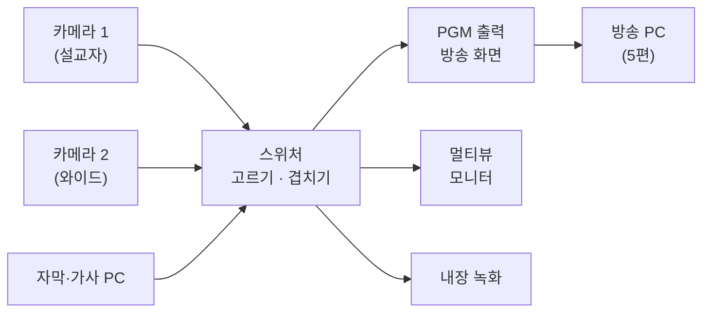
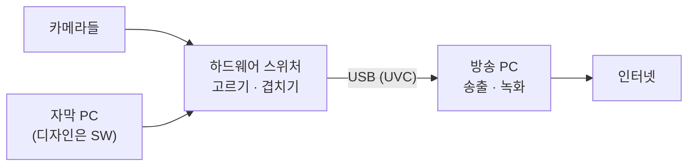

> **작은 교회 방송 입문** 4편 / 전 9편 + 부록
> 지도에서의 위치: **처리** 칸 · **영상 줄기** (카메라와 자막이 한곳에 모여 "무엇이 나갈지" 결정되는 곳)

> **한 줄 요약**
> 스위처는 여러 영상 중 **지금 내보낼 하나를 고르고**, 그 위에 자막과 작은 화면을 **겹쳐 얹는** 장비입니다. 즉시 반응해야 하는 일은 하드웨어가, 유연하게 꾸미는 일은 소프트웨어가 잘합니다.

---

## 1. 지도에서의 위치

1편의 지도에서 **처리** 칸 중 영상 쪽을 확대해 보겠습니다. 카메라와 가사·자막이 들어오고, 하나로 정리된 영상이 나갑니다.

이 편에서는 화살표의 가운데, **스위처 상자 안에서 일어나는 일**을 다룹니다. 스위처 뒤에 이어지는 방송 PC와 소프트웨어는 5편, 케이블은 7편, 인터넷으로 보내는 일은 8편에서 이어집니다.

> 📌 소리는 이 편의 주인공이 아닙니다. 소리는 3편의 음향 콘솔에서 만들어지고, 스위처는 그것을 영상과 합쳐 주는 **만남의 장소**가 되기도 합니다. 이 이야기는 6절에서 다룹니다.

---

## 2. 쉬운 비유 — 리모컨과 편집실을 합친 장비

집에서 TV를 보다가 채널을 바꾸는 장면을 떠올려 보세요. 리모컨 버튼을 누르면 화면이 즉시 바뀝니다. 스위처의 가장 기본 기능이 바로 이것입니다. **카메라 여러 대가 각각 다른 채널이고, 그중 하나를 골라 시청자에게 보내는 것**입니다.

여기에 **편집실** 기능이 더해집니다. 영화나 뉴스를 만드는 편집실에서는 장면과 장면을 부드럽게 이어 붙이고, 화면 아래에 이름 자막을 넣고, 구석에 작은 화면을 띄웁니다. 스위처는 이런 일을 **녹화된 영상이 아니라 지금 흘러가는 영상에 실시간으로** 합니다.

| 비유 | 스위처에서는 |
| --- | --- |
| 리모컨으로 채널 고르기 | 카메라 1, 2, 3 버튼으로 영상 선택 (컷) |
| 편집실에서 장면 잇기 | 디졸브 같은 부드러운 전환 |
| 방송 화면 아래 이름 자막 | 키(Key) 합성 |
| 뉴스 화면 구석의 작은 화면 | PIP (Picture in Picture) |
| 조정실 벽의 모니터 여러 개 | 멀티뷰 |

> 💡 방송사 조정실에서 감독이 "카메라 2번!"이라고 외치면 스위처 담당이 버튼을 누릅니다. 소규모 교회에서는 한 사람이 감독과 담당을 겸한다고 생각하면 됩니다.

---

## 3. 스위처의 기본 용어

### 3-1. PGM과 PVW — 지금 화면과 다음 화면

스위처에는 보통 버튼 줄이 **두 줄** 있습니다.

- **PGM (Program, 프로그램)**: 지금 시청자에게 **나가고 있는** 화면입니다. 보통 빨간색으로 표시됩니다.
- **PVW (Preview, 프리뷰)**: **다음에 내보낼** 화면입니다. 보통 초록색으로 표시됩니다.

운영 순서는 이렇습니다. 먼저 PVW 줄에서 다음 카메라를 골라 놓고, 준비가 되면 **전환 버튼**을 누릅니다. 그러면 PVW에 있던 화면이 PGM으로 올라가고, 나가던 화면은 PVW로 내려옵니다. 시청자는 완성된 화면만 보고, 준비 과정은 보지 못합니다.

> ⚠️ 가장 흔한 사고는 **PGM 줄 버튼을 바로 누르는 것**입니다. 준비되지 않은 카메라(아직 강단을 찾는 중인 화면)가 그대로 방송에 나갑니다. 초보 봉사자에게는 "항상 PVW에서 고르고, 전환 버튼으로 보낸다"를 규칙으로 알려 주세요.

### 3-2. 전환 방식 — 컷, 디졸브, 그리고 나머지

| 전환 | 모양 | 언제 쓰나 |
| --- | --- | --- |
| **컷 (Cut)** | 한 화면이 순간 다른 화면으로 바뀜 | 기본. 설교, 말씀 낭독처럼 차분한 순간 |
| **디졸브 (Dissolve, Mix)** | 앞 화면이 서서히 사라지며 뒤 화면이 나타남 | 찬양에서 부드러운 분위기, 장면 전환 |
| **와이프 (Wipe)** | 한 화면을 밀어내듯 다른 화면이 들어옴 | 거의 쓰지 않음. 오프닝 영상 정도 |
| **페이드 투 블랙 (FTB)** | 화면이 까맣게 사라짐 | 방송 시작과 끝, 광고·휴식 전후 |

스위처에는 대개 전환 효과가 수십 가지 들어 있지만, 교회 방송에서는 **컷과 디졸브만 써도 충분합니다.** 효과를 많이 쓸수록 화면이 산만해지고, 보는 사람은 예배보다 효과에 신경이 갑니다. 전환 시간은 디졸브 기준으로 대략 0.5~1초가 자연스럽습니다.

> 💡 **Tip — 전환의 원칙**: 말하는 도중에는 컷, 말이 끝나고 분위기가 바뀔 때는 디졸브. 이 두 줄만 기억해도 됩니다.

### 3-3. 멀티뷰 — 한 모니터에 전부 보기

운영자는 입력된 모든 카메라, 지금 PGM 화면, 다음 PVW 화면을 **동시에** 봐야 합니다. 모니터를 카메라 수만큼 놓을 수는 없으니, 스위처가 이 화면들을 **한 장에 타일처럼 모아 보여주는** 기능을 **멀티뷰(Multiview)** 라고 합니다.

멀티뷰는 보통 스위처의 별도 HDMI 출력 단자로 나옵니다. 그 단자에 모니터를 연결하면 됩니다. 입력 4개짜리 스위처라면 화면이 6~8개 칸으로 나뉘어, 맨 위에 PGM과 PVW가 크게, 아래에 입력 영상이 작게 표시되는 모양이 흔합니다.

> 📌 멀티뷰 모니터 한 대만 있어도 운영 실수가 크게 줄어듭니다. 스위처 본체의 작은 화면만 보고 운영하기보다는, **눈높이에 24인치 정도의 모니터**를 두는 것을 권합니다.

---

## 4. 합성 — 영상 위에 영상을 겹치기

### 4-1. 키(Key) — 구멍을 뚫고 다른 화면을 끼워 넣기

**키(Key)** 는 한 영상의 일부를 "투명하게 만들어" 그 뒤에 있는 다른 영상이 보이게 하는 기술입니다. 종이에 가위로 글자 모양을 오려 내고, 그 뒤에 그림을 대는 것과 비슷합니다. 어디를 오려 낼지 정하는 방법에 따라 세 가지로 나뉩니다.

| 종류 | 오려 내는 기준 | 교회에서 쓰는 예 |
| --- | --- | --- |
| **루마 키 (Luma Key)** | 영상의 **밝기**. 검은 부분이나 흰 부분을 투명하게 | 검은 배경에 흰 글씨로 만든 자막 화면을 카메라 영상 위에 얹기 |
| **크로마 키 (Chroma Key)** | 영상의 **색**. 보통 초록색을 투명하게 | 초록 배경 앞에서 촬영한 사람 뒤에 다른 배경 넣기 (교회에서는 드묾) |
| **DSK (Downstream Key)** | 키의 **위치**. 모든 전환이 끝난 맨 마지막 단계에서 얹음 | 하단 자막, 로고. 화면이 전환돼도 자막이 흔들리지 않음 |

교회 방송에서 **가장 많이 쓰는 것은 루마 키와 DSK의 조합**입니다. 6편에서 다룰 하단 자막(로워서드)을 이렇게 얹습니다.

**DSK가 왜 필요할까요?** 일반 키는 카메라 영상과 함께 전환되기 때문에, 카메라를 바꾸면 자막도 같이 사라지거나 흔들립니다. DSK는 "카메라가 바뀌든 말든 자막은 그 자리에 계속 떠 있다"는 의미입니다. 버튼 하나로 자막을 켜고 끄기 때문에, 설교 제목이나 성경 본문 자막을 띄울 때 편리합니다.

> 📖 **쉽게 정리하면**: 루마 키는 "밝기로 오려 내기"이고, DSK는 "맨 위에 한 겹 더 얹기"입니다. 두 개는 경쟁 관계가 아니라 **함께 쓰는 기능**입니다. "자막 PC가 보낸 검은 배경 영상을 루마 키로 오려서, DSK로 맨 위에 얹는다"가 가장 흔한 사용 방식입니다.

### 4-2. PIP — 화면 속의 작은 화면

**PIP (Picture in Picture)** 는 큰 화면 한쪽 구석에 작은 화면을 띄우는 것입니다. 교회에서는 다음 경우에 씁니다.

- 큰 화면에는 설교 슬라이드, 구석에는 설교자 얼굴
- 큰 화면에는 찬양팀 전체, 구석에는 가사
- 두 사람이 함께 진행할 때 둘을 동시에 보여주기

PIP의 위치와 크기는 스위처에 **저장**해 둘 수 있어서, 버튼 한 번으로 같은 모양을 다시 만들 수 있습니다.

### 4-3. 레이어 — 겹치는 순서

합성은 **겹의 순서**로 이해하면 쉽습니다. 맨 아래부터 쌓입니다.

| 층 | 내용 | 예 |
| --- | --- | --- |
| 맨 아래 | 배경 영상 | 선택한 카메라 영상 |
| 중간 | PIP 등 작은 화면 | 구석의 발표 화면 |
| 위 | 키 합성 | 루마 키로 얹은 자막 |
| 맨 위 | DSK | 로고, 하단 자막 |

> ⚠️ 겹치는 순서가 틀리면 자막이 PIP 화면 **뒤에 숨는** 일이 생깁니다. 처음 설정할 때 한 번 시험해 두면 됩니다.

---

## 5. 하드웨어 스위처 vs 소프트웨어 스위처

스위처에는 두 가지 종류가 있습니다. 전용 기계인 **하드웨어 스위처**, 그리고 PC 안에서 돌아가는 **소프트웨어 스위처**(5편에서 다루는 방송 소프트웨어가 이 역할을 합니다)입니다.

| 비교 | 하드웨어 스위처 | 소프트웨어 스위처 |
| --- | --- | --- |
| **모양** | 버튼이 달린 상자 | PC 화면 속 프로그램 |
| **전환 반응** | 버튼을 누르면 **즉시** | 마우스·키보드 조작. 약간의 지연 가능 |
| **안정성** | 전용 기계라 잘 멈추지 않음 | PC 상태(업데이트, 다른 프로그램)에 영향 받음 |
| **조작 방식** | 손으로 더듬어서 가능 (눈은 화면에) | 마우스 클릭. 화면을 봐야 함 |
| **입력 단자** | 단자 수가 **정해져 있음** | 단자는 캡처 카드·USB 수에 따라 늘림 |
| **기능 확장** | 제조사가 정한 기능까지 | 오버레이, 웹 화면, 플러그인 등 **매우 유연** |
| **처음 시작 비용** | 입력 4개급 기준 수백 달러 (2026년 기준 대략) | 소프트웨어는 무료도 있음. 단 PC 성능 필요 |
| **어울리는 곳** | 매주 안정적으로, 사람이 바뀌어도 | 화면 연출이 많고, 운영자가 컴퓨터에 익숙한 곳 |

### 5-1. 역할 분담의 원칙

> 💡 **즉시 반응은 하드웨어, 유연함은 소프트웨어.**

예배는 되돌릴 수 없는 생방송입니다. 카메라를 바꿔야 하는 순간에 마우스가 멈추거나 PC가 느려지면 곤란합니다. 그래서 **전환처럼 즉시 반응해야 하는 일은 하드웨어 스위처에 맡기고**, 자막 디자인, 화면 꾸미기처럼 **자유로움이 필요한 일은 소프트웨어에서** 하는 조합이 많이 쓰입니다.

이 구성에서 스위처는 카메라 전환의 "손"이 되고, PC는 송출·녹화의 "다리"가 됩니다. PC가 잠깐 멈춰도 스위처 화면과 현장 화면은 영향이 없습니다.

> 📌 **하나만 고른다면?** 운영자가 매주 바뀌는 자원봉사자라면 하드웨어 스위처를 권합니다. 버튼에 라벨만 붙여 두면 몇 분 교육으로 운영이 가능합니다. 반대로 한 사람이 전담하고 컴퓨터에 익숙하다면 소프트웨어만으로도 시작할 수 있습니다.

---

## 6. 스위처를 고르는 법

### 6-1. 입력은 몇 개가 필요할까

입력 수는 "지금 필요한 수"가 아니라 **"2~3년 뒤에 필요한 수"** 로 계산합니다.

> **필요한 입력 = 카메라 수 + 자막·가사 PC 1 + 여유 1~2**

| 현재 구성 | 필요한 입력 | 추천 |
| --- | --- | --- |
| 카메라 1대 + 자막 PC | 2 + 여유 = 3~4 | 4입력 |
| 카메라 2~3대 + 자막 PC | 4 + 여유 = 5~6 | 4입력은 빠듯. **6~8입력** 고려 |
| 카메라 4대 이상 + 자막 + 영상 재생 PC | 6 + 여유 = 8 이상 | **8입력**, SDI 스위처 |

4입력이면 대부분의 소규모 교회에서 시작하기 충분하지만, 카메라를 늘릴 계획이 있다면 처음부터 입력이 넉넉한 것을 고르는 편이 결국 저렴합니다.

### 6-2. 입력 단자 — HDMI냐 SDI냐

| 비교 | HDMI 입력 스위처 | SDI 입력 스위처 |
| --- | --- | --- |
| **케이블 길이** | 일반 케이블 약 25~50ft(약 7.6~15m) 한계 | 약 300ft(약 91m)까지 (3G-SDI 기준 대략) |
| **케이블 고정** | 헐거워 빠지기 쉬움 | **잠금식** 커넥터라 안 빠짐 |
| **카메라와 거리** | 가깝다면 OK | 예배당 뒤쪽 카메라처럼 멀면 유리 |
| **가격** | 비교적 저렴 | 장비·케이블 모두 비쌈 |

자세한 케이블 이야기는 7편에서 합니다. 여기서는 **"카메라가 스위처에서 25ft(약 7.6m)보다 멀다면 SDI나 변환기를 고려한다"** 정도만 기억하세요.

### 6-3. 출력은 무엇이 있나

스위처에서 나오는 길은 여러 갈래입니다. 필요한 출력이 있는지 확인하세요.

| 출력 | 하는 일 | 확인할 점 |
| --- | --- | --- |
| **UVC (USB-C) 출력** | PC에 웹캠처럼 인식되어 방송 PC로 영상을 보냄 | 캡처 카드가 따로 필요 없어짐. 5편과 연결 |
| **HDMI PGM 출력** | 방송 화면을 모니터나 다른 장비로 | 현장 화면에 방송 화면을 보여주고 싶을 때 |
| **HDMI AUX 출력** | 다른 입력 하나를 따로 내보냄 | 예: 설교자용 확인 모니터에 자막 PC 화면 |
| **멀티뷰 출력** | 운영용 모니터 | 3절 참고 |
| **내장 녹화** | 스위처가 SD카드나 SSD에 직접 저장 | PC가 꺼져도 녹화가 남음. 8편의 이중 녹화 |
| **내장 송출** | 스위처가 인터넷으로 직접 보냄 | 있으면 PC 없이도 방송 가능. 설정은 8편 |

> ⚠️ **UVC 출력 해상도를 확인하세요.** 스위처가 1080p60을 내보내도 USB 출력은 1080p30까지만 되는 제품이 있습니다. 사양표에 "USB 출력: 1080p60"처럼 적혀 있는지 읽어 보세요.

### 6-4. 소리는 어디서 합쳐지나

3편에서 말한 것처럼 소리와 영상은 **어디선가 만나야** 합니다. 스위처가 그 만남의 장소가 되기도 합니다.

| 구성 | 소리 경로 | 장단점 |
| --- | --- | --- |
| **스위처에 오디오 입력이 있는 경우** | 음향 콘솔 AUX → 스위처의 XLR 또는 라인 입력 → 영상과 함께 출력 | 영상과 소리가 **하나의 케이블**로 묶여 나감. 지연 맞추기 쉬움 |
| **스위처에 오디오가 없는 경우** | 음향 콘솔 → 오디오 인터페이스 → PC에서 영상과 합침 | 장비가 하나 더 필요. PC에서 소리 지연을 맞춰야 함 |
| **스위처에 간단한 오디오 믹서가 내장된 경우** | 마이크 몇 개를 스위처에 직접 연결해 믹스 | 아주 작은 구성에 편리. 많은 마이크에는 부족 |

음향 콘솔이 이미 있는 교회라면, **콘솔의 AUX 출력을 스위처 오디오 입력에 꽂는 방식**이 가장 단순합니다. XLR 입력이 있는 스위처는 이것이 가능합니다.

### 6-5. 일체형 — PTZ 컨트롤러가 들어 있는 스위처

2편에서 다룬 PTZ 카메라를 쓴다면, 카메라를 움직이는 **PTZ 컨트롤러**(조이스틱)도 필요합니다. 일부 스위처는 이 컨트롤러 기능을 **내장**하고 있습니다. 카메라 전환 버튼 옆에 조이스틱이 있어서, 카메라를 고르고 곧바로 방향과 줌을 조절하는 방식입니다.

| 구성 | 장점 | 단점 |
| --- | --- | --- |
| **일체형 (스위처 + PTZ 컨트롤러)** | 장비 한 대에 책상 공간 절약. 따로 사는 것보다 대체로 저렴 | 한쪽이 고장 나면 둘 다 영향. 제어 가능한 카메라 대수가 정해져 있음 |
| **따로 구성** | 각각 필요한 성능으로 교체 가능 | 비용·공간·케이블이 늘어남. 연결 설정이 두 번 |

한 소규모 교회에서는 4입력 스위처와 PTZ 컨트롤러가 합쳐진 일체형을 골라, **따로 구매할 때보다 금액을 줄이면서도 카메라 4대까지 제어할 수 있게** 했습니다. 이 사례는 9편에서 다룹니다.

> 💡 일체형을 고를 때는 **"PTZ 카메라 몇 대까지 제어되나"** 와 **"내 카메라와 연결되는 방식(IP 제어, 시리얼 제어)을 지원하나"** 두 가지를 확인하세요.

### 6-6. 매크로와 장면 저장

스위처에는 자주 쓰는 동작을 **저장해 두는 기능**이 있습니다.

- **프리셋(Preset)**: PIP의 위치와 크기, 키 설정을 저장해 두고 버튼으로 불러옴
- **매크로(Macro)**: 여러 동작을 한 번에 실행. 예: "카메라 2로 컷 → 하단 자막 켜기 → 3초 후 자막 끄기"
- **PTZ 프리셋**: 일체형에서는 "강단 중앙", "찬양팀 전체", "회중석" 같은 카메라 위치를 저장

> 📌 매크로는 **편리하지만 처음엔 욕심내지 마세요.** 기본 전환이 손에 익은 뒤 가장 자주 하는 두세 동작만 저장하면 충분합니다.

---

## 7. 기본 권장 사양 — 이 편의 장비

소규모 예배당(50~200석)에서 몇 년 쓸 수 있는 수준을 기준으로 했습니다. 링크는 Amazon의 검색 페이지입니다.

| 장비 | 하는 일 | 기본 권장 사양 | 둘러보기 |
| --- | --- | --- | --- |
| **4입력 HDMI 스위처** | 카메라 선택·자막 합성의 기본 장비 | HDMI 입력 4개, **PGM/PVW** 버튼 줄, 루마·크로마 키, DSK, **멀티뷰 출력**, **USB-C 출력(UVC) 1080p60**, 오디오 입력(XLR 또는 3.5mm) | [HDMI Video Switcher](https://www.amazon.com/s?k=hdmi%20video%20switcher%204%20input%20usb%20uvc) |
| **SDI 스위처 (8입력)** | 카메라가 멀거나 대수가 많을 때 | SDI 입력 8개 (3G-SDI 이상), 멀티뷰, PGM·AUX 출력, 내장 녹화 또는 USB 출력 | [SDI Video Switcher](https://www.amazon.com/s?k=sdi%20video%20switcher%208%20input%20multiview) |
| **PTZ 컨트롤러 일체형 스위처** | 전환과 카메라 조작을 한 대로 | 입력 4개 이상, 조이스틱, **PTZ 카메라 4대 이상 제어**, IP 제어 지원, XLR 오디오 입력, UVC 출력 | [Switcher with PTZ Controller](https://www.amazon.com/s?k=video%20switcher%20ptz%20controller%20joystick%204%20input) |
| **멀티뷰 모니터** | 모든 입력과 PGM·PVW를 한눈에 | **21~27인치**, 1080p 이상, HDMI 입력, 스탠드 높이·각도 조절 | [HDMI Monitor 24 inch](https://www.amazon.com/s?k=24%20inch%201080p%20hdmi%20monitor) |
| **스위처 녹화용 SD카드** | 스위처 내장 녹화 저장 | **V30 이상**, 128GB 이상, 스위처 사용 설명서의 지원 규격 확인 | [SD Card V30 128GB](https://www.amazon.com/s?k=sd%20card%20v30%20128gb) |
| **스위처 녹화용 외장 SSD** | 긴 예배의 안정적 녹화 | USB 3.0 이상, 500GB~1TB, 읽기·쓰기 속도 지속 유지형 | [Portable SSD 1TB](https://www.amazon.com/s?k=portable%20ssd%20usb%203.2%201tb) |

> ⚠️ **녹화 용량 계산**: 1080p 영상은 방식에 따라 1시간에 대략 수 GB에서 수십 GB까지 차이가 납니다. 제품 설명서에서 "1시간 녹화 용량"을 확인하고, **예배 시간의 2배**를 저장할 수 있게 고르세요. 카드나 SSD는 스위처가 지원하는 형식인지(파일 시스템, 최대 용량)도 먼저 확인합니다.

---

## 8. 우리는? — 자가 진단 질문

1. **카메라는 몇 대로 시작해서, 2~3년 뒤 몇 대까지 늘리고 싶나요?** 입력 수가 여기서 정해집니다.
2. **카메라와 스위처 사이 거리는 몇 ft(m)인가요?** 25ft(약 7.6m)가 넘는다면 SDI나 변환기를 알아봐야 합니다.
3. **운영자는 한 사람인가요, 돌아가며 하나요?** 돌아간다면 하드웨어 스위처의 버튼 조작이 유리합니다.
4. **음향 콘솔의 AUX 출력은 남아 있나요?** 있다면 스위처의 오디오 입력으로 연결할 수 있습니다.
5. **자막은 누가, 어떤 PC로 보내나요?** 6편 가사·자막 편의 방식과 연결됩니다.
6. **스위처가 PC 없이도 녹화를 남겨야 하나요?** 그렇다면 내장 녹화 기능을 확인하세요.

---

## 9. 흔한 실수 / Tips

> ⚠️ **실수 1 — PGM 줄을 직접 누르기**
> 준비되지 않은 화면이 방송에 나갑니다. "PVW에서 고르고, 전환 버튼"을 규칙으로 정하세요.
>
> ⚠️ **실수 2 — 입력 수를 딱 맞게 사기**
> 카메라를 한 대만 늘려도 새로 사야 합니다. 여유 입력 1~2개를 두세요.
> 
> ⚠️ **실수 3 — 효과를 너무 많이 쓰기**
> 와이프, 회전, 확대 같은 화려한 전환은 예배의 집중을 깹니다. 컷과 디졸브로 충분합니다.
> 
> ⚠️ **실수 4 — 입력 해상도·프레임이 제각각**
> 카메라마다 1080p60, 1080p30, 4K가 섞여 있으면 화면이 깜빡이거나 입력이 안 잡힐 수 있습니다. **모든 카메라 출력을 같은 해상도·프레임(예: 1080p30 또는 1080p60)으로 맞추세요.** 2편에서 말한 "4K로 찍고 1080p로 보낸다"는 원칙은 카메라 출력 설정에서 정합니다.
> 
> 💡 **Tip 1 — 버튼에 라벨**: 마스킹 테이프에 "설교", "와이드", "자막"이라고 써서 버튼 아래에 붙이세요. 가장 싸고 가장 효과적인 교육 자료입니다.
> 
> 💡 **Tip 2 — 시작 전 전환 연습**: 예배 전에 PVW → PGM 전환을 3~4번 해 보고, 자막 켜기·끄기, 페이드 투 블랙까지 한 바퀴 점검하세요.
> 
> 💡 **Tip 3 — 하드웨어와 소프트웨어를 섞어 쓸 수 있습니다**: 스위처가 만든 영상을 UVC로 PC에 보내면, PC의 방송 소프트웨어에서 로고와 오버레이를 더할 수 있습니다. 5편에서 이어집니다.

---

## 10. 이번 편의 용어

| 용어 | 뜻 |
| --- | --- |
| **스위처** | 여러 영상 중 하나를 고르고 합성하는 장비 |
| **PGM** | Program. 지금 시청자에게 나가는 화면 |
| **PVW** | Preview. 다음에 나갈 화면 |
| **컷** | 화면이 순간적으로 바뀌는 전환 |
| **디졸브** | 앞 화면이 서서히 뒤 화면으로 바뀌는 전환 |
| **FTB** | Fade To Black. 화면이 검게 사라지는 전환 |
| **멀티뷰** | 여러 입력과 PGM·PVW를 한 화면에 모아 보는 기능 |
| **루마 키** | 밝기를 기준으로 영상의 일부를 투명하게 만드는 합성 |
| **크로마 키** | 특정 색(주로 초록)을 투명하게 만드는 합성 |
| **DSK** | Downstream Key. 전환 뒤 맨 마지막에 얹는 키. 하단 자막에 사용 |
| **PIP** | 큰 화면 안의 작은 화면 |
| **레이어** | 합성에서 겹치는 층 |
| **UVC 출력** | PC에서 웹캠처럼 인식되는 USB 출력 |
| **매크로** | 여러 조작을 저장해 한 번에 실행하는 기능 |

---

## 다음 편 예고

**5편 「컴퓨터와 방송 소프트웨어」**: 스위처가 만든 화면을 받아 인터넷으로 보내고 녹화하는 PC의 세계를 다룹니다. 방송 소프트웨어가 하는 일, 컴퓨터 사양 고르기, 그리고 **방송 PC와 프레젠테이션 PC를 나누는 이유**를 이야기합니다.
