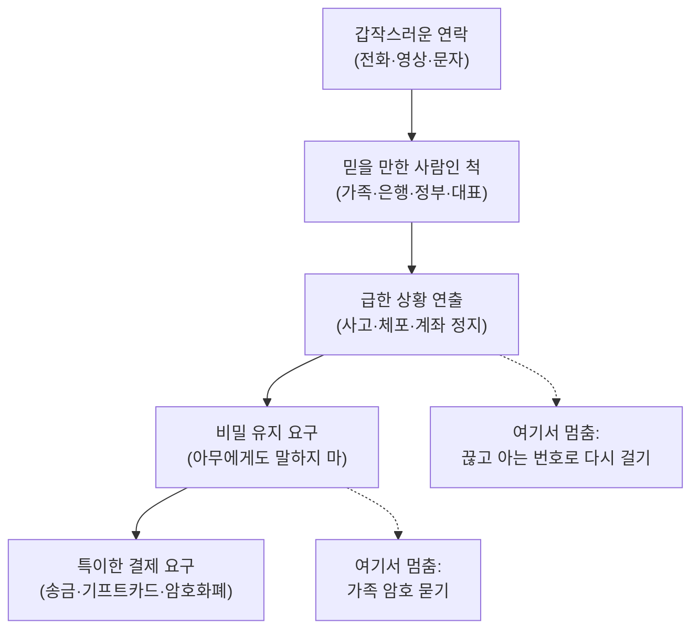



> **디지털 생활 안전** 01편 / 전 7편 · 시즌 6 · 2026년 11월 기준
> 난이도: 초급 · 읽는 시간: 약 18분
> 이 편의 질문: 전화 속 가족 목소리와 영상 통화 속 얼굴까지 가짜일 수 있다면, 무엇을 보고 진짜를 가려야 할까요?

> **한 줄 요약**
> 요즘 사기는 AI로 가족 목소리를 흉내 내고, 화상 통화 얼굴까지 만들어 냅니다. 그래서 "목소리가 맞으니 진짜"라는 판단은 더 이상 안전하지 않습니다. 대신 **급하게 돈을 요구하면 일단 끊고, 내가 아는 번호로 다시 건다**는 습관 하나와 **가족 암호** 하나면 대부분의 사기를 막을 수 있습니다.

## 시즌 6 「디지털 생활 안전」 목차

| 편 | 제목 | 내용 |
| --- | --- | --- |
| 01 | AI 사기 구별법 — 목소리·영상 딥페이크와 문자 사기 | 가족 목소리 복제 전화, 가짜 영상 통화, 스미싱·피싱 문자, 가족 암호 정하기, 의심될 때 끊고 다시 걸기, 미국 신고처 |
| 02 | 비밀번호 다음 — 패스키와 2단계 인증 | 비밀번호의 한계, 2단계 인증 종류(문자·앱·보안키), 패스키 원리와 Apple·Google·Microsoft 지원 현황, 비밀번호 관리자, 복구 코드 |
| 03 | 내 개인정보 지키기 — 앱 권한과 데이터 브로커 | 앱 권한 점검(iPhone·Android), 위치·연락처·마이크, 데이터 브로커와 미국 주별 삭제 요청 제도, 신용 동결 |
| 04 | 잃어버려도 괜찮게 — 백업 3-2-1 규칙 | 3-2-1 규칙, 클라우드 동기화 ≠ 백업, 랜섬웨어, iPhone·Android·PC·Mac 백업, 기관 자료 백업 점검표 |
| 05 | 진짜일까 가짜일까 — AI 워터마크와 출처 표시 | AI 생성 이미지·영상 신호, C2PA·콘텐츠 자격 증명, SynthID 등 워터마크, 역이미지 검색, 공유 전 확인 습관 |
| 06 | 기본기가 지켜 준다 — 업데이트·공용 와이파이·백신 | 자동 업데이트, 지원 종료 기기 위험, 공용 와이파이 주의, 기본 보안 기능, 가짜 경고창 |
| 07 | 가족과 함께 — 어르신 디지털 안전 점검과 디지털 유산 | 가족 점검 체크리스트, 계정 복구 연락처, 유산 연락처, 비밀번호 정리, 시즌 마무리 |

시즌 6은 "겁주기"보다 "이것만 하면 된다"를 목표로 합니다. 각 편 끝의 따라 하기를 하나씩만 해 두셔도, 일곱 편이 끝날 때쯤에는 우리 집과 우리 기관의 디지털 안전 수준이 눈에 띄게 올라가 있을 것입니다.

## 1. 지금 벌어지는 일 — 숫자로 보는 사칭 사기

### 사기 피해, 역대 최고를 다시 넘었습니다

미국 연방거래위원회(FTC, 소비자 보호를 맡은 정부 기관)는 2026년 6월, 2025년 한 해 동안 사람들이 **사칭(imposter) 사기**로 잃었다고 신고한 금액이 약 **35억 달러**라고 발표했습니다. 2020년과 비교하면 거의 3배입니다. 사칭 사기란 은행, 정부 기관, 회사, 가족 등 **믿을 만한 누군가인 척**하고 돈이나 정보를 받아 내는 사기를 말합니다. FTC에 들어온 사기 신고 약 3건 중 1건이 이 사칭 사기였습니다.

같은 발표에서 2025년 전체 사기 신고 손실은 약 **160억 달러**로 역대 최고였고, 전년보다 약 25% 늘었습니다. 은행인 척하는 사기의 손실이 기업 사칭 가운데 가장 컸고, 정부 기관인 척하는 사기도 약 9억 2천만 달러에 달했습니다. FTC는 가장 비싼 사기의 상당수가 **은행에서 온 것 같은 가짜 보안 경고**로 시작한다고 짚었습니다.

미국 연방수사국(FBI)의 인터넷 범죄 신고 센터(IC3)가 2026년 4월 낸 2025년 보고서도 비슷한 흐름입니다. 보도에 따르면 신고가 처음으로 100만 건을 넘었고, 신고된 손실은 약 209억 달러로 전년보다 26% 늘었습니다. 60세 이상이 신고한 손실만 약 77억~78억 달러로, 나이대별로 가장 컸습니다. 이 보고서에는 처음으로 **AI 관련 항목**이 생겼는데, AI가 쓰인 사기 신고가 2만 2천여 건, 손실은 약 8억 9천만 달러였다고 보도되었습니다.

> 📌 이 숫자들은 **신고된 것만** 센 값입니다. FTC도 대부분의 사기는 신고되지 않는다고 말합니다. 실제 피해는 이보다 훨씬 클 수 있습니다.

### 목소리와 얼굴을 흉내 내는 사기

2026년 11월 초, 뉴욕의 연방 검찰은 AI로 회사 대표(CEO)와 변호사의 목소리·모습을 흉내 내 여러 회사에서 약 **1억 2,900만 달러**를 빼낸 혐의로 3명을 기소했다고 보도되었습니다. 보도에 따르면 이들은 회계 담당 직원에게 대표인 척 연락해 "비밀 거래라 아무에게도 말하지 말라"며 송금을 요구했습니다.

이런 일은 처음이 아닙니다. 2024년에는 한 다국적 엔지니어링 회사의 홍콩 직원이, 동료 임원들이 여럿 참석한 **화상 회의** 자체가 딥페이크였다는 사실을 모른 채 약 2,500만 달러를 보낸 사건이 보도되었습니다. 경찰은 범인들이 인터넷에 공개된 영상을 이용해 가짜 참석자를 만들었다고 밝혔습니다.

회사만의 일도 아닙니다. FTC는 "할머니, 저 큰일 났어요" 같은 **가족 비상 사기** 전화에 AI 음성 복제가 쓰인다고 경고합니다. 미국 비영리 소비자 단체 Consumer Reports가 2025년 3월 음성 복제 서비스 6곳을 살펴본 결과, 보도에 따르면 그중 4곳은 남의 목소리를 허락 없이 복제하지 못하게 막는 기본 장치가 부족했습니다.

### 문자로 오는 사기도 여전히 많습니다

FTC 자료에 따르면 2024년 **문자 사기**로 신고된 손실은 약 4억 7천만 달러로, 2020년의 5배가 넘었습니다. 많이 신고된 유형은 다음과 같습니다.

- 택배 배송에 문제가 있다는 가짜 문자
- 재택 부업·일자리를 주겠다는 문자
- 은행 계좌에 "이상 거래"가 있다는 가짜 경고
- 미납 통행료(toll)를 내라는 문자
- 잘못 보낸 척 말을 거는 문자 (대화가 길어지며 연애·투자 사기로 이어지기도 함)

통행료 문자는 특히 많아서, 보도에 따르면 FBI는 2024년에만 관련 신고를 6만 건 넘게 받았습니다.

## 2. 알아야 할 원리 — 왜 진짜처럼 들리고 보일까

### 딥페이크란

**딥페이크(Deepfake)**는 AI로 사람의 얼굴이나 목소리를 합성·조작해 만든 가짜 영상·음성을 말합니다. "딥러닝(AI 학습 방식)"과 "페이크(가짜)"를 합친 말입니다. 처음엔 재미나 영화 효과로 쓰였지만, 지금은 사기와 명예 훼손에 악용되는 일이 많습니다.

AI는 어떤 사람의 목소리를 짧게라도 들으면, 그 사람 특유의 음색·말투를 흉내 내 **아무 문장이나** 그 목소리로 읽어 줄 수 있습니다. FTC는 이미 2023년에 SNS 등에 올라온 짧은 음성 클립만으로도 가족 목소리를 흉내 낼 수 있다고 경고했습니다. 영상도 마찬가지로, 공개된 사진·영상이 많을수록 더 그럴듯한 가짜 얼굴을 만들 수 있습니다.

### 비유: 도장은 위조돼도, 약속한 질문은 위조하기 어렵습니다

옛날에는 도장이나 서명을 보고 본인인지 확인했습니다. 그런데 도장은 위조할 수 있지요. 목소리와 얼굴도 이제 **위조 가능한 도장**이 되었습니다.

반면, 가족끼리만 아는 **약속한 질문과 답**은 위조하기 어렵습니다. 인터넷 어디에도 올라와 있지 않기 때문입니다. 또, 내가 **직접 아는 번호로 다시 거는 것**은 "도장을 들고 온 사람"이 아니라 "진짜 주인 집에 직접 찾아가 묻는 것"과 같습니다. 이 두 가지가 이 편의 핵심 방어법입니다.

### 사기는 같은 공식을 따릅니다

수법은 바뀌어도, 사기꾼이 노리는 마음의 흐름은 거의 같습니다. 아래 그림은 사기의 공통 흐름과, 어느 지점에서 끊으면 되는지를 보여 줍니다.

이 다섯 단계 가운데 **"급하다", "비밀로 해라", "특이한 방법으로 돈을 보내라"** 이 세 가지가 함께 나오면, 목소리나 얼굴이 아무리 진짜 같아도 사기를 먼저 의심하시면 됩니다.

> ❓ **자주 묻는 질문**: 영상 통화로 얼굴까지 봤는데도 가짜일 수 있나요?

네, 가능합니다. FBI는 2024년 12월 공익 경보에서 범죄자들이 회사 임원이나 경찰 같은 인물로 위장해 **실시간 영상 통화**용 영상을 만든다고 밝혔습니다. FBI가 꼽은 의심 신호는 어색한 손이나 발, 부자연스러운 치아나 눈, 흐릿하거나 일그러지는 얼굴, 이상한 안경·장신구, 맞지 않는 그림자, 말과 입 모양의 지연, 부자연스러운 움직임 등입니다. 다만 기술이 계속 좋아지고 있어서, 이런 흠을 **못 찾았다고 진짜라는 뜻은 아닙니다.** 눈으로 판별하기보다 "끊고 다시 걸기"가 더 확실합니다.

### 문자 사기(스미싱)의 원리

**스미싱(Smishing)**은 문자(SMS)와 피싱(Phishing, 가짜 미끼로 정보를 낚는 것)을 합친 말입니다. 문자 속 **링크**를 누르게 해서 진짜처럼 꾸민 가짜 웹사이트로 데려가고, 거기서 카드 번호나 로그인 정보를 입력하게 만드는 방식이 대부분입니다. 금액은 몇 달러로 작게 보이게 해 의심을 낮추는 경우가 많습니다.

> ⚠️ 문자에 적힌 링크와 전화번호는 **사기꾼이 고른 것**입니다. 진짜 은행·택배·통행료 회사인지 확인하려면, 문자 속 정보가 아니라 **카드 뒷면, 공식 앱, 직접 입력한 공식 웹사이트**를 이용하세요.

## 3. 누가 왜 그렇게 하나 — 사기꾼, 기술 회사, 정부의 입장

### 사기꾼: 적은 비용, 큰 효과

AI 덕분에 사기꾼은 예전보다 훨씬 적은 노력으로 더 그럴듯한 연락을 대량으로 보낼 수 있게 되었습니다. 문장을 자연스럽게 다듬는 일, 목소리를 흉내 내는 일, 얼굴을 합성하는 일이 모두 쉬워졌습니다. 그래서 FBI 보고서에 처음으로 AI 항목이 생긴 것입니다.

특히 걱정스러운 것은 **2차 사기**입니다. FBI는 2026년 7월 경보에서, 이미 사기를 당한 사람에게 "FBI나 IC3 직원인데 돈을 되찾아 주겠다"며 접근하는 사기를 경고했습니다. FBI 고위 간부처럼 꾸민 **딥페이크 영상**과 진짜처럼 만든 **가짜 IC3 웹사이트**까지 쓰였다고 합니다.

> 🔒 FBI에 따르면 IC3는 **돈을 되찾아 주는 대가로 비용을 요구하지 않고**, 전화·이메일·SNS로 **먼저 연락하지 않으며**, SNS 계정도 없습니다. "피해금을 찾아 주겠다"는 연락은 그 자체로 사기 신호입니다.

### 기술 회사: 만들기는 쉬워졌고, 막는 장치는 고르지 않습니다

음성 복제나 영상 합성 기술은 원래 오디오북, 더빙, 장애인 보조처럼 좋은 용도로도 쓰입니다. 하지만 앞서 본 Consumer Reports 조사처럼, 회사마다 남용을 막는 장치의 수준이 다릅니다. 보도에 따르면 이 단체는 본인 동의 확인, 워터마크(생성물 표시) 같은 장치를 갖추라고 요구했습니다. AI 생성물을 표시하는 워터마크 이야기는 이 시즌 05편에서 자세히 다룹니다.

### 정부: 규칙을 만들고, 신고를 모읍니다

미국 연방통신위원회(FCC)는 2024년 2월, **AI로 만든 목소리**를 쓴 자동 녹음 전화(로보콜)도 법에서 말하는 "인공 음성"에 해당한다고 결정했습니다. 그래서 받는 사람의 사전 동의 없이 그런 전화를 거는 것은 불법입니다. FTC와 FBI는 신고를 모아 추세를 분석하고 경보를 냅니다. 우리가 신고하는 한 건 한 건이 이 통계와 단속의 재료가 됩니다.

> ❓ **자주 묻는 질문**: 제 목소리가 SNS 영상에 나오는데, 지워야 하나요?

모두 지울 필요는 없지만, 줄이는 것은 도움이 됩니다. FBI는 가능하다면 온라인에 올리는 내 사진·목소리를 줄이고, SNS 계정을 비공개로 하며, 아는 사람만 팔로워로 두라고 권합니다. 특히 아이·손주의 목소리가 길게 담긴 공개 영상은 한 번 점검해 보세요. 그래도 목소리를 완전히 숨기기는 어렵기 때문에, 결국 가장 확실한 방어는 다음 절에서 보실 **가족 암호**와 **다시 걸기**입니다.

## 4. 나에게 미치는 영향 — 개인과 작은 기관의 입장에서

### 개인과 가족

가장 흔한 시나리오는 **밤늦게 걸려 오는 가족의 다급한 전화**입니다. "사고가 났다", "경찰서에 있다", "엄마 아빠한테는 말하지 마"라는 말과 함께 송금이나 기프트카드를 요구합니다. FTC는 진짜 가족이라면 이렇게 기프트카드나 송금을 다그치는 일은 드물다고 말합니다. 미국에서는 영어가 서툰 한인 어르신을 노려 한국어로 접근하는 사칭 전화도 있을 수 있으니, 언어가 익숙하다고 안심하지 마세요.

미국에서 흔한 요구 방법은 다음과 같습니다. 이런 방법은 한 번 보내면 되돌리기가 매우 어렵다는 공통점이 있습니다.

| 요구 방법 | 왜 위험한가 |
| --- | --- |
| 기프트카드 번호 불러 달라 | 번호만 알면 바로 써 버릴 수 있음 |
| 송금(wire transfer)·즉시 송금 앱 | 보내고 나면 취소가 어려움 |
| 암호화폐·암호화폐 ATM | 추적·회수가 매우 어려움 |
| 현금을 봉투에 넣어 택배·직접 전달 | 받는 사람을 찾기 어려움 |

> ❓ **자주 묻는 질문**: 정말 가족이 사고를 당한 거면 어떡하죠? 끊었다가 큰일 날까 봐 무서워요.

그 마음이 바로 사기꾼이 노리는 지점입니다. 끊고 가족에게 **직접 다시 거는 데 걸리는 시간은 1~2분**입니다. 진짜 비상이라면 1~2분 늦어져도 해결할 수 있지만, 사기로 보낸 돈은 되찾기 어렵습니다. 가족이 전화를 안 받으면 다른 가족이나 그 사람과 함께 있을 만한 사람에게 연락해 보세요. FBI도 전화를 끊고, 연락처를 직접 찾아서 다시 걸라고 권합니다.

### 교회·비영리 단체 같은 작은 기관

작은 기관은 사람이 적고 서로를 믿기 때문에 오히려 노려지기 쉽습니다. 예를 들어 한 소규모 교회의 재정 담당자가 "담임목사인데 지금 회의 중이라 통화가 어렵다. 급히 기프트카드를 사서 번호를 보내 달라"는 문자를 받는 식입니다. 큰 회사를 노린 1억 2,900만 달러 사건과 구조는 똑같습니다. **윗사람인 척 + 급함 + 비밀 + 특이한 결제**입니다.

작은 기관에서 정해 두면 좋은 규칙은 다음과 같습니다.

- 돈이 나가는 요청은 **문자·이메일·전화 한 가지만으로 처리하지 않는다**. 반드시 다른 경로(직접 대면, 미리 저장된 번호)로 확인한다.
- 일정 금액 이상 송금은 **두 사람이 확인**한다.
- "기프트카드를 사서 번호를 보내 달라"는 요청은 **무조건 사기로 간주**한다는 원칙을 모두에게 알린다.

> 💡 이 규칙을 종이 한 장(Letter 크기)에 적어 사무실 컴퓨터 옆에 붙여 두면, 급한 순간에 큰 힘이 됩니다.

### 문자 사기를 알아보는 신호

- 내가 주문한 적 없는 택배, 쓴 적 없는 통행료 이야기
- "24시간 안에", "오늘까지" 같은 시간 압박
- 낯선 짧은 링크나, 공식 주소와 철자가 살짝 다른 주소
- 개인 정보, 카드 번호, 인증 코드를 입력하라는 요구
- 모르는 번호인데 이름을 부르며 친한 척하는 말투

> ❓ **자주 묻는 질문**: 링크를 이미 눌렀어요. 어떻게 해야 하나요?

누르기만 하고 아무것도 입력하지 않았다면 대개 큰 문제는 없습니다. 창을 닫고 휴대폰을 최신 상태로 업데이트해 두세요. 만약 카드 번호를 입력했다면 바로 **카드 뒷면 번호로 카드 회사에 전화**해 알리고, 비밀번호를 입력했다면 그 계정의 비밀번호를 바꾸고 2단계 인증을 켜세요(02편에서 자세히 다룹니다). 돈이 빠져나갔다면 은행에 즉시 연락한 뒤, 아래 신고처에 신고합니다.

## 5. 오늘 해 볼 수 있는 것

### 따라 하기 1 — 가족 암호 정하기 (10분)

FBI는 가족끼리 **비밀 단어나 문구**를 정해 서로를 확인하라고 권합니다.

1. 가족 단톡방이 아니라, **직접 만나거나 전화로** 이야기합니다. (문자로 남기면 휴대폰이 털렸을 때 같이 새어 나갈 수 있습니다.)
2. 다음 조건에 맞는 단어나 짧은 문구를 하나 고릅니다.
  - 이름, 생일, 주소, 반려동물 이름처럼 **SNS에서 찾을 수 있는 정보가 아닐 것**
  - 어르신도 **쉽게 기억할 수 있을 것** (예: 둘만 아는 옛 추억의 장소 이름처럼)
3. 규칙을 정합니다. "돈이나 급한 도움을 요청하는 전화·영상 통화에서는 **받는 사람이 먼저 암호를 묻는다**."
4. 암호를 모르거나, 얼버무리거나, 화를 내며 넘어가려 하면 **바로 끊고** 그 가족의 저장된 번호로 다시 겁니다.
5. 한 번 연습해 봅니다. 가족 한 명이 "급한 일"이라며 전화하고, 다른 사람이 암호를 묻는 역할극을 해 보세요.

**완료 기준**: 가족 모두가 암호를 말할 수 있고, "급한 돈 요청 → 암호 묻기 → 모르면 끊고 다시 걸기" 순서를 말로 설명할 수 있으면 완료입니다.

> 🔒 가족 암호는 휴대폰 메모, 메신저, 사진으로 남기지 마세요. 꼭 적어야 한다면 종이에 적어 집 안 안전한 곳에 두세요.

### 따라 하기 2 — 스팸 문자 거르기와 신고 연습 (10분)

FTC는 휴대폰의 필터 기능을 켜고, 사기 문자는 신고하라고 권합니다.

1. **iPhone**: 설정 안의 메시지 항목에서 "알 수 없는 발신자 걸러내기" 같은 스팸·미확인 발신자 필터를 켭니다. (메뉴 위치와 이름은 iOS 버전에 따라 조금 다를 수 있습니다.)
2. **Android**: 기본 메시지 앱의 설정에서 스팸 보호(스팸 차단) 기능을 켭니다. 통신사가 제공하는 차단 기능이나 차단 앱을 써도 됩니다.
3. 의심 문자가 오면 링크를 누르지 말고, 그 문자를 **7726**(키패드로 SPAM)으로 **전달**합니다. 통신사가 비슷한 문자를 막는 데 쓰입니다.
4. 메시지 앱의 **"정크 신고"·"스팸 신고"** 버튼을 누른 뒤 삭제합니다.
5. 진짜일까 걱정되면, 문자가 아니라 **공식 앱이나 직접 입력한 웹사이트**로 들어가 확인합니다.

**완료 기준**: 필터가 켜져 있고, 7726으로 전달하는 방법을 한 번 해 봤으면 완료입니다.

### 피해를 입었거나 의심될 때 — 미국 신고처

| 상황 | 어디에 |
| --- | --- |
| 돈을 보냈거나 카드 정보를 줬다 | **은행·카드 회사에 먼저** 전화 (카드 뒷면 번호) |
| 사기·사칭 신고 (돈을 잃지 않았어도) | FTC [**ReportFraud.ftc.gov**](http://reportfraud.ftc.gov/) |
| 인터넷·온라인 사기로 금전 피해 | FBI [**www.ic3.gov**](http://www.ic3.gov/) (주소창에 직접 입력) |
| 사기 문자 | **7726**으로 전달 + [ReportFraud.ftc.gov](http://reportfraud.ftc.gov/) |
| 60세 이상이 신고에 도움이 필요할 때 | 법무부 노인 사법 핫라인 **1-833-FRAUD-11** (833-372-8311) |

FBI는 IC3에 신고할 때 상대의 이름·전화번호·이메일, 송금 날짜·방법·금액·계좌, 어떻게 연락이 왔는지 등을 최대한 적으라고 안내합니다. 통화 기록과 문자는 지우지 말고 화면을 캡처해 두세요.

> ⚠️ 검색창에 "IC3"를 쳐서 나온 **광고(Sponsored) 링크**는 누르지 마세요. FBI는 주소창에 [www.ic3.gov](http://www.ic3.gov/) 를 **직접 입력**하고, 주소가 .gov로 끝나는지 확인하라고 권합니다.

## 한눈에 정리

| 상황 | 이렇게 하세요 |
| --- | --- |
| 가족 목소리로 급한 돈 요청 | 가족 암호 묻기 → 모르면 끊고 저장된 번호로 다시 걸기 |
| 윗사람·은행·정부인 척 영상·전화 | 끊고 공식 번호를 직접 찾아 다시 걸기 |
| 택배·통행료·은행 경고 문자 | 링크 누르지 않기 → 7726 전달 → 공식 앱으로 확인 |
| 기프트카드·송금·암호화폐 요구 | 그 자체로 사기 신호, 보내지 않기 |
| 피해가 생겼을 때 | 은행 먼저 → [ReportFraud.ftc.gov](http://reportfraud.ftc.gov/) · [www.ic3.gov](http://www.ic3.gov/) 신고 |

## 다음 편 예고

사기꾼이 노리는 또 하나의 대상은 **내 계정**입니다. 비밀번호가 새어 나가도 계정을 지켜 주는 **2단계 인증**, 그리고 비밀번호 자체를 없애 가는 **패스키**가 무엇인지, Apple·Google·Microsoft에서 어떻게 켜는지 02편 「비밀번호 다음 — 패스키와 2단계 인증」에서 함께 알아봅니다.

## 참고 자료

- [FTC Data Show People Reported Losing $3.5 Billion to Imposter Scams in 2025](https://www.ftc.gov/news-events/news/press-releases/2026/06/ftc-data-show-people-reported-losing-3-point-5-billion-imposter-scams-2025) — FTC, 2026-06-15
- [New FTC Data Show Top Text Message Scams of 2024](https://www.ftc.gov/news-events/news/press-releases/2025/04/new-ftc-data-show-top-text-message-scams-2024-overall-losses-text-scams-hit-470-million) — FTC, 2025-04
- [Family Emergency Scams](https://consumer.ftc.gov/scams/family-emergency-scams) — FTC 소비자 정보
- [How To Recognize and Report Spam Text Messages](https://consumer.ftc.gov/articles/how-recognize-and-report-spam-text-messages) — FTC 소비자 정보
- [Criminals Use Generative AI to Facilitate Financial Fraud (I-120324-PSA)](https://www.ic3.gov/PSA/2024/PSA241203) — FBI IC3, 2024-12-03
- [FBI·IC3 사칭 2차 사기 경보 (I-072026-PSA)](https://www.ic3.gov/PSA/2026/PSA260720) — FBI IC3, 2026-07-20
- [FBI: Cybercrime Losses Neared $21 Billion in 2025](https://securityweek.com/fbi-cybercrime-losses-neared-21-billion-in-2025) — SecurityWeek, 2026-04
- [FCC Makes AI-Generated Voices in Robocalls Illegal](https://www.fcc.gov/document/fcc-makes-ai-generated-voices-robocalls-illegal) — FCC, 2024-02-08
- [US accuses trio of using AI to impersonate CEOs and lawyers](https://www.scmp.com/news/world/united-states-canada/article/3373511/us-accuses-trio-using-ai-impersonate-ceos-and-lawyers-steal-us129-million) — South China Morning Post, 2026-11
- [Do These 6 AI Voice Cloning Companies Do Enough to Prevent Misuse?](https://innovation.consumerreports.org/new-report-do-these-6-ai-voice-cloning-companies-do-enough-to-prevent-misuse/) — Consumer Reports, 2025-03

## 이 편에 포함된 글

- 딥페이크
