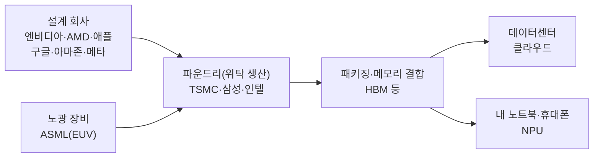



> **IT 속사정** 01편 / 전 12편 · 시즌 8 · 2026년 11월 기준
> 난이도: 초급 · 영상 예상 길이: 24~28분
> 이 편의 질문: AI를 돌리는 "엔진"인 칩은 누가 만들고, 왜 모두가 그 칩을 차지하려고 싸울까요?

> **한 줄 요약**
> AI는 결국 칩 위에서 돌아갑니다. 지금은 엔비디아가 가장 앞서 있지만, 구글·아마존·마이크로소프트·메타·OpenAI가 저마다 자기 칩을 만들고, 일론 머스크는 아예 칩 공장(테라팹)을 짓겠다고 나섰습니다. 이 싸움을 알면 AI 요금, AI PC, 뉴스 속 "반도체 전쟁"이 한 줄로 이어집니다.

## 시즌 8 「IT 속사정」 목차

| 편 | 제목 | 축 |
| --- | --- | --- |
| 01 | AI 칩 전쟁 — 누가 AI의 엔진을 만드나 | AI 산업 |
| 02 | AI는 어디서 돌아가나 — 내 책상, 클라우드, 데이터센터 | AI 산업 |
| 03 | AI 비용의 경제학 — 구독, API, 로컬, 하이브리드 | AI 산업 |
| 04 | 내 컴퓨터는 어떻게 일하나 — 부품, 메모리, 운영체제 | 내 컴퓨터 |
| 05 | 파일과 데이터의 언어 — 형식, 확장자, 인코딩 | 내 컴퓨터 |
| 06 | 말로 컴퓨터를 부리는 시대 — 터미널에서 바이브 코딩까지 | 내 컴퓨터 |
| 07 | 오픈소스 혁명 — GitHub에서 무슨 일이 벌어지나 | 만드는 사람의 세계 |
| 08 | 만들 수 있다고 다 해도 될까 — 저작권, 약관, 보안, 크롤링 | 만드는 사람의 세계 |
| 09 | 인터넷은 얼마나 튼튼한가 — DNS, CDN, Cloudflare, 대규모 장애 | 인터넷 |
| 10 | 웹사이트의 일생 — 정적·동적, 호스팅, 무료로 운영하기 | 인터넷 |
| 11 | AI에게 나를 알려 주는 기술 — 위키, 온톨로지, RAG, 컨텍스트 엔지니어링 | 지식과 미래 |
| 12 | 과장 없이 보는 다음 10년 — 양자 컴퓨터와 기술 전망 읽는 법 | 지식과 미래 |

## 1. 지금 벌어지는 일 — 칩 하나에 회사들의 운명이 걸렸습니다

2026년 8월 26일, 엔비디아(NVIDIA)는 한 분기(5~7월) 매출이 962억 달러라고 발표했습니다. 1년 전보다 두 배가 넘게(106%) 늘어난 숫자입니다. 그중 890억 달러가 "데이터센터" 부문, 즉 AI용 칩과 장비를 판 돈이었습니다. 엔비디아는 다음 분기 매출을 약 1,080억 달러로 내다봤습니다. 회사 하나가 석 달에 1,000억 달러 가까이 버는 이유는 단순합니다. 전 세계 AI 회사들이 엔비디아 칩을 사려고 줄을 서 있기 때문입니다.

그런데 이 줄에 선 회사들이 동시에 "엔비디아 없이도 살 길"을 찾고 있습니다.

- 구글은 자체 AI 칩 TPU의 7세대인 아이언우드(Ironwood)를 내놓았고, 다음 세대는 학습용과 추론용으로 나눠 만든다고 보도됐습니다.
- 아마존(AWS)은 2025년 12월 트레이니엄3(Trainium3)를 정식 출시했습니다.
- 마이크로소프트는 2026년 1월 추론용 칩 마이아 200(Maia 200)을 발표했습니다.
- 메타는 2026년 3월, 2027년까지 MTIA라는 자체 칩을 네 세대나 내놓겠다고 발표했습니다.
- OpenAI는 브로드컴과 함께 맞춤 칩을 설계해 2026년 하반기부터 배치하겠다고 2025년 10월에 발표했습니다. 같은 달 AMD와도 대규모 GPU 계약을 맺었습니다.

그리고 2026년 3월, 일론 머스크는 테슬라·스페이스X·xAI가 함께 텍사스에 거대한 칩 공장 "테라팹(Terafab)"을 세우겠다고 발표했습니다. 4월에는 인텔이 이 계획에 참여하겠다고 밝혔습니다.

> 🐱 **꿈이**: 칩 하나 때문에 이렇게까지 싸워요? 그냥 많이 만들면 되잖아요.

"그냥 많이 만들기"가 세상에서 가장 어려운 일 중 하나라서 그렇습니다. 최첨단 칩을 만드는 공장은 지구에 몇 곳 없고, 그 공장에 들어가는 핵심 장비는 단 한 회사만 만듭니다. AI를 만들고 쓰는 회사는 늘어나는데, 칩을 만드는 길목은 아주 좁습니다. 그래서 이 길목을 누가 쥐느냐가 곧 AI 시대의 주도권 싸움이 됩니다.

## 2. 알아야 할 원리 — 칩의 종류, 칩이 만들어지는 길, 그리고 CUDA

### 칩 다섯 형제: CPU, GPU, NPU, TPU, DPU

"칩(chip)"은 손톱만 한 실리콘 조각 위에 아주 작은 스위치(트랜지스터)를 수백억 개 새겨 넣은 부품입니다. 하는 일에 따라 이름이 달라집니다. 식당 주방에 비유해 보겠습니다.

| 칩 | 풀어 쓴 이름 | 주방 비유 | 잘하는 일 |
| --- | --- | --- | --- |
| CPU | 중앙 처리 장치 | 무엇이든 하는 주방장 한 명 | 복잡한 판단, 순서대로 하는 일, 컴퓨터 전체 지휘 |
| GPU | 그래픽 처리 장치 | 같은 동작을 동시에 하는 보조 요리사 수천 명 | 똑같은 계산을 한꺼번에(게임 그래픽, AI 계산) |
| NPU | 신경망 처리 장치 | 작은 AI 전용 조리대 | 노트북·휴대폰에서 AI를 적은 전기로 처리 |
| TPU | 텐서 처리 장치(구글 전용) | 한 가지 요리만 하는 공장형 주방 | 구글 데이터센터의 AI 학습·추론 |
| DPU | 데이터 처리 장치 | 주문·배달을 전담하는 홀 매니저 | 데이터센터에서 네트워크·저장장치 일을 대신 맡아 CPU 부담 줄이기 |

AI의 계산은 대부분 "엄청나게 많은 곱하기와 더하기를 동시에" 하는 일입니다. 주방장 한 명(CPU)이 아무리 똑똑해도, 감자 10만 개 깎기는 보조 요리사 수천 명(GPU)이 훨씬 빠릅니다. 그래서 원래 게임 그래픽용이던 GPU가 AI 시대의 주인공이 됐습니다.

> 🐱 **꿈이**: 그럼 GPU랑 TPU 같은 건 뭐가 달라요? 둘 다 AI 하잖아요.

GPU는 "범용" 칩입니다. 게임, 영상 편집, 과학 계산, AI까지 두루 합니다. 반면 TPU처럼 특정 회사가 특정 일만 하도록 맞춰 만든 칩을 **ASIC(에이식, 특정 용도용 칩)**이라고 부릅니다. 아마존 트레이니엄, 마이크로소프트 마이아, 메타 MTIA도 모두 이쪽입니다. 맞춤옷이 기성복보다 몸에 잘 맞듯, ASIC은 자기 회사 일에는 더 싸고 효율적일 수 있습니다. 대신 다른 일에는 잘 안 맞고, 설계에 큰돈과 시간이 듭니다.

### 학습과 추론 — AI 칩이 하는 두 가지 일

- **학습(training)**: AI 모델을 처음 만드는 과정입니다. 엄청난 양의 글과 그림을 보여 주며 몇 주, 몇 달씩 계산합니다. 학생이 몇 년 동안 공부하는 것과 비슷합니다.
- **추론(inference)**: 다 만든 AI가 우리 질문에 답하는 과정입니다. 공부를 마친 학생이 시험 문제를 푸는 것과 같습니다. 한 번은 짧지만, 수억 명이 매일 쓰니 전체 양은 어마어마합니다.

보도에 따르면 시장조사 회사 가트너는 2026년 AI용 클라우드 지출에서 처음으로 추론(약 233억 달러)이 학습(약 190억 달러)을 넘을 것이라고 내다봤습니다. 딜로이트는 2026년 AI 연산의 약 3분의 2가 추론이 될 것이라고 봤습니다. 이 흐름이 중요한 이유는, 마이크로소프트 마이아 200이나 메타의 새 MTIA처럼 **추론에 맞춘 칩**이 쏟아지는 배경이기 때문입니다. 학습은 여전히 엔비디아가 강하지만, 추론은 맞춤 칩이 파고들 틈이 크다는 계산입니다.

### 칩이 태어나는 길: 설계 → 생산 → 장비

칩 한 개가 나오기까지는 여러 회사가 이어달리기를 합니다.

1. **설계**: 엔비디아, AMD, 애플, 구글 같은 회사는 칩의 "설계도"를 그립니다. 엔비디아도 자기 공장이 없습니다.
2. **파운드리(foundry, 위탁 생산)**: 설계도를 받아 실제로 칩을 찍어 내는 공장입니다. 시장조사 회사 트렌드포스에 따르면 2026년 2분기 세계 파운드리 시장에서 대만 TSMC의 점유율은 72.5%로 사상 최고였습니다. 2위 삼성은 5.9%였습니다. 사실상 첨단 AI 칩 대부분이 대만의 한 회사를 거친다는 뜻입니다.
3. **노광 장비(EUV)**: 칩에 회로를 새기는 일은 빛으로 아주 가는 선을 그리는 "사진 찍기"와 비슷합니다. 가장 가는 선을 그리는 극자외선(EUV) 노광 장비는 네덜란드 ASML 한 회사만 만들고, 중국에는 수출이 막혀 있습니다. 최신형 장비(High-NA EUV)는 보도에 따르면 한 대에 약 4억 달러로, 웬만한 빌딩 값입니다.

> 🐱 **꿈이**: 공장이 대만에 몰려 있으면 위험하지 않아요?

바로 그 걱정 때문에 미국 안에 공장을 늘리려는 움직임이 큽니다. 보도에 따르면 삼성은 2025년 7월 테슬라와 약 165억 달러 규모의 AI 칩 위탁 생산 계약을 맺고 텍사스 테일러 공장에서 만들기로 했습니다. 인텔도 다른 회사 칩을 대신 만들어 주는 파운드리 사업을 키우고 있습니다. 머스크의 테라팹도 같은 고민에서 나온 계획입니다.

### 테라팹(Terafab)은 무엇인가

보도에 따르면 머스크는 2026년 3월 X(옛 트위터) 생방송에서 테라팹을 처음 공개했습니다. 핵심만 정리하면 이렇습니다.

- **누가**: 테슬라·스페이스X·xAI의 합작. 2026년 4월 인텔이 참여를 발표했습니다.
- **무엇을**: 설계, 생산, 메모리, 패키징을 한곳에 모은 칩 단지. 자율주행차·로봇용 칩과 AI·우주용 칩을 만들겠다는 구상입니다.
- **왜**: 머스크는 지금 세계의 칩 생산 능력이 자기 회사들에 필요한 양의 약 2%밖에 안 된다고 주장했습니다. 목표로는 "1년에 1테라와트어치 컴퓨팅"이라는 말을 썼습니다.
- **얼마나**: 처음 보도는 200억~250억 달러였는데, 이후 스페이스X 상장 서류를 다룬 보도에서는 1단계 550억 달러, 전체 최대 1,190억 달러까지 나왔습니다. 위치도 오스틴, 그라임스 카운티 등으로 보도가 엇갈립니다.
- **언제**: 완공 일정은 발표되지 않았습니다.

> ⚠️ 테라팹은 아직 "계획"입니다. 보도에 따르면 스페이스X 상장 서류에도 목표를 일정 안에, 혹은 아예 달성하지 못할 수 있다는 위험 고지가 들어 있습니다. TSMC 회장은 새 공장을 짓는 데 2~3년, 제대로 돌리기까지 1~2년이 더 걸리며 "지름길은 없다"고 말했다고 보도됐습니다. 뉴스에서 "세계 최대"라는 표현을 보면, 그건 발표한 사람의 말이라는 점을 기억해 두세요.

### CUDA — 엔비디아가 쉽게 안 밀리는 진짜 이유

> 🐱 **꿈이**: 다른 회사들도 칩을 만든다면서요. 그럼 엔비디아 거 안 사면 되잖아요?

칩만 바꾸면 끝나는 문제가 아니라서 그렇습니다. 엔비디아에는 **CUDA(쿠다)**라는 소프트웨어 도구가 있습니다. 개발자가 GPU에 일을 시킬 때 쓰는 "언어와 도구 상자"입니다. 엔비디아는 2026년에 CUDA 20주년을 기념했습니다. 20년 동안 수백만 명의 개발자가 CUDA로 프로그램을 짜고, 수많은 AI 도구가 CUDA를 기준으로 만들어졌습니다.

비유하자면 이렇습니다. 어떤 교회가 20년 동안 한 회사의 회계 프로그램으로 장부를 써 왔다면, 더 싼 프로그램이 나와도 쉽게 못 바꿉니다. 옛 자료를 옮겨야 하고, 봉사자들이 새로 배워야 하고, 처음엔 오류도 납니다. 이것을 **잠금 효과(lock-in)**라고 합니다.

다만 이 벽은 조금씩 낮아지고 있습니다. 여러 분석에 따르면 PyTorch 같은 표준 AI 도구로 만든 프로그램은 AMD의 ROCm(엔비디아 CUDA에 해당하는 AMD의 도구)에서도 꽤 잘 돌아가게 됐습니다. 하지만 CUDA로 직접 깊게 짠 코드나 수천 대의 칩을 묶어 하는 대규모 학습은 여전히 엔비디아 쪽이 유리하다는 평가가 많습니다. "해자(성을 둘러싼 물길)가 좁아지고는 있지만 아직 사라지지는 않았다"는 것이 대체적인 시각입니다.

## 3. 누가 왜 그렇게 하나 — 각자의 속사정

> 🐱 **꿈이**: 구글이나 메타는 돈도 많은데 왜 굳이 칩까지 직접 만들어요?

이유는 크게 세 가지입니다.

1. **비용**: 엔비디아 칩은 비싸고, 엔비디아는 높은 이익을 남깁니다(보도에 따르면 2분기 매출총이익률이 약 75%). 수십억 명이 쓰는 서비스를 돌리는 회사라면, 자기 일에 꼭 맞는 칩을 만들어 한 개당 비용을 조금만 낮춰도 엄청난 돈이 절약됩니다. 마이크로소프트는 마이아 200이 이전 세대 장비보다 "달러당 성능이 30% 좋다"고 주장합니다.
2. **공급 안정**: 칩을 엔비디아 한 곳에서만 사면, 물량이 부족할 때 줄을 서야 합니다. 그래서 여러 곳에서 칩을 확보하려 합니다. 메타는 "어떤 칩 하나로 모든 일을 할 수는 없다"며 여러 칩을 섞어 쓰는 전략을 밝혔습니다.
3. **협상력**: 자기 칩이 있으면 엔비디아와 가격을 협상할 때 할 말이 생깁니다.

재미있는 점은, 이들이 엔비디아를 완전히 버리지는 않는다는 것입니다. 마이크로소프트는 마이아가 엔비디아·AMD 칩을 "대체하는 게 아니라 보완한다"고 했고, 아마존은 다음 세대 트레이니엄4가 엔비디아의 연결 기술(NVLink Fusion)을 지원할 것이라고 밝혔습니다. 경쟁자이면서 동시에 최대 고객인, 복잡한 관계입니다.

**엔비디아의 입장**은 "칩만 파는 게 아니라 시스템 전체를 판다"입니다. 칩, 칩끼리 잇는 네트워크, CUDA 소프트웨어, 랙(서버 장롱) 전체를 한 묶음으로 내놓습니다. 차세대 플랫폼 베라 루빈(Vera Rubin)은 2026년 8월 기준 "본격 생산 중"이라고 발표됐습니다.

**AMD의 입장**은 "엔비디아의 유일한 범용 대안"입니다. 2025년 10월 OpenAI와 최대 6기가와트 규모의 GPU 공급 계약을 맺었고, 첫 1기가와트는 2026년 하반기부터 배치됩니다.

**나라의 입장**도 있습니다. 엔비디아는 3분기 전망에서 중국으로의 데이터센터 칩 매출을 0으로 잡았습니다. 첨단 칩과 장비는 이제 무역과 안보의 문제가 됐습니다. 미국이 자국 내 공장을 늘리려는 이유이기도 합니다.

## 4. 나에게 미치는 영향 — 우리가 그 칩을 만질 수 있을까?

> 🐱 **꿈이**: 근데 이거 다 큰 회사 얘기잖아요. 저랑 무슨 상관이에요?

AI 칩은 두 갈래로 나뉩니다. 이것만 알면 뉴스가 내 생활과 연결됩니다.

| 구분 | 예 | 내가 만질 수 있나 | 나와의 연결 |
| --- | --- | --- | --- |
| 클라우드로만 쓰는 칩 | 구글 TPU, 아마존 트레이니엄, MS 마이아, 메타 MTIA, 엔비디아 데이터센터 GPU | 직접 살 수 없음(일부는 기업이 클라우드로 빌려 씀) | ChatGPT·Gemini·Claude 같은 서비스 요금과 속도에 영향 |
| 내 기기에 들어오는 칩 | 노트북·휴대폰의 NPU, 게임용 GPU, 애플 M 시리즈의 뉴럴 엔진 | 기기를 사면 내 것 | 인터넷 없이 되는 AI 기능, 배터리, 개인정보 |

**① AI 서비스 요금과 무료 혜택**: 칩 경쟁이 치열해지고 추론 전용 칩이 늘어나면, AI 회사가 답 하나를 만드는 비용이 내려갑니다. 그 비용이 무료 요금제의 범위나 구독료에 반영됩니다. (요금 구조는 시즌 8 · 03편에서 자세히 다룹니다.)

**② AI PC 고르기**: 마이크로소프트의 "Copilot+ PC" 기준은 1초에 40조 번 이상 연산(40 TOPS)하는 NPU, 16GB 이상 메모리, 256GB 이상 저장장치입니다. 이 40 TOPS는 GPU가 아니라 NPU로 채워야 합니다. 다만 클라우드에서 돌아가는 일반 Copilot은 거의 모든 최신 PC에서 쓸 수 있습니다. 즉 **"AI PC가 아니면 AI를 못 쓴다"는 말은 사실이 아닙니다.** 기기 안에서 돌아가는 일부 기능만 NPU가 필요합니다.

> 💡 교회나 작은 단체에서 컴퓨터를 새로 산다면, "AI PC" 스티커보다 메모리 용량과 실제로 쓸 프로그램을 먼저 보세요. 대부분의 AI 서비스는 클라우드에서 돌아가므로 브라우저만 잘 돌면 됩니다. 메모리 고르는 법은 03편과 04편에서 다룹니다.

**③ 개인정보**: 내 기기의 NPU에서 처리되는 AI는 자료가 밖으로 나가지 않을 수 있습니다. 클라우드 칩에서 처리되는 AI는 자료가 회사 서버로 갑니다. 어디서 처리되는지는 02편의 주제입니다.

> 🔒 같은 "AI 기능"이라도 내 기기에서 처리되는지, 클라우드로 보내지는지에 따라 개인정보 위험이 다릅니다. 교인 명단, 상담 기록 같은 민감한 자료를 AI에 넣기 전에는 그 서비스가 어디서 처리되는지 먼저 확인하세요.

**④ 뉴스 읽기**: "○○사, 엔비디아 대항마 칩 공개" 같은 기사를 보면 세 가지만 물어보세요. 학습용인가 추론용인가? 우리가 살 수 있는 칩인가, 그 회사 클라우드 안에서만 쓰는 칩인가? 성능 비교는 누가 한 것인가(회사 주장인가, 독립 검증인가)?

> 📌 **핵심 정리**: AI 칩은 "클라우드 칩"과 "내 기기 칩"으로 나뉩니다. 클라우드 칩 경쟁은 AI 서비스 요금에, 내 기기 칩(NPU)은 오프라인 AI 기능과 개인정보에 영향을 줍니다.

## 5. 오늘 해 볼 수 있는 것 — 내 기기에 어떤 칩이 들어 있나 확인하기

> 🐱 **꿈이**: 우리 집 컴퓨터에도 NPU 있어요? 어떻게 알아요?

### 따라 하기 1: Windows 컴퓨터

1. 키보드에서 `Ctrl` + `Shift` + `Esc`를 함께 눌러 **작업 관리자**를 엽니다.
2. 왼쪽(또는 위쪽) 메뉴에서 **성능**을 누릅니다.
3. 목록에 **CPU**, **GPU**가 보입니다. 각각을 눌러 오른쪽 위에 적힌 칩 이름(예: Intel, AMD, Qualcomm, NVIDIA 등)을 메모합니다.
4. 목록에 **NPU**가 있는지 봅니다. 최신 윈도우 11과 드라이버가 깔린 NPU 탑재 PC라면 여기에 NPU가 나타납니다.
5. NPU가 안 보이면, 없거나 윈도우·드라이버가 오래된 것일 수 있습니다. Windows 업데이트 후 다시 확인합니다.

**완료 기준**: CPU 이름, GPU 이름, NPU 유무를 종이에 적었습니다.

### 따라 하기 2: Mac 또는 휴대폰

1. **Mac**: 화면 왼쪽 위 사과 메뉴 → **이 Mac에 관하여**를 누릅니다. "칩" 항목에 Apple M 시리즈가 보이면, 그 안에 CPU·GPU·뉴럴 엔진(애플의 NPU)이 함께 들어 있는 것입니다. Intel이라고 나오면 예전 방식의 Mac입니다.
2. **아이폰**: 설정 → 일반 → 정보에서 모델 이름을 확인하고, 인터넷에 "모델 이름 + chip"으로 검색해 칩 이름을 찾습니다.
3. **안드로이드 폰**: 설정 → 휴대전화 정보(또는 디바이스 정보)에서 모델 이름이나 프로세서 이름을 확인합니다.
4. 아래 표에 정리합니다.

| 기기 | CPU/칩 이름 | GPU | NPU(뉴럴 엔진) 유무 |
| --- | --- | --- | --- |
| 내 노트북 |  |  |  |
| 내 휴대폰 |  |  |  |
| 사무실 PC |  |  |  |

**완료 기준**: 집이나 사무실 기기 2대 이상의 칩 정보를 표에 채웠습니다.

> ⚠️ 칩 정보를 확인하려고 이름 모를 "시스템 정보 프로그램"을 내려받지 마세요. 위 방법처럼 운영체제에 들어 있는 기능만으로 충분합니다.

## 한눈에 정리

| 질문 | 답 |
| --- | --- |
| AI 칩의 주인공은? | 지금은 엔비디아 GPU. 구글·아마존·MS·메타·OpenAI가 맞춤 칩(ASIC)으로 추격 중 |
| 칩은 누가 만드나? | 설계는 여러 회사, 생산은 TSMC가 약 72%, 핵심 장비 EUV는 ASML 독점 |
| 테라팹은? | 머스크 회사들의 칩 공장 계획. 비용·일정 보도가 엇갈리는 "계획 단계" |
| 엔비디아가 강한 이유는? | 칩 성능 + 20년 된 CUDA 생태계(잠금 효과) |
| 나와의 관계는? | 클라우드 칩은 AI 요금에, 내 기기 NPU는 오프라인 AI·개인정보에 영향 |

## 다음 편 예고

이번 편에서 AI 칩이 "클라우드 칩"과 "내 기기 칩"으로 나뉜다는 것을 봤습니다. 그럼 내가 ChatGPT나 Gemini에 질문을 던지면, 그 답은 정확히 어디서 만들어질까요? 다음 02편 「AI는 어디서 돌아가나 — 내 책상, 클라우드, 데이터센터」에서는 내 컴퓨터를 꺼도 AI가 일하는 "클라우드 에이전트", 데이터센터가 쓰는 전기와 물, 그리고 미국 곳곳에서 벌어지는 데이터센터 찬반 논쟁을 다룹니다.

## 참고 자료

- [NVIDIA Announces Financial Results for Second Quarter Fiscal 2027](https://nvidianews.nvidia.com/news/nvidia-announces-financial-results-for-second-quarter-fiscal-2027) — NVIDIA, 2026-08-26
- [Expanding Meta's Custom Silicon to Power Our AI Workloads](https://about.fb.com/news/2026/03/expanding-metas-custom-silicon-to-power-our-ai-workloads/) — Meta, 2026-03-11
- [Microsoft Unveils Maia 200](https://rcpmag.com/Articles/2026/01/29/Microsoft-Unveils-Maia-200.aspx) — RCP Magazine, 2026-01-29
- [AWS makes Trainium3 UltraServers generally available](https://www.datacenterdynamics.com/en/news/aws-makes-trainium3-ultraservers-generally-available/) — DatacenterDynamics, 2025-12
- [Ironwood TPUs and new Axion-based VMs for your AI workloads](https://cloud.google.com/blog/products/compute/ironwood-tpus-and-new-axion-based-vms-for-your-ai-workloads/) — Google Cloud, 2025-11-06
- [TrendForce 2Q26 Foundry Ranking](https://www.trendforce.com/presscenter/news/20260909-13225.html) — TrendForce, 2026-09-09
- [Elon Musk announces Terafab project](https://engadget.com/science/elon-musk-announces-terafab-project-he-claims-will-be-the-largest-chip-manufacturing-facility-ever-171718545.html) — Engadget, 2026-03-22
- [Intel gets on board with Musk's Terafab project](https://engadget.com/ai/intel-gets-on-board-with-musks-terafab-project-182200144.html) — Engadget, 2026-04-07
- [OpenAI, Broadcom to co-develop 10GW of custom AI chips](https://www.tomshardware.com/openai-broadcom-to-co-develop-10gw-of-custom-ai-chips) — Tom's Hardware, 2025-10
- [Copilot+ PCs: All we know](https://tomshardware.com/software/windows/microsoft-copilot-pcs-all-we-know) — Tom's Hardware
