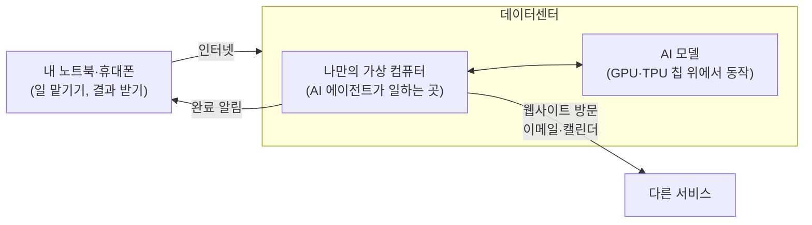



> **IT 속사정** 02편 / 전 12편 · 시즌 8 · 2026년 11월 기준
> 난이도: 초급 · 영상 예상 길이: 22~26분
> 이 편의 질문: 내가 AI에게 일을 맡기면, 그 일은 실제로 어디에 있는 어떤 컴퓨터가 하고 있을까요?

> **한 줄 요약**
> 대부분의 AI는 내 책상이 아니라 멀리 있는 데이터센터의 컴퓨터에서 돌아갑니다. 2026년에는 AI에게 "클라우드 컴퓨터 한 대"를 통째로 맡겨, 내 컴퓨터를 꺼도 일이 계속되는 에이전트가 무료로까지 풀렸습니다. 그 편리함 뒤에는 전기·물·지역 사회의 고민이 함께 있습니다.

## 1. 지금 벌어지는 일 — 컴퓨터를 꺼도 AI가 일합니다

2026년 11월 17일, 구글은 Gemini 앱의 **Task**(옛 이름 Gemini Spark, 공식 블로그 표기는 "Tasks in Gemini") 기능을 미국·캐나다·호주·인도·일본·한국에서 무료로 열었습니다. Gemini 앱이나 웹에서 대화 방식을 "Chat"에서 "Task"로 바꾸고 일을 맡기면, Gemini가 뒤에서 여러 단계를 혼자 처리한 뒤 다 되면 알려 줍니다. 구글이 든 예는 이렇습니다. 전기요금이 왜 많이 나왔는지 고지서를 분석하기, 학교에서 온 이메일의 행사 날짜를 캘린더에 넣기, 여러 정비소에 전화해 예약 잡기.

이 기능이 처음 발표된 것은 2026년 5월 구글 I/O였습니다. 보도에 따르면 당시 구글 측은 "노트북을 닫거나 휴대폰을 꺼도 백그라운드에서 계속 일할 수 있다"고 소개했습니다. 비결은 간단합니다. 일하는 컴퓨터가 내 노트북이 아니라 **구글 데이터센터 안의 가상 컴퓨터**이기 때문입니다.

구글만 그런 것이 아닙니다.

- **OpenAI**: 보도에 따르면 2025년 7월 "ChatGPT agent"로 ChatGPT에 자기만의 가상 컴퓨터를 줬고, 2026년 7월에는 "ChatGPT Work"를 내놓았습니다. OpenAI 담당자는 이를 "클라우드에 늘 켜져 있는 가상 머신"이라고 설명했다고 보도됐습니다.
- **Anthropic**: Claude의 작업 도우미 "Cowork"를 2026년 7월부터 클라우드에서 돌리기 시작했습니다. Anthropic 도움말에 따르면 작업이 Anthropic 서버에서 돌아가므로 내 컴퓨터가 꺼져 있어도 계속됩니다.

> 🐱 **꿈이**: 잠깐만요, 제 컴퓨터가 꺼져 있는데 AI가 어떻게 일을 해요?

AI가 쓰는 컴퓨터가 처음부터 내 컴퓨터가 아니었기 때문입니다. 우리가 쓰는 대부분의 AI는 원래 멀리 있는 데이터센터에서 돌아갑니다. 예전에는 "질문 하나 → 답 하나"로 금방 끝났을 뿐입니다. 이제는 그 데이터센터 안에 **나를 위한 컴퓨터 한 대를 잠시 빌려주고**, AI가 그 컴퓨터로 몇 시간씩 일하게 하는 방식으로 바뀌고 있습니다. 내 노트북은 일을 맡기고 결과를 받는 "창구"일 뿐입니다.

## 2. 알아야 할 원리 — 클라우드, 가상 컴퓨터, 데이터센터

### 클라우드는 "남의 컴퓨터를 빌려 쓰기"입니다

**클라우드(cloud)**라는 말은 구름처럼 어딘가 떠 있다는 느낌을 주지만, 실제로는 땅 위 거대한 건물(데이터센터) 안에 있는 수많은 컴퓨터입니다. 우리는 그 컴퓨터를 인터넷으로 빌려 씁니다.

전기에 비유하면 쉽습니다. 옛날에는 공장마다 자기 발전기를 돌렸지만, 지금은 발전소가 만든 전기를 전깃줄로 받아 쓰고 쓴 만큼 요금을 냅니다. 클라우드도 마찬가지로, 집에 큰 컴퓨터를 두는 대신 데이터센터의 컴퓨터를 인터넷으로 받아 씁니다. Gmail, 구글 드라이브, 아이클라우드 사진, 그리고 ChatGPT·Gemini·Claude가 모두 이렇게 돌아갑니다.

> 🐱 **꿈이**: 그럼 클라우드는 누가 운영해요? 구글이요?

큰 클라우드는 몇 회사가 나눠 갖고 있습니다. 시장조사 보도에 따르면 2026년 3분기 클라우드 인프라 시장은 아마존(AWS), 마이크로소프트(Azure), 구글 클라우드 순입니다(점유율 수치는 조사마다 조금씩 다릅니다). AI 회사들은 자기 데이터센터를 짓기도 하고, 이런 클라우드 회사에서 컴퓨터를 빌리기도 합니다. 보도에 따르면 마이크로소프트·알파벳·아마존·메타 네 회사가 2026년 한 해 데이터센터 등에 쓰겠다고 밝힌 돈은 합쳐서 6천억 달러가 넘습니다(집계마다 약 6,300억~7,250억 달러).

### 가상 컴퓨터 — 큰 집을 방으로 나누기

데이터센터의 컴퓨터 한 대는 아주 강력합니다. 그래서 이것을 소프트웨어로 여러 칸으로 나눠, 각 칸을 독립된 컴퓨터처럼 쓰게 합니다. 이것이 **가상 머신(virtual machine, VM)**입니다. 큰 건물을 여러 개의 원룸으로 나눠 세를 주는 것과 같습니다. 원룸마다 문이 따로 있어 옆방 사람이 내 방에 들어올 수 없습니다.

구글은 공식 블로그에서 Task가 **사용자마다 따로 쓰는, 하드웨어 수준에서 격리된 가상 머신**에서 실행되고, 다른 사용자와 공유하지 않는다고 설명했습니다. 클라우드 에이전트의 정체가 바로 이것입니다. "AI에게 원룸 하나와 컴퓨터 한 대를 내주고, 거기서 일하게 한다."

### 내 기기에서 돌아가는 AI도 있습니다

모든 AI가 클라우드에서만 돌아가는 것은 아닙니다. 01편에서 본 NPU(신경망 처리 장치)가 들어 있는 기기는 일부 AI를 직접 처리합니다. 애플의 방식이 좋은 예입니다. 애플 도움말에 따르면 Apple Intelligence는 먼저 **기기 안에서 처리할 수 있는지** 따져 보고, 더 큰 계산이 필요할 때만 애플의 서버(Private Cloud Compute)로 보냅니다. 기기 안 모델은 인터넷이 없어도 되지만, 서버 쪽은 인터넷이 필요합니다.

| 어디서 | 장점 | 단점 | 예 |
| --- | --- | --- | --- |
| 내 기기 | 인터넷 없이 됨, 자료가 밖으로 안 나감 | 기기 성능만큼만 가능, 배터리 소모 | 휴대폰 사진 분류, 기기 안 AI 기능, 로컬 AI 모델 |
| 클라우드(대화형) | 아주 똑똑한 큰 모델 사용 | 인터넷 필요, 자료가 회사 서버로 감 | ChatGPT·Gemini·Claude 대화 |
| 클라우드 에이전트 | 내 컴퓨터를 꺼도 오래 일함 | 권한을 많이 줘야 함, 실수의 파급이 큼 | 구글 Task, ChatGPT Work, Claude Cowork(클라우드) |

> 🐱 **꿈이**: 그럼 클라우드 에이전트는 제 컴퓨터 안 파일도 볼 수 있어요?

기본적으로는 못 봅니다. 데이터센터의 가상 컴퓨터는 내 컴퓨터와 다른 곳에 있으니까요. Anthropic 도움말이 이 점을 분명히 적어 두었습니다. Claude Cowork의 클라우드 작업은 컴퓨터를 꺼도 계속되지만, **내 컴퓨터의 파일·폴더를 쓰거나 내 브라우저를 조작하는 일은 데스크톱 앱이 켜져 연결돼 있어야** 합니다. 즉 "내 컴퓨터가 꺼져도 일한다"는 말은, 정확히는 "클라우드에 올려 둔 자료와 연결해 둔 온라인 서비스로 할 수 있는 일은 계속한다"는 뜻입니다.

### 데이터센터는 전기와 물을 먹고 삽니다

데이터센터는 칩 수만~수십만 개가 쉬지 않고 돌아가는 건물입니다. 칩은 계산할 때 전기를 쓰고, 쓴 전기는 거의 다 열이 됩니다. 그래서 데이터센터에는 두 가지가 꼭 필요합니다. **전기**와 **식히는 장치**입니다.

**전기**: 보도에 따르면 미국 에너지부 산하 로렌스 버클리 국립연구소(LBNL)는 2026년 6월 보고서에서, 데이터센터가 지금 미국 전력의 약 4.5%를 쓰고 2030년에는 약 9.5~15%까지 늘 수 있다고 내다봤습니다. 국제에너지기구(IEA)는 최근 미국 전력 수요 증가분의 약 절반이 데이터센터에서 나왔다고 봤습니다.

**냉각과 물**: 식히는 방법은 크게 두 가지입니다.

- **증발식 냉각**: 여름날 땀이 마르며 몸이 시원해지듯, 물을 증발시켜 열을 뺏습니다. 전기는 덜 들지만 물이 많이 사라집니다. 업계 추정에 따르면 IT 장비 1메가와트(MW)당 하루 약 2만~5만 갤런의 물을 쓸 수 있습니다(더 낮게 보는 추정도 있어 출처마다 차이가 큽니다).
- **폐쇄형(closed-loop) 냉각**: 자동차 냉각수처럼 물을 관 안에서 계속 돌리며 식힙니다. 물은 훨씬 덜 쓰지만, 대신 냉각기를 돌리는 전기를 더 씁니다.

> 🐱 **꿈이**: 물을 쓰는 게 그렇게 큰일이에요? 그냥 수돗물 조금 쓰는 거 아니에요?

건물 하나만 보면 그렇게 보일 수 있지만, 위 추정대로라면 증발식으로 식히는 100메가와트급 데이터센터는 하루 약 200만~500만 갤런의 물을 쓸 수 있습니다. 그리고 물이 부족한 지역에 들어서면 농사, 주민 식수와 경쟁하게 됩니다. 또 한 가지 놓치기 쉬운 점이 있습니다. 데이터센터가 쓰는 전기를 만드는 발전소도 물을 씁니다. 보도된 분석들에 따르면 이런 "간접적인 물 사용"이 데이터센터가 직접 쓰는 물보다 큰 경우가 많습니다. 그래서 "우리 데이터센터는 물을 거의 안 쓴다"는 홍보만으로는 전체 그림을 다 알 수 없습니다.

## 3. 누가 왜 그렇게 하나 — 회사, 주민, 정부의 셈법

**AI 회사의 입장**: 클라우드 에이전트는 AI를 "대답해 주는 도구"에서 "일을 대신하는 직원"으로 바꾸는 열쇠입니다. 내 컴퓨터에서만 돌면 노트북을 닫는 순간 멈추지만, 클라우드에서 돌면 밤새 일할 수 있습니다. 그만큼 사람들이 AI 서비스에 더 오래 머물고, 더 많은 일을 맡기게 됩니다. 구글이 Task를 무료로 연 것도 더 많은 사람이 이 방식에 익숙해지게 하려는 뜻으로 읽힙니다.

**지역 주민의 입장**: 데이터센터는 세금과 건설 일자리를 가져오지만, 큰 땅을 차지하고 소음이 나며 전기와 물을 많이 씁니다. 데이터센터 반대 움직임을 추적하는 Data Center Watch에 따르면 2026년 1분기(1~3월)에만 최소 75개, 약 1,300억 달러 규모의 데이터센터 사업이 지역 반대로 막히거나 늦춰졌습니다. 반대 단체는 49개 주에 퍼졌고, 쟁점은 전력, 물, 토지, 그리고 **전기요금**이었습니다. 보도에 따르면 2분기에도 최소 45개, 약 680억 달러 규모가 같은 일을 겪었습니다.

> 🐱 **꿈이**: 데이터센터가 생기면 우리 집 전기요금도 올라요?

지역에 따라 그럴 수 있다는 분석이 있습니다. 미국 동부의 가장 큰 전력망인 PJM에서는, 보도에 따르면 전력 시장 감시 기관이 2025/26년 "용량 요금"(미래 전력 공급을 미리 확보하는 비용) 상승의 63%를 데이터센터 탓으로 분석했습니다. 일부 지역에서는 이것이 가정 전기요금을 한 달에 약 16~18달러 올리는 효과를 냈다는 추정도 나왔습니다. 다만 전기요금은 여러 요소로 이뤄지므로, 모든 지역에서 같은 일이 벌어진다고 단정할 수는 없습니다.

**정부의 입장**: 주 정부들은 일자리와 세수를 원하면서도 주민 불만을 무시할 수 없습니다. 보도에 따르면 2026년 첫 6주 동안 주 의회들에 데이터센터 관련 법안이 300개 넘게 나왔습니다. 큰 데이터센터가 전력망 비용을 더 부담하게 하자는 법안도 여러 곳에서 논의되고 있습니다.

## 4. 나에게 미치는 영향 — 편리함과 맞바꾸는 것들

**① 권한을 얼마나 줄 것인가**: 클라우드 에이전트가 쓸모 있으려면 내 이메일, 캘린더, 문서에 접근해야 합니다. 일을 많이 맡길수록 열쇠도 많이 넘겨야 합니다. 구글은 Task가 물건을 사기 전에 확인을 받거나 미리 승인받도록 설계했고, 지출 한도를 정할 수 있다고 밝혔습니다. 이런 안전장치가 있는지 꼭 확인하세요.

> 🔒 교회 행정 계정이나 단체 공용 계정을 클라우드 에이전트에 바로 연결하지 마세요. 먼저 개인 계정으로 작은 일(일정 정리, 자료 요약)부터 시험해 보고, 결제 권한은 끄거나 한도를 낮게 두세요. 교인 명단, 헌금 기록, 상담 내용처럼 민감한 자료가 있는 폴더는 연결 대상에서 빼는 것이 안전합니다.

**② "어디서 돌아가는지"를 알면 고르기 쉬워집니다**: 인터넷이 끊겨도 돼야 하는 일, 밖으로 나가면 안 되는 자료는 내 기기 AI가 맞습니다. 오래 걸리는 반복 업무는 클라우드 에이전트가 맞습니다. 이 구분이 03편에서 다룰 "하이브리드(섞어 쓰기)" 구성의 출발점입니다.

**③ 무료에도 비용이 있습니다**: 클라우드 에이전트가 한 번 일할 때마다 데이터센터의 칩과 전기와 물이 쓰입니다. 개인이 걱정할 만큼 큰 양은 아니지만, 무료 서비스가 공짜로 만들어지지는 않는다는 점은 기억해 둘 만합니다. 비용 구조는 03편에서 다룹니다.

**④ 우리 동네 이야기일 수 있습니다**: 미국 곳곳에서 데이터센터 건설 공청회가 열리고 있습니다. 내 지역 카운티나 시 의회 안건에 데이터센터가 올라오면, 이 편에서 본 전기·물·세금 이야기가 바로 우리 동네 일이 됩니다.

> 💡 지역 뉴스에서 데이터센터 기사를 볼 때는 네 가지를 확인해 보세요. 전력은 어디서 오나? 냉각 방식은 증발식인가 폐쇄형인가? 전력망 비용은 누가 내나?

## 5. 오늘 해 볼 수 있는 것 — 내 AI는 어디서 돌아가나 표 만들기

> 🐱 **꿈이**: 제가 쓰는 AI가 클라우드인지 제 폰인지 어떻게 알아요?

### 따라 하기 1: 내 AI 서비스 지도 그리기

1. 종이나 문서에 아래 표를 그립니다.
2. 지난 일주일 동안 쓴 AI 서비스·기능을 모두 적습니다(예: ChatGPT, Gemini, Claude, 휴대폰 사진 검색, 키보드 자동 완성, 번역 앱).
3. 각 서비스를 **비행기 모드**(인터넷 끊기)로 바꾼 상태에서 한 번 써 봅니다.
4. 인터넷 없이도 되면 "내 기기", 안 되면 "클라우드"에 표시합니다.
5. 내 컴퓨터를 끈 뒤에도 일을 계속하는 기능(구글 Task 등)을 쓰고 있다면 "클라우드 에이전트"에 표시하고, 어떤 계정·앱에 접근 권한을 줬는지 함께 적습니다.

| 서비스·기능 | 인터넷 없이 됨? | 어디서 돌아가나 | 접근 권한을 준 것 |
| --- | --- | --- | --- |
| 예: ChatGPT | 아니요 | 클라우드 | 없음 |
| 예: 휴대폰 사진 속 글자 인식 | (직접 확인) |  |  |
|  |  |  |  |

**완료 기준**: 내가 쓰는 AI 서비스 3개 이상을 "내 기기 / 클라우드 / 클라우드 에이전트"로 나눠 적었습니다.

> ⚠️ 비행기 모드에서 되는 기능도, 인터넷이 연결되면 일부 요청을 서버로 보낼 수 있습니다. 이 실습은 "대략적인 지도"를 그리는 것이지 정밀 검사가 아닙니다.

### 따라 하기 2 (아이폰·Mac 사용자): 서버로 간 요청 확인하기

1. **설정** → **개인정보 보호 및 보안**으로 들어갑니다.
2. **Apple Intelligence 보고서**를 누르고 기간을 **지난 7일**로 고릅니다(기간을 고르면 보고서가 켜집니다. 메뉴 이름은 운영체제 언어·버전에 따라 조금 다를 수 있습니다).
3. 며칠 동안 평소처럼 Apple Intelligence 기능을 씁니다.
4. 같은 메뉴에서 **활동 내보내기**를 눌러 파일(Apple_Intelligence_Report.json)로 저장합니다.
5. 파일 앱에서 그 파일을 열어, 애플 서버(Private Cloud Compute)로 간 요청이 있는지 봅니다. 비어 있으면 그 기간에 서버로 간 요청이 없었다는 뜻입니다.

**완료 기준**: 내 기기에서 서버로 보낸 AI 요청이 있었는지 직접 확인했습니다.

## 한눈에 정리

- 대부분의 AI는 데이터센터(클라우드)에서, 일부는 내 기기의 NPU에서 돌아갑니다.
- 2026년의 새 흐름은 "AI에게 클라우드 컴퓨터 한 대를 맡기는" 에이전트입니다. 구글 Task(옛 Spark), ChatGPT Work, Claude Cowork 클라우드가 대표 예입니다.
- 내 컴퓨터가 꺼져도 일하는 이유는 일하는 컴퓨터가 데이터센터의 가상 머신이기 때문입니다. 다만 내 컴퓨터 안 파일은 못 씁니다.
- 데이터센터는 미국 전력의 약 4.5%를 쓰고(LBNL), 물 사용과 전기요금 때문에 2026년 지역 반대가 크게 늘었습니다.
- 에이전트에게는 필요한 만큼만 권한을 주고, 결제 한도와 확인 절차를 꼭 켜 두세요.

## 다음 편 예고

AI가 데이터센터에서 돌아간다면, 그 비용은 누가 내고 있을까요? 무료 AI는 어떻게 가능하고, 월 20달러 구독과 "토큰"으로 계산하는 API 요금은 무엇이 다를까요? 다음 03편 「AI 비용의 경제학 — 구독, API, 로컬, 하이브리드」에서는 큰 AI 서비스와 내 컴퓨터의 작은 AI를 섞어 써서 돈을 아끼는 방법, 그리고 AI PC를 살 때 무엇을 봐야 하는지 다룹니다.

## 참고 자료

- [How to use Tasks in Gemini for personal assistance](https://blog.google/innovation-and-ai/products/gemini-app/tasks-in-gemini-free-new-features/) — Google, 2026-11-17
- [Gemini Spark, a 24/7 agentic assistant you can email like a colleague](https://thenextweb.com/news/google-gemini-spark-agentic-assistant-gmail-io-2026) — The Next Web, 2026-05
- [OpenAI introduces ChatGPT Work](https://venturebeat.com/technology/openai-introduces-chatgpt-work-a-cloud-based-ai-agent-that-manages-tasks-across-email-slack-and-calendars) — VentureBeat, 2026-07-10
- [What to expect with Claude Cowork in the cloud](https://support.claude.com/en/articles/15811196-what-to-expect-with-claude-cowork-in-the-cloud) — Anthropic 도움말, 2026
- [Apple Intelligence and privacy on iPhone](https://support.apple.com/guide/iphone/apple-intelligence-and-privacy-iphe3f499e0e/ios) — Apple
- [US data centers' electricity use could double by 2030, DOE lab says](https://www.eenews.net/articles/us-data-centers-electricity-use-could-double-by-2030-doe-lab-says/) — E&E News, 2026-06-22
- [Q1 2026: Data Center Watch Report](https://datacenterwatch.org/q1-2026) — Data Center Watch, 2026
- [Local opposition blocked $68 billion worth of data center projects in Q2 2026](https://www.tomshardware.com/tech-industry/data-centers/local-opposition-blocked-usd68-billion-worth-of-data-center-projects-in-the-second-quarter-of-2026-data-center-investments-reportedly-still-on-track-to-hit-usd32-trillion-by-2050) — Tom's Hardware, 2026
- [Projected data center growth spurs PJM capacity prices](https://ieefa.org/resources/projected-data-center-growth-spurs-pjm-capacity-prices-factor-10) — IEEFA
- [Data Center Water Use: From Efficiency Metrics to Real-World Resilience](https://www.datacenterknowledge.com/cooling/data-center-water-use-from-efficiency-metrics-to-real-world-resilience) — Data Center Knowledge
