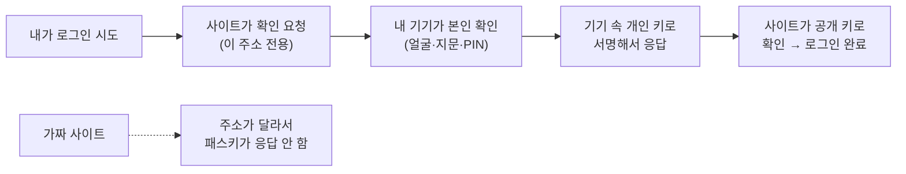



> **디지털 생활 안전** 02편 / 전 7편 · 시즌 6 · 2026년 11월 기준
> 난이도: 초급 · 읽는 시간: 약 18분
> 이 편의 질문: 비밀번호가 새어 나가도 내 계정을 지키려면 무엇을 켜 두어야 할까요?

> **한 줄 요약**
> 비밀번호 하나만으로는 계정을 지키기 어렵습니다. 비밀번호 위에 **2단계 인증**을 덧붙이고, 가능한 곳부터 비밀번호 대신 **패스키**로 바꾸면 가짜 사이트에 속아도 계정이 잘 털리지 않습니다. 오늘은 가장 중요한 계정 두세 개만 골라 켜 보는 것이 목표입니다.

## 1. 지금 벌어지는 일 — 비밀번호 시대가 저물고 있습니다

### 큰 회사들이 "비밀번호 없는 로그인"으로 옮겨 가는 중

2025년 5월 1일, Microsoft는 **새로 만드는 Microsoft 계정은 기본적으로 비밀번호가 없다**고 발표했습니다. 새 사용자는 가입할 때 비밀번호를 정하지 않고, 휴대폰이나 Windows의 얼굴·지문·PIN 같은 방법으로 로그인합니다. 기존 사용자도 계정 설정에서 비밀번호를 지울 수 있게 했습니다. Google은 이보다 앞선 2023년 10월, 개인 Google 계정에서 **패스키를 기본 로그인 방법**으로 내세웠습니다. Apple 기기에서도 패스키는 iCloud 키체인을 통해 기기끼리 안전하게 동기화됩니다.

같은 흐름은 숫자에서도 보입니다. 비밀번호 없는 로그인 표준을 만드는 업계 단체 **FIDO 얼라이언스**는 2026년 5월 '세계 패스키의 날'에 전 세계에서 쓰이는 패스키가 약 **50억 개**라고 추정했고, 2026년 10월에는 약 **70억 개**로 늘었다고 밝혔습니다. 같은 10월 발표에 따르면, 주요 소비자 서비스 15곳에서 성공한 로그인의 **3분의 1 이상**이 이미 패스키로 이루어지고 있습니다.

### 그런데도 비밀번호 피해는 계속됩니다

FIDO 얼라이언스가 2026년 4월 10개국 1만 1천 명을 조사한 결과, **3명 중 1명(33%)**이 지난 1년 사이 계정이 침해되었거나 "정보가 유출되었다"는 통지를 받은 적이 있다고 답했습니다. Microsoft는 2024년 한 해 동안 **1초에 7,000건**꼴로 비밀번호를 노린 공격을 관찰했다고 밝혔습니다. 2023년의 두 배가 넘는 수준입니다.

> 📌 지금은 **비밀번호에서 패스키로 넘어가는 중간 시기**입니다. 패스키를 지원하는 곳은 패스키로, 아직 지원하지 않는 곳은 "튼튼한 비밀번호 + 2단계 인증"으로 지키는 것이 현실적인 방법입니다.

## 2. 알아야 할 원리 — 열쇠를 하나 더, 그리고 열쇠를 바꾸기

### 비밀번호의 한계

비밀번호는 **"나만 아는 비밀"을 상대에게 말해 주는 방식**입니다. 문제는 그 비밀이 여러 길로 새어 나간다는 점입니다.

- **피싱**: 진짜처럼 꾸민 가짜 사이트에 내가 직접 입력해 버림 (01편에서 본 스미싱도 여기에 해당)
- **재사용**: 한 사이트에서 유출된 비밀번호를 다른 사이트에 그대로 넣어 봄
- **추측**: 짧고 흔한 비밀번호는 컴퓨터가 빠르게 맞혀 봄
- **유출**: 회사 서버가 털려 비밀번호 목록이 새어 나감

그래서 FTC(미국 연방거래위원회)는 "계정을 지키는 가장 좋은 방법은 **2단계 인증**을 쓰는 것"이라고 안내합니다.

### 2단계 인증이란 — 현관문 열쇠 + 경비실 확인

**2단계 인증**(2-Step Verification, 2FA, 다중 인증·MFA라고도 부름)은 비밀번호 말고 **다른 종류의 확인을 한 번 더** 거치는 방식입니다. 아파트에 비유하면, 현관 열쇠(비밀번호)가 있어도 경비실에서 "몇 호 사시죠?" 하고 한 번 더 확인하는 것과 같습니다. 누가 열쇠를 복사해 가도, 경비실 확인을 통과하지 못하면 들어올 수 없습니다.

FTC는 두 번째 확인 수단을 세 가지로 나눠 설명합니다.

| 종류 | 어떻게 쓰나 | 안전도 (FTC·CISA 안내 기준) |
| --- | --- | --- |
| 문자·이메일 코드 | 로그인할 때 6자리 숫자가 문자나 메일로 옴 | 없는 것보다 낫지만 가장 약함. 전화번호를 빼앗는 **SIM 스와프** 공격에 취약 |
| 인증 앱 | Google Authenticator, Microsoft Authenticator 같은 앱이 짧은 시간만 쓸 수 있는 코드를 보여 주거나, 승인 알림을 보냄 | 문자보다 안전. SIM 스와프에 당하지 않음 |
| 보안 키 | USB나 NFC(대면 무선)로 연결하는 작은 실물 열쇠 | 가장 강함. 가짜 사이트에서는 작동하지 않음 |

미국 사이버보안·인프라보안청(CISA)은 "**어떤 2단계 인증이든 없는 것보다 낫다**"고 하면서도, 가짜 사이트에 속지 않는 **피싱 저항형** 인증(아래에서 볼 FIDO·WebAuthn 방식)을 목표로 삼으라고 권합니다.

> ❓ **자주 묻는 질문**: 문자로 코드 받는 2단계 인증은 쓰면 안 되는 건가요?

쓰셔도 됩니다. 아예 없는 것보다는 훨씬 낫습니다. 다만 문자 코드는 두 가지 약점이 있습니다. 첫째, 사기꾼이 통신사를 속여 내 전화번호를 자기 유심(SIM)으로 옮기는 **SIM 스와프**를 하면 코드를 대신 받을 수 있습니다. 둘째, 가짜 사이트가 "방금 받은 코드를 입력하세요"라고 하면 그대로 넘겨주게 될 수 있습니다. 그래서 선택할 수 있다면 **인증 앱이나 패스키**를 고르시고, 문자 코드밖에 없는 곳은 일단 그거라도 켜 두세요.

> ⚠️ 어떤 경우에도 **인증 코드를 다른 사람에게 불러 주지 마세요.** FTC는 사기꾼이 은행 직원 등 그럴듯한 이유를 대며 코드를 물어 오는 경우가 많다고 경고합니다. 진짜 회사는 전화로 인증 코드를 묻지 않습니다.

### 패스키란 — 자물쇠와 열쇠를 나눠 갖는 방식

**패스키(Passkey)**는 비밀번호를 아예 대신하는 새 로그인 방식입니다. Apple의 설명에 따르면 패스키는 WebAuthn이라는 표준과 **공개 키 암호** 방식을 씁니다. 어렵게 들리지만 원리는 간단합니다.

- 계정마다 **짝이 맞는 열쇠 두 개**가 만들어집니다.
- **자물쇠 쪽(공개 키)**은 웹사이트가 보관합니다. 남이 봐도 상관없습니다.
- **열쇠 쪽(개인 키)**은 내 휴대폰·컴퓨터 안에만 있고, 밖으로 나가지 않습니다.
- 로그인할 때 내 기기는 **얼굴 인식·지문·화면 잠금 PIN**으로 "주인이 맞다"를 확인한 뒤, 열쇠로 자물쇠를 열어 보입니다.

비유하면, 비밀번호는 "문 앞에서 암호를 소리 내어 말하는 것"이라 옆에서 엿들으면 끝입니다. 패스키는 "내 주머니 속 열쇠로 그 집 자물쇠만 돌려 보이는 것"이라 엿들을 암호 자체가 없습니다. Apple은 패스키가 **피싱에 강하고, 항상 강력하며, 서로 공유하는 비밀이 없다**고 설명합니다.

패스키는 **처음 만든 그 사이트 주소에서만** 작동합니다. 그래서 철자가 살짝 다른 가짜 사이트에서는 아예 반응하지 않습니다. 내가 속더라도 기기가 대신 막아 주는 셈입니다. 이것이 CISA가 말하는 "피싱 저항형"의 뜻입니다.

> ❓ **자주 묻는 질문**: 얼굴이나 지문 정보가 웹사이트로 보내지는 건가요?

아닙니다. 얼굴·지문은 **내 기기가 주인을 확인하는 데에만** 쓰이고, 웹사이트로 보내지지 않습니다. 사이트가 받는 것은 "이 기기의 열쇠로 서명했다"는 증명뿐입니다. 얼굴 인식이나 지문을 쓰기 싫으시면 기기의 화면 잠금 PIN이나 암호로 대신 확인할 수도 있습니다.

## 3. 누가 왜 그렇게 하나 — 빅테크와 표준 단체의 입장

### 회사들: 보안도 좋아지고, 고객 지원 비용도 줄어듭니다

Microsoft는 자사 계정에서 패스키 로그인 성공률이 약 **98%**인 반면, 비밀번호 로그인은 약 **32%**에 그친다고 밝혔습니다. 비밀번호를 잊거나 잘못 입력하는 일이 그만큼 많다는 뜻입니다. 또 패스키 로그인이 "비밀번호 + 2단계 인증"보다 약 8배 빠르다고 했습니다. FIDO 얼라이언스의 2026년 10월 자료도 패스키 로그인이 기존 방식보다 성공률이 높고 약 3배 빠르다고 정리했습니다. 회사 입장에서는 "비밀번호 찾기" 문의와 계정 도용 피해가 함께 줄어드니 서두를 이유가 충분합니다.

### 표준 단체와 정부: 같은 규칙으로 맞추기

패스키는 한 회사의 기술이 아니라 FIDO 얼라이언스와 웹 표준(WebAuthn)을 바탕으로 한 **공통 규칙**입니다. 그래서 Apple, Google, Microsoft 제품 어디서나 비슷하게 작동합니다. 미국 국립표준기술연구소(NIST)는 2025년 7월 확정한 디지털 신원 지침에 **여러 기기 사이에 동기화되는 패스키**를 정식으로 포함했습니다.

### 회사별 현황 (2026년 11월 기준 확인된 내용)

| 회사 | 패스키 저장·동기화 | 확인된 변화 |
| --- | --- | --- |
| Apple | iCloud 키체인. 종단간 암호화로 내 Apple 기기끼리 동기화 | iCloud 키체인을 쓰려면 Apple 계정에 2단계 인증 필수. iOS 26·macOS 26부터 FIDO 표준 방식으로 다른 비밀번호 관리 앱에 패스키를 옮기는 기능이 소개됨(보도, 상대 앱 지원 필요) |
| Google | Google 비밀번호 관리자. Android와 Windows·macOS·Linux의 Chrome 사이 동기화 | 2023년 10월 개인 계정에서 패스키를 기본 옵션으로. 새 기기에서는 비밀번호 관리자 PIN이나 Android 화면 잠금으로 확인 |
| Microsoft | Windows Hello(얼굴·지문·PIN), 휴대폰의 Microsoft Authenticator 앱 | 2025년 5월부터 새 계정은 기본적으로 비밀번호 없음. Authenticator 앱의 비밀번호 저장·자동 채우기 기능은 2025년 8월 종료되어 저장 비밀번호는 Edge 브라우저에서 관리(패스키는 계속 지원) |

> 💡 Microsoft Authenticator에 비밀번호를 저장해 두셨던 분은, 이제 그 비밀번호를 **Edge 브라우저**에서 찾으시면 됩니다. 인증 코드와 패스키 기능은 계속 쓸 수 있습니다.

> ❓ **자주 묻는 질문**: iPhone에서 만든 패스키를 Windows 컴퓨터에서도 쓸 수 있나요?

네, 대부분 가능합니다. Apple은 가까이에 있는 Apple 이외의 기기에서도 패스키를 쓸 수 있다고 안내합니다. 보통 컴퓨터 화면에 "다른 기기의 패스키 사용" 같은 선택지가 나오고, 휴대폰으로 확인하는 방식입니다. 다만 화면 문구와 순서는 기기·브라우저마다 다를 수 있습니다. 자주 쓰는 컴퓨터라면 그 컴퓨터에도 패스키를 하나 더 만들어 두면 편합니다. 한 계정에 패스키를 여러 개 등록할 수 있는 서비스가 많습니다.

## 4. 나에게 미치는 영향 — 개인과 작은 기관의 입장에서

### 개인: 가장 중요한 계정부터

FTC는 2단계 인증을 **은행, 신용카드, 이메일, SNS, 세금 신고, 결제 앱**부터 켜라고 권합니다. 이 중에서도 **이메일**이 가장 중요합니다. 다른 모든 계정의 "비밀번호 찾기" 메일이 이메일로 오기 때문에, 이메일이 털리면 나머지도 줄줄이 털릴 수 있습니다.

FTC는 또 "이 기기 기억하기" 옵션은 **내 기기에서만** 쓰고, 도서관이나 교회 사무실 공용 컴퓨터에서는 쓰지 말라고 안내합니다.

### 비밀번호 관리자: 기억은 기계에게

패스키를 아직 지원하지 않는 사이트가 많기 때문에, 비밀번호는 당분간 함께 써야 합니다. CISA는 비밀번호를 이렇게 만들라고 권합니다.

- **16자 이상** ("길수록 강하다")
- 대소문자·숫자·기호를 무작위로 섞거나, **서로 관계없는 단어 4~7개**를 이어 붙이기
- **사이트마다 다르게** (한 곳이 털려도 다른 곳은 안전하도록)

이걸 사람이 다 외우기는 불가능하니, CISA는 **비밀번호 관리자**를 쓰라고 권합니다. 비밀번호 관리자는 튼튼한 비밀번호를 만들어 주고, 저장했다가 로그인할 때 자동으로 채워 주며, 약하거나 겹치는 비밀번호를 알려 줍니다. 나는 관리자를 여는 **강한 비밀번호 하나만** 기억하면 됩니다. CISA에 따르면 **브라우저에 내장된 무료 관리자**(예: Google 비밀번호 관리자, Edge)도 충분히 쓸 만하고, 여러 회사 기기를 섞어 쓰신다면 유료 관리 앱을 고려해 볼 수 있습니다.

> ❓ **자주 묻는 질문**: 비밀번호를 한곳에 다 모아 두면 오히려 더 위험하지 않나요?

걱정은 이해되지만, 현실적으로는 관리자를 쓰는 편이 훨씬 안전합니다. 관리자가 없으면 대부분 **같은 비밀번호를 여러 곳에 재사용**하게 되고, 한 사이트만 털려도 모든 계정이 위험해집니다. 관리자를 쓸 때는 **관리자 계정 자체에 강한 비밀번호와 2단계 인증**을 꼭 걸어 두세요. 그러면 비밀번호를 알아내도 두 번째 관문에서 막힙니다.

### 복구 코드: 휴대폰을 잃어버렸을 때의 비상 열쇠

2단계 인증을 켜면 많은 서비스가 **복구 코드**(백업 코드)를 줍니다. 휴대폰을 잃어버리거나 인증 앱을 쓸 수 없을 때 계정에 다시 들어가는 비상 열쇠입니다. 이걸 잃어버리면 계정 복구가 매우 어려워질 수 있습니다.

> 🔒 복구 코드는 비밀번호 관리자에 저장하거나, **종이에 적어 집 안 안전한 곳**에 보관하세요. 사진으로 찍어 앨범에 두거나 이메일로 자신에게 보내는 것은 피하세요. 그리고 복구 코드도 인증 코드처럼 누구에게도 알려 주면 안 됩니다.

### 작은 기관: 공용 계정이 가장 약한 고리

교회나 비영리 단체에서는 홈페이지, 헌금·후원 결제, 단체 이메일, SNS 계정을 여러 사람이 **하나의 비밀번호로 돌려 쓰는** 경우가 많습니다. 담당자가 바뀌어도 비밀번호를 안 바꾸거나, 2단계 인증 코드가 이미 그만둔 사람의 휴대폰으로 가는 일도 생깁니다.

- 가능하면 **사람마다 따로 계정**을 주고 권한만 나눠 주세요.
- 꼭 공유해야 하는 계정은 비밀번호 관리자의 **공유 기능**을 쓰고, 단톡방에 비밀번호를 올리지 마세요.
- 2단계 인증 수단과 복구 코드가 **누구의 휴대폰·어디에** 있는지 목록으로 정리해 두세요. (목록에 비밀번호 자체는 적지 않습니다.)
- 담당자가 바뀌면 그날 비밀번호와 2단계 인증 수단을 함께 바꿉니다.

FIDO 얼라이언스 조사에서도 기업의 57%가 아직 피싱에 약한 방식으로 일상 로그인을 하고 있었습니다. 큰 회사도 쉽지 않은 일이니, 작은 기관은 **가장 중요한 계정 한두 개**부터 시작하면 됩니다.

## 5. 오늘 해 볼 수 있는 것

### 따라 하기 1 — 내 이메일 계정에 2단계 인증 켜기 (15분)

Gmail, Outlook, iCloud 메일 등 내가 가장 많이 쓰는 이메일부터 시작합니다. 메뉴 이름은 서비스와 시기에 따라 바뀔 수 있으니, CISA의 안내처럼 **"2단계 인증", "Two-Step Verification", "Two-Factor Authentication", "보안"** 같은 단어를 찾으세요.

1. 컴퓨터나 휴대폰에서 이메일 계정의 **계정 설정 → 보안** 메뉴로 들어갑니다.
2. "2단계 인증" 항목을 찾아 켭니다.
3. 두 번째 확인 수단을 고릅니다. 선택할 수 있다면 **인증 앱 또는 패스키**를 고르고, 없다면 문자 코드라도 설정합니다.
4. 인증 앱을 고르셨다면, 화면의 QR 코드를 인증 앱으로 스캔하고 앱에 나온 6자리 숫자를 입력합니다.
5. **복구 코드**가 나오면 비밀번호 관리자에 저장하거나 종이에 적어 안전한 곳에 둡니다.
6. 한 번 로그아웃했다가 다시 로그인해 봅니다. 두 번째 확인 화면이 나오고, 정상적으로 들어가지는지 확인합니다.

**완료 기준**: 다시 로그인할 때 두 번째 확인을 요구하고, 복구 코드를 어디에 두었는지 말할 수 있으면 완료입니다.

### 따라 하기 2 — 패스키 하나 만들어 보기 (10분)

Google, Microsoft, Apple 계정은 모두 패스키를 지원합니다. 그중 하나를 골라 봅니다.

1. 휴대폰 화면 잠금(얼굴·지문·PIN)이 켜져 있는지 먼저 확인합니다. 패스키는 이것으로 본인 확인을 합니다.
2. 해당 계정의 **보안 설정**에서 **"패스키"**(Passkeys) 항목을 찾습니다.
3. "패스키 만들기"를 누르고, 휴대폰이 요청하면 얼굴·지문·PIN으로 확인합니다.
4. 로그아웃한 뒤 다시 로그인할 때 "패스키로 로그인"을 골라, 비밀번호 없이 들어가지는지 확인합니다.
5. 다른 서비스(쇼핑, SNS 등)에 로그인할 때 "패스키를 만드시겠습니까?"라는 안내가 뜨면, 이제 **안심하고 만들어도** 됩니다.

**완료 기준**: 계정 하나에서 비밀번호를 입력하지 않고 패스키로 로그인에 성공하면 완료입니다.

> ⚠️ 휴대폰을 바꾸기 전에는 인증 앱의 코드와 패스키가 새 휴대폰으로 옮겨지는지 먼저 확인하세요. 옛 휴대폰을 초기화한 뒤에 알아차리면 복구가 번거로워집니다. 이럴 때 복구 코드가 큰 도움이 됩니다.

## 한눈에 정리

| 할 일 | 이유 |
| --- | --- |
| 이메일·은행부터 2단계 인증 켜기 | 비밀번호가 새도 두 번째 관문이 막아 줌 |
| 가능하면 인증 앱·패스키, 문자는 차선 | 문자 코드는 SIM 스와프·가짜 사이트에 약함 |
| 패스키를 지원하는 곳은 패스키로 | 가짜 사이트에서는 아예 작동하지 않음 |
| 비밀번호는 관리자에게, 16자 이상·사이트마다 다르게 | 재사용이 가장 큰 위험 |
| 복구 코드는 종이나 관리자에 보관, 코드는 아무에게도 알려 주지 않기 | 휴대폰 분실 대비, 사칭 사기 차단 |

## 다음 편 예고

계정을 지켰다면, 이제는 **내 휴대폰 속 정보가 어디로 흘러가는지** 볼 차례입니다. 03편 「내 개인정보 지키기 — 앱 권한과 데이터 브로커」에서는 iPhone·Android 앱 권한 점검, 내 정보를 사고파는 데이터 브로커, 미국의 삭제 요청 제도와 신용 동결을 다룹니다.

## 참고 자료

- [Use Two-Factor Authentication To Protect Your Accounts](https://consumer.ftc.gov/articles/use-two-factor-authentication-protect-your-accounts) — FTC 소비자 정보
- [More than a Password: Multifactor Authentication](https://www.cisa.gov/MFA) — CISA
- [Use Strong Passwords](https://www.cisa.gov/secure-our-world/use-strong-passwords) — CISA Secure Our World
- [7 Billion Passkeys and Counting](https://fidoalliance.org/7-billion-passkeys-and-counting-the-next-chapter-of-passwordless-authentication/) — FIDO Alliance, 2026-10-15
- [FIDO Alliance Reports Accelerating Global Passkey Adoption on World Passkey Day 2026](https://fidoalliance.org/fido-alliance-reports-accelerating-global-passkey-adoption-on-world-passkey-day-2026/) — FIDO Alliance, 2026-05-07
- [Pushing passkeys forward: Microsoft's latest updates](https://www.microsoft.com/en-us/security/blog/2025/05/01/pushing-passkeys-forward-microsofts-latest-updates-for-simpler-safer-sign-ins/) — Microsoft Security Blog, 2025-05-01
- [Changes to Microsoft Authenticator autofill](https://support.microsoft.com/en-US/authenticator/changes-to-microsoft-authenticator-autofill) — Microsoft 지원
- [Passwordless by default: Make the switch to passkeys](https://blog.google/technology/safety-security/passkeys-default-google-accounts/) — Google, 2023-10-10
- [About the security of passkeys](https://support.apple.com/en-us/102195) — Apple 지원
- [NIST SP 800-63B-4 Digital Identity Guidelines](https://csrc.nist.gov/pubs/sp/800/63/b/4/final) — NIST, 2025-07

## 이 편에 포함된 글

- 01-010. 2단계 인증 설정하기
