> 🧾 **이번 글에서 할 일**
‘데이터 창고’ 안에 첫 데이터베이스를 만들고, 현재 결제 중인 구독 서비스를 직접 기록합니다. 글을 마치면 매달 구독에 얼마를 쓰고 있는지 확인할 수 있습니다.

**예상 시간:** 약 30분 · **결과물:** 구독 서비스 데이터베이스 1개

[나의 일상 시스템 서문. 노션 초보자를 좌절시키는 문턱](https://app.notion.com/p/3e9091c284f680d2a6d4d594bd7ece9b)에서는 처음부터 모든 기능을 배우려 하지 말고, 실제 생활의 작은 문제 하나에서 시작하자고 말씀드렸습니다. [나의 일상 시스템 1강. 틀 만들기 — 페이지 5개로 시작하기](https://app.notion.com/p/3e8091c284f6816b9d41d20732be4dd7)에서는 앞으로 만든 자료가 흩어지지 않도록 돌아올 ‘집’을 마련했습니다.

이제 그 집에 첫 번째 실제 데이터를 넣어보겠습니다.

첫 데이터베이스의 주제는 **구독 관리**입니다. 구독은 대부분 몇 개 이상의 항목이 반복되고, 금액과 결제 주기처럼 공통된 정보가 있으며, 정렬과 계산을 통해 바로 결과를 확인할 수 있습니다. 데이터베이스가 왜 필요한지 처음 경험하기에 좋은 주제입니다.

## 오늘 확인할 질문

이번 글의 목적은 데이터베이스 기능을 많이 배우는 것이 아닙니다. 다음 질문에 답할 수 있는 작은 시스템을 만드는 것입니다.

> 나는 현재 어떤 서비스를 구독하고 있으며, 한 달 기준으로 얼마를 쓰고 있을까요?

여기에 한 가지 질문을 더해보겠습니다.

> 돈은 내고 있지만 실제로 사용하지 않는 서비스는 없을까요?

이 두 질문에 답하기 위해 구독 서비스의 금액뿐 아니라 마지막으로 사용한 날짜도 함께 기록하겠습니다.

## 표와 데이터베이스는 무엇이 다를까요?

겉으로 보기에는 데이터베이스도 행과 열로 이루어진 표처럼 보입니다. 하지만 단순 표와 데이터베이스는 역할이 다릅니다.

| 기능 | 단순 표 | 데이터베이스 |
| --- | --- | --- |
| 내용을 보기 좋게 배치하기 | 가능 | 가능 |
| 금액순으로 정렬하기 | 어려움 | 가능 |
| 조건에 맞는 항목만 보기 | 어려움 | 가능 |
| 합계와 계산 사용하기 | 어려움 | 가능 |
| 항목을 열어 자세한 메모 쓰기 | 불가 | 가능 |

단순 표는 내용을 정리해서 보여주는 데 적합합니다. 데이터베이스는 같은 종류의 정보를 계속 쌓고, 필요에 따라 찾고 계산하는 데 적합합니다.

> 💡 **노션 데이터베이스에서는 한 줄이 하나의 페이지입니다.**
구독 서비스 한 줄을 클릭하면 별도의 페이지로 열립니다. 그 안에 해지 방법이나 사용 기록 같은 자세한 메모도 남길 수 있습니다.

## 1단계. 데이터 창고에 구독 데이터베이스 만들기

1강에서 만든 **데이터 창고** 페이지를 엽니다. 빈 공간에 다음과 같이 입력합니다.

```
/표
```

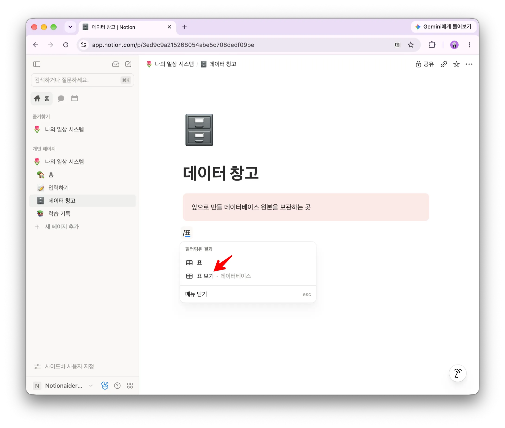

메뉴에서 **표 보기** 또는 **데이터베이스**라고 표시된 항목을 선택한 뒤, 새 데이터베이스를 만듭니다. 이름은 다음과 같이 입력합니다.

```
🧾 구독 서비스
```

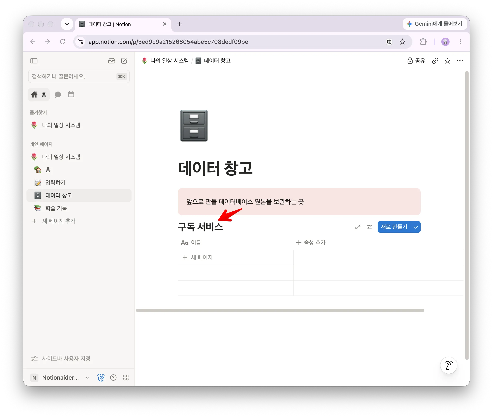

> ⚠️ **‘단순 표’가 아니라 데이터베이스를 선택하세요.**
`/표`를 입력하면 단순 표와 데이터베이스 표가 함께 보일 수 있습니다. 정렬, 필터, 속성 같은 기능을 사용할 수 있는 데이터베이스 항목인지 확인하세요. 노션 버전에 따라 메뉴 이름은 조금 다를 수 있습니다.

### 왜 홈이 아니라 데이터 창고에 만들까요?

홈은 자주 확인할 내용을 보여주는 화면으로 사용할 예정입니다. 원본 데이터베이스까지 홈에 놓으면 데이터가 늘어날수록 홈이 복잡해집니다.

그래서 원본은 데이터 창고에 보관하고, 다음 글에서 필요한 내용만 홈으로 가져오겠습니다. 지금은 이 원칙만 기억해 주세요.

```
원본은 데이터 창고에
자주 볼 내용은 홈에
```

## 2단계. 구독을 설명할 속성 만들기

데이터베이스의 열을 노션에서는 **속성**이라고 부릅니다. 표 오른쪽의 `+` 버튼을 선택하면 새 속성을 추가할 수 있습니다.

이번에 만들 기본 속성은 일곱 개입니다.

| 속성 | 유형 | 무엇을 적나요? |
| --- | --- | --- |
| 서비스명 | 제목 | 구독 서비스 이름 |
| 금액 | 숫자 | 실제 결제되는 금액 |
| 주기 | 선택 | 월 또는 연 |
| 결제일 | 숫자 | 매달 결제되는 날짜 1~31 |
| 결제수단 | 선택 | 사용하는 카드나 계좌 이름 |
| 상태 | 선택 | 이용 중, 해지 예정, 해지함 |
| 최근 사용 | 날짜 | 마지막으로 사용한 날짜 |

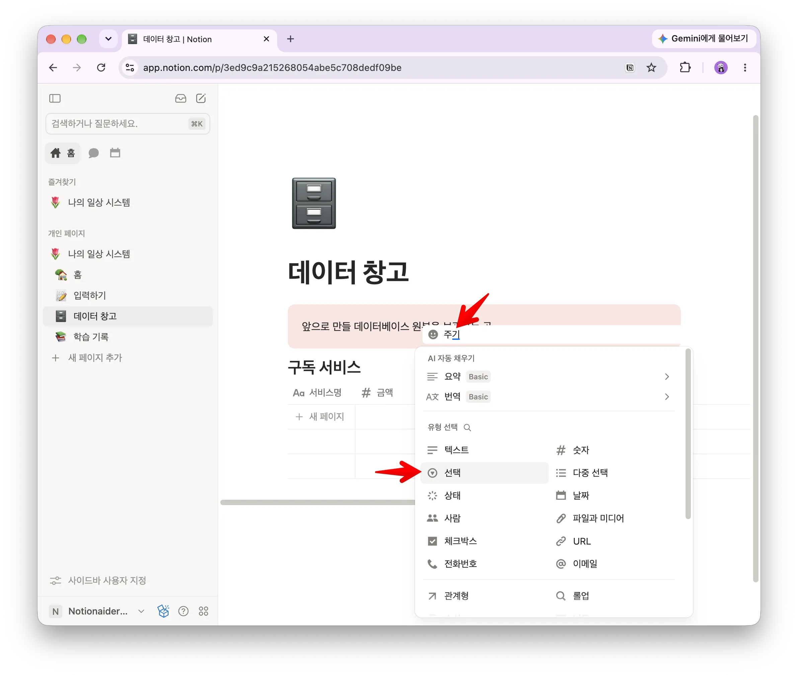

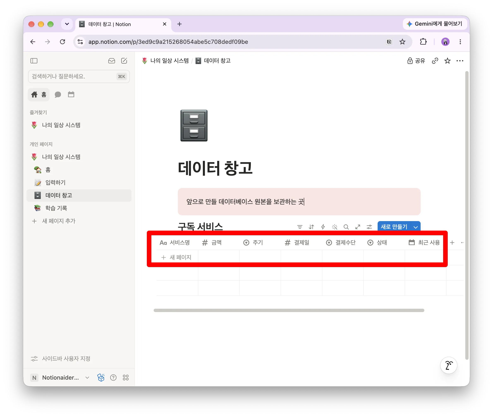

금액 속성의 표시 형식은 **USD($)**로 설정합니다. 금액 칸에는 달러 기호나 쉼표를 직접 입력하지 말고 숫자만 입력하세요. 표시 형식이 통화 기호를 붙여줍니다.(한국에서는 ‘원 (KRW)’를 선택합니다.)

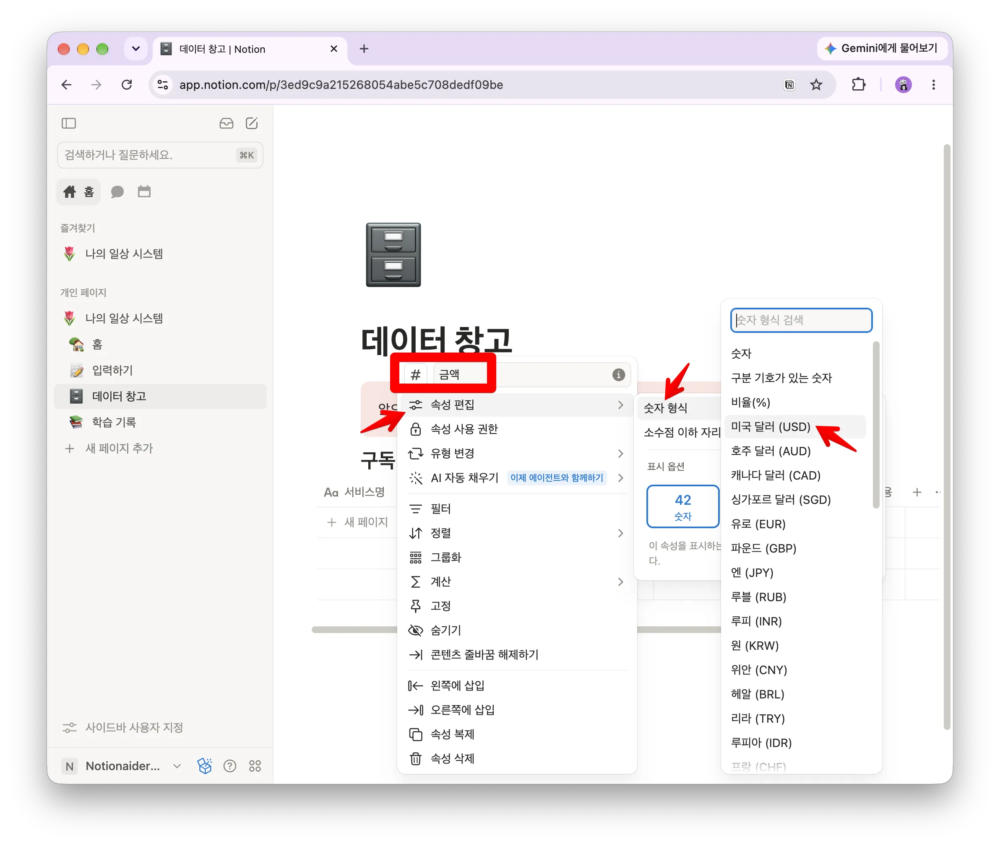

### 가장 중요한 속성은 ‘최근 사용’입니다

구독 관리라고 하면 금액이 가장 중요해 보입니다. 하지만 실제로 해지 여부를 결정할 때 더 중요한 질문은 “마지막으로 언제 사용했는가?”입니다.

비싼 서비스라도 매일 사용한다면 가치가 있을 수 있습니다. 반대로 적은 금액이라도 오랫동안 사용하지 않았다면 계속 결제할 이유를 다시 생각해 볼 수 있습니다.

> 🔎 **최근 사용일이 기억나지 않는다면 그것도 중요한 정보입니다.**
정확한 날짜를 모르겠다면 대략적인 날짜를 넣거나 일단 비워두셔도 됩니다. 마지막 사용이 기억나지 않는 서비스는 이후에 해지 후보를 찾을 때 먼저 살펴볼 수 있습니다.

### 결제수단 이름은 그대로 유지해 주세요

지금은 결제수단을 간단한 선택 속성으로 만듭니다. 시리즈가 진행되어 가계부와 결제수단을 따로 관리하게 되면, 이 속성을 다른 데이터와 연결하는 방식으로 확장할 예정입니다.

지금은 어렵게 이해할 필요가 없습니다. 나중에 이어서 사용할 수 있도록 속성 이름만 `결제수단`으로 유지해 주세요.

## 3단계. 내 실제 구독을 입력하기

이제 예시가 아니라 현재 실제로 결제 중인 구독을 입력합니다. 카드나 은행 명세서를 보면서 최소 다섯 개를 적어보세요.

- 서비스명은 실제 사용하는 이름으로 적습니다.
- 금액은 USD 기준으로 입력합니다.
- 연간 결제는 12로 나누지 말고 실제 연간 결제액을 그대로 적습니다.
- 주기에서 월 또는 연을 선택합니다.
- 최근 사용일은 기억나는 범위에서 입력합니다.

예시는 다음과 같습니다. 아래 금액은 구조를 설명하기 위한 임의의 값입니다.

| 서비스명 | 금액 | 주기 | 상태 | 최근 사용 |
| --- | --- | --- | --- | --- |
| 영상 서비스 A | 24 | 월 | 이용 중 | 2일 전 |
| 업무 도구 B | 120 | 연 | 이용 중 | 오늘 |
| 음악 서비스 C | 12 | 월 | 이용 중 | 어제 |
| 오래된 서비스 D | 8 | 월 | 해지 예정 | 6개월 전 |

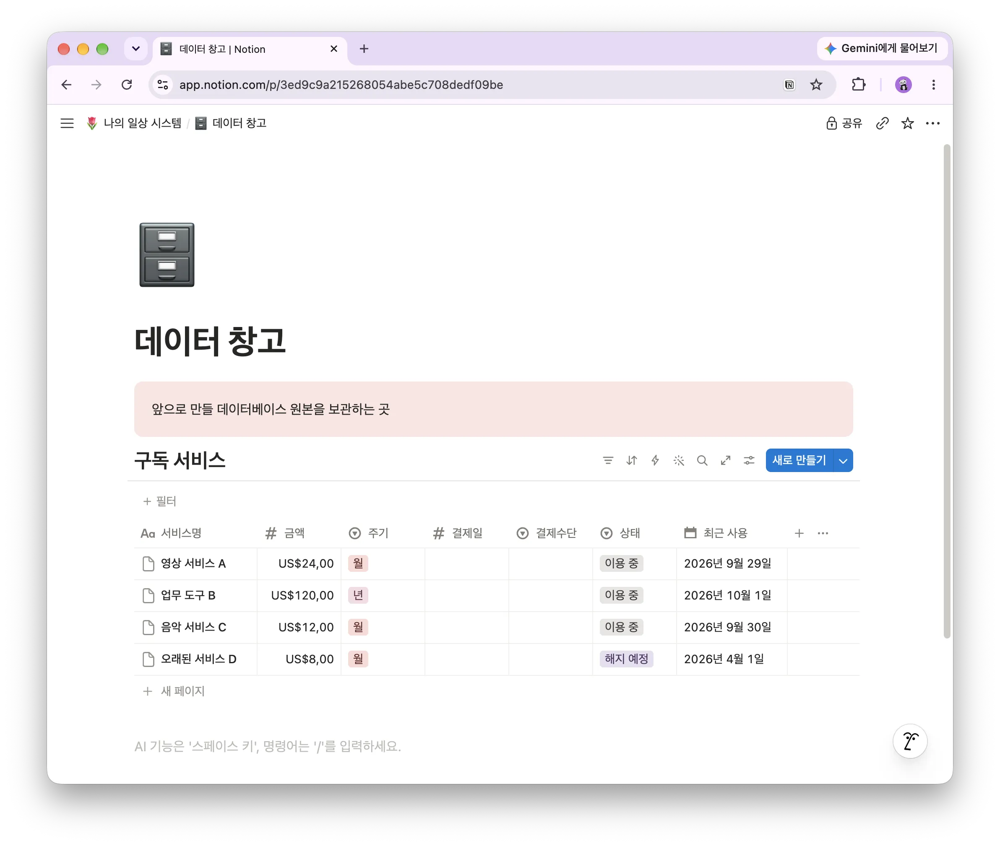

실제 데이터를 넣어야 이 데이터베이스가 연습장이 아니라 생활 도구가 됩니다. 다섯 개를 입력하는 동안 자주 비어 있는 속성이나 기록하기 어려운 정보가 무엇인지도 자연스럽게 알게 됩니다.

## 4단계. 두 가지 계산 추가하기

현재 표에서는 월 구독과 연 구독을 바로 비교하기 어렵습니다. 연간 $120인 서비스와 매월 $10인 서비스는 실제로 한 달 기준 금액이 같지만, 입력된 숫자만 보면 전혀 다르게 보입니다.

이를 해결하기 위해 수식 속성 두 개를 추가하겠습니다. 수식을 아직 이해하지 못해도 괜찮습니다. 이번에는 복사해 붙여넣고, 어떤 결과를 만들어주는지만 확인하세요.

### 월 환산액

새 속성을 만들고 유형을 **수식**, 이름을 `월 환산액`으로 지정합니다. 다음 수식을 붙여넣습니다.

```
if(prop("주기") == "년", prop("금액") / 12, prop("금액"))
```

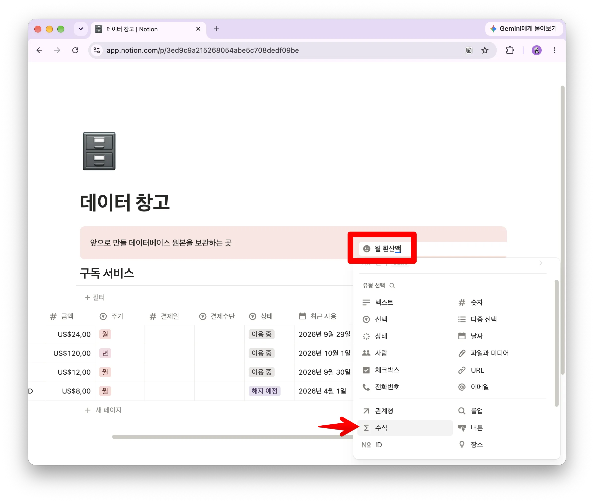

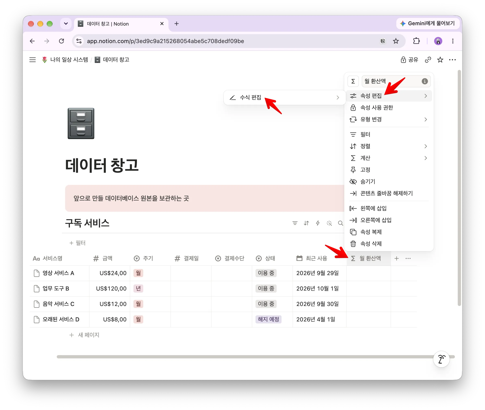

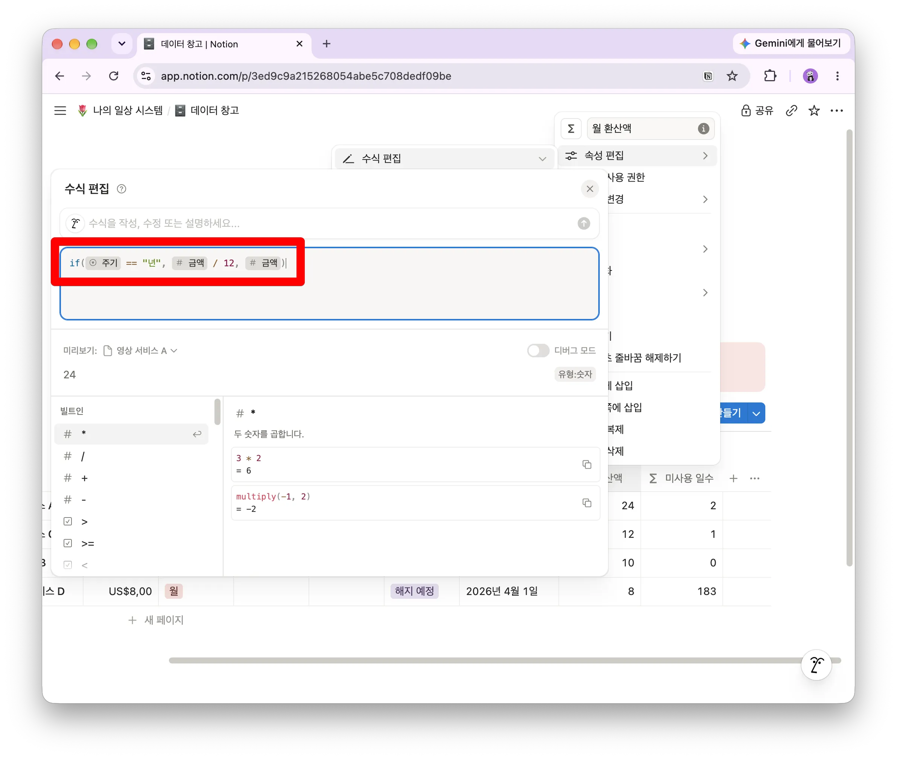

이 수식은 주기가 ‘년’이면 금액을 12로 나누고, ‘월’이면 입력한 금액을 그대로 보여줍니다.

### 미사용 일수

수식 속성을 하나 더 만들고 이름을 `미사용 일수`로 지정합니다. 다음 수식을 붙여넣습니다.

```
dateBetween(now(), prop("최근 사용"), "days")
```

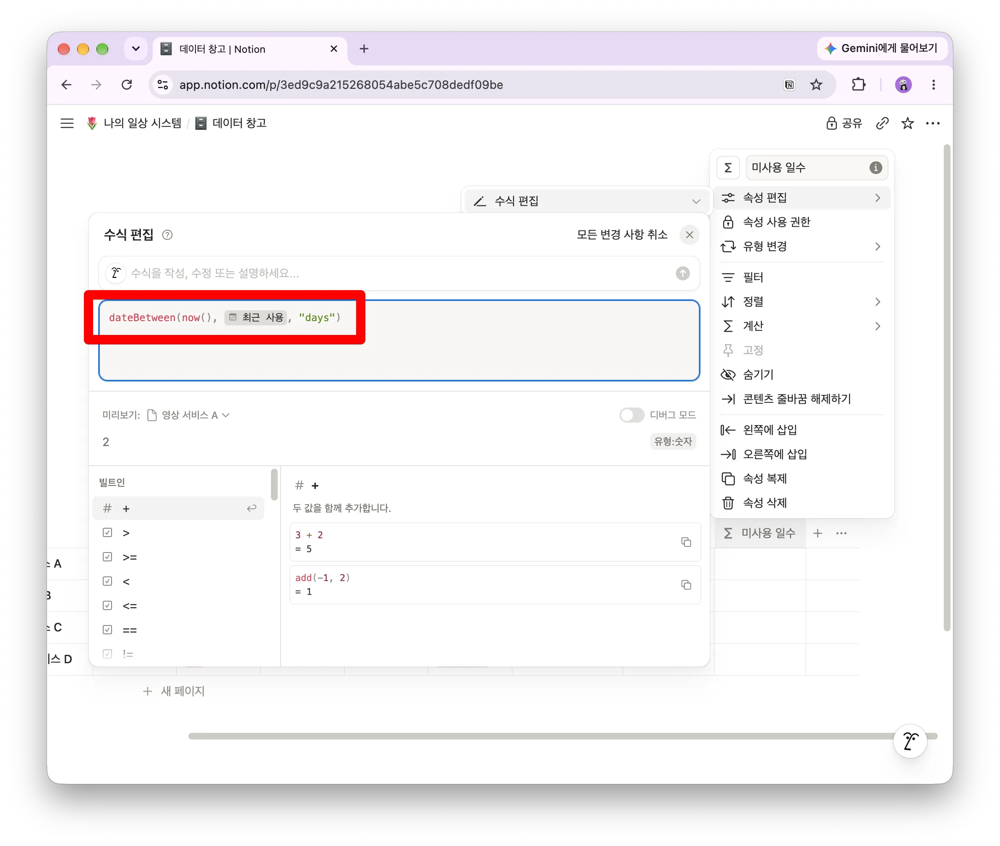

이 수식은 오늘과 최근 사용일 사이가 며칠인지 계산합니다. 오늘 사용한 서비스는 0, 약 6개월 전에 사용한 서비스는 180 전후로 표시됩니다.

> 🧩 **수식을 외울 필요는 없습니다.**
이번 글의 목표는 코드를 배우는 것이 아니라, 기록한 데이터가 계산 결과로 바뀌는 경험을 하는 것입니다. 속성 이름이 수식과 정확히 같아야 작동한다는 점만 확인하세요.

## 5단계. 비싼 구독부터 정렬하기

데이터베이스 위쪽의 **정렬** 메뉴를 선택하고 다음과 같이 설정합니다.

```
월 환산액 → 내림차순
```

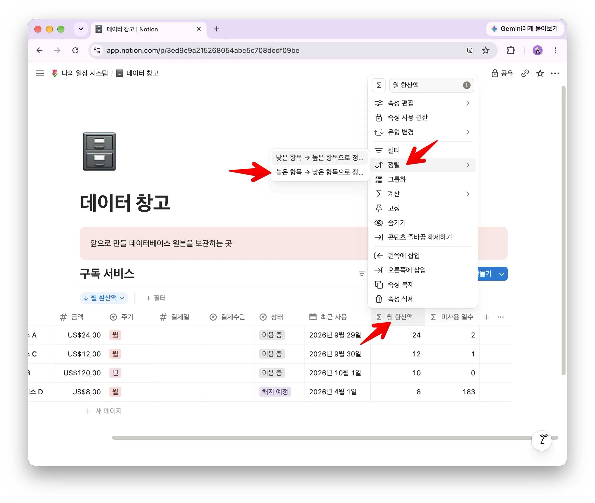

그러면 한 달 기준 비용이 큰 서비스가 위로 올라옵니다. 연간 결제 서비스도 월 기준으로 환산되어 함께 비교됩니다.

이제 표 아래의 계산 메뉴에서 `월 환산액`의 **합계**를 선택해 보세요. 화면에 표시되는 숫자가 현재 구독 서비스에 사용하는 월평균 금액입니다.

잠시 숫자를 살펴보세요. 예상과 비슷한가요? 생각보다 큰가요? 그리고 금액이 큰 서비스보다 오래 사용하지 않은 서비스가 눈에 띄지는 않나요?

## 값이 제대로 나오는지 확인하기

수식에 오류가 표시되지 않더라도 결과가 의도와 맞는지 직접 확인하는 것이 좋습니다.

| 확인할 항목 | 기대되는 결과 |
| --- | --- |
| 연 $120 서비스 | 월 환산액 $10 |
| 월 $24 서비스 | 월 환산액 $24 |
| 오늘 사용한 서비스 | 미사용 일수 0 |
| 약 6개월 전 사용한 서비스 | 미사용 일수 약 180 |


## 잘되지 않을 때 확인하세요

### 정렬 메뉴가 보이지 않습니다

단순 표를 만들었을 가능성이 큽니다. 데이터베이스 형태의 표인지 확인하세요.

### 합계가 계산되지 않습니다

금액 속성이 텍스트로 되어 있는지 확인하세요. 속성 유형을 숫자로 바꾸고, 금액 칸에는 숫자만 입력합니다.

### 연간 결제액이 너무 작게 나옵니다

연간 결제액을 미리 12로 나누어 입력했는지 확인하세요. 금액에는 실제로 한 번 결제되는 연간 금액을 그대로 입력해야 합니다. 월 환산은 수식이 처리합니다.

### 수식에 오류가 나타납니다

속성 이름이 수식 안의 이름과 같은지 확인하세요. `주기`, `금액`, `최근 사용`의 띄어쓰기까지 같아야 합니다.

### 미사용 일수가 비어 있습니다

최근 사용 날짜가 비어 있으면 미사용 일수도 표시되지 않습니다. 정확한 날짜를 모른다면 비워두어도 괜찮습니다. 이후 해지 후보를 살펴볼 때 다시 확인할 수 있습니다.

## 완성 확인

아래 항목을 하나씩 확인해 보세요.

- [ ] 데이터 창고 안에 ‘구독 서비스’ 데이터베이스를 만들었습니다.
- [ ] 기본 속성 일곱 개를 만들었습니다.
- [ ] 금액의 표시 형식을 USD($)로 설정했습니다.
- [ ] 실제 구독 서비스를 다섯 개 이상 입력했습니다.
- [ ] 월 환산액과 미사용 일수가 표시됩니다.
- [ ] 월 환산액을 기준으로 내림차순 정렬했습니다.
- [ ] 월 환산액의 합계를 확인했습니다.

## 첫 데이터베이스가 알려준 것

오늘 만든 것은 단순한 구독 목록이 아닙니다. 같은 종류의 정보를 일정한 형식으로 기록하고, 필요에 따라 계산하고 정렬할 수 있는 첫 데이터베이스입니다.

처음에는 서비스 이름과 금액을 적었을 뿐이지만, 주기와 최근 사용일을 함께 기록하자 새로운 질문에 답할 수 있게 되었습니다.

- 한 달 기준으로 가장 비싼 구독은 무엇인가요?
- 전체 월평균 구독료는 얼마인가요?
- 오랫동안 사용하지 않은 서비스는 무엇인가요?

이것이 데이터베이스를 사용하는 이유입니다. 정보를 많이 모으기 위해서가 아니라, 생활에서 필요한 질문에 답하기 위해 구조를 만드는 것입니다.

## 다음 글에서는 홈에서 확인합니다

지금은 구독 현황을 보려면 데이터 창고를 열어야 합니다. 다음 글에서는 원본 데이터베이스를 옮기거나 복제하지 않고, 홈에서 필요한 내용만 확인할 수 있도록 화면을 만들어보겠습니다.

> 🏠 **다음 글: 홈에서 필요한 구독만 보기**
같은 구독 데이터를 다시 입력하지 않고, 목적에 맞는 화면으로 꺼내 보는 방법을 배웁니다.
