> 📊 **이번 글에서 할 일**
구독 데이터베이스는 새로 만들지 않습니다. 하나의 원본에서 ‘비싼 순’과 ‘해지 후보’ 보기를 만들고, 홈에 링크된 보기로 배치합니다.

**예상 시간:** 약 30분 · **결과물:** 목적별 보기 2개와 홈 대시보드

[나의 일상 시스템 서문. 노션 초보자를 좌절시키는 문턱](https://app.notion.com/p/3e9091c284f680d2a6d4d594bd7ece9b)에서는 완성된 시스템을 한꺼번에 만들지 않고, 실제 생활의 필요에 따라 한 단계씩 확장하기로 했습니다. [나의 일상 시스템 1강. 틀 만들기 — 페이지 5개로 시작하기](https://app.notion.com/p/3e8091c284f6816b9d41d20732be4dd7)에서는 모든 것이 돌아올 집을 만들었고, [나의 일상 시스템 2강. 첫 데이터베이스 — 구독 관리로 시작하기](https://app.notion.com/p/3e8091c284f681fc9fd2ca3c17220ac5)에서는 실제 구독 정보를 데이터 창고에 기록했습니다.

이제 기록한 데이터를 매일 볼 수 있는 화면으로 꺼내보겠습니다.

이번 글에서 기억할 문장은 하나입니다.

> ⭐ **원본은 하나, 화면은 여러 개.**

같은 데이터를 여러 곳에 복사하지 않습니다. 데이터는 한곳에 저장하고, 필요한 장소에서 목적에 맞는 화면으로 보여줍니다.

## 데이터는 만들었는데 왜 다시 보지 않을까요?

지난 글에서 만든 구독 데이터베이스는 데이터 창고 안에 있습니다. 내용을 확인하려면 ‘나의 일상 시스템’을 열고, 데이터 창고로 들어가 구독 서비스 데이터베이스를 찾아야 합니다.

한두 번은 괜찮습니다. 하지만 자주 확인해야 하는 정보라면 이 과정이 점점 번거롭게 느껴집니다. 결국 데이터는 잘 정리되어 있지만 다시 보지 않는 상태가 되기 쉽습니다.

이를 해결하려고 원본 데이터베이스를 홈으로 옮기면 홈이 창고처럼 복잡해집니다. 홈에 표를 하나 더 만들고 내용을 복사하면 같은 정보를 두 곳에서 관리해야 합니다. 한쪽만 수정하면 두 표의 내용이 달라지는 문제도 생깁니다.

노션은 이 문제를 **보기**와 **링크된 보기**로 해결합니다.

## 창고는 하나, 진열장은 여러 개

데이터베이스 원본을 창고라고 생각해 보세요. 물건은 창고에 한 번만 보관합니다. 대신 목적에 따라 여러 진열장을 만들 수 있습니다.

```
          🗄 구독 서비스 원본
                  │
        ┌─────────┴─────────┐
        ▼                   ▼
   💸 비싼 순          🗑 해지 후보
```

- 진열장을 없애도 창고의 물건은 사라지지 않습니다.
- 창고의 값을 수정하면 모든 진열장에 같은 내용이 반영됩니다.
- 진열장마다 필요한 항목만 고르고 다른 순서로 보여줄 수 있습니다.

노션에서 이 진열장에 해당하는 것이 **보기(View)**입니다. 보기는 원본 데이터를 복사하지 않습니다. 필터, 정렬, 표시 속성을 이용해 같은 데이터를 다른 관점으로 보여줍니다.

## 1단계. ‘비싼 순’ 보기 만들기

먼저 데이터 창고에 있는 **구독 서비스** 데이터베이스를 엽니다. 기존 보기 이름 옆의 `+`를 선택하고 새로운 표 보기를 만듭니다.

보기 이름은 다음과 같이 지정합니다.

```
3강 · 💸 비싼 순
```

이름 앞에 강 번호를 붙이면 나중에 보기가 많아져도 언제 만든 화면인지 쉽게 알 수 있습니다.

이제 보기의 필터와 정렬을 설정합니다.

| 설정 | 값 |
| --- | --- |
| 필터 | 상태는 ‘이용 중’ |
| 정렬 | 월 환산액 내림차순 |
| 표시할 속성 | 서비스명, 금액, 주기, 월 환산액, 결제수단 |

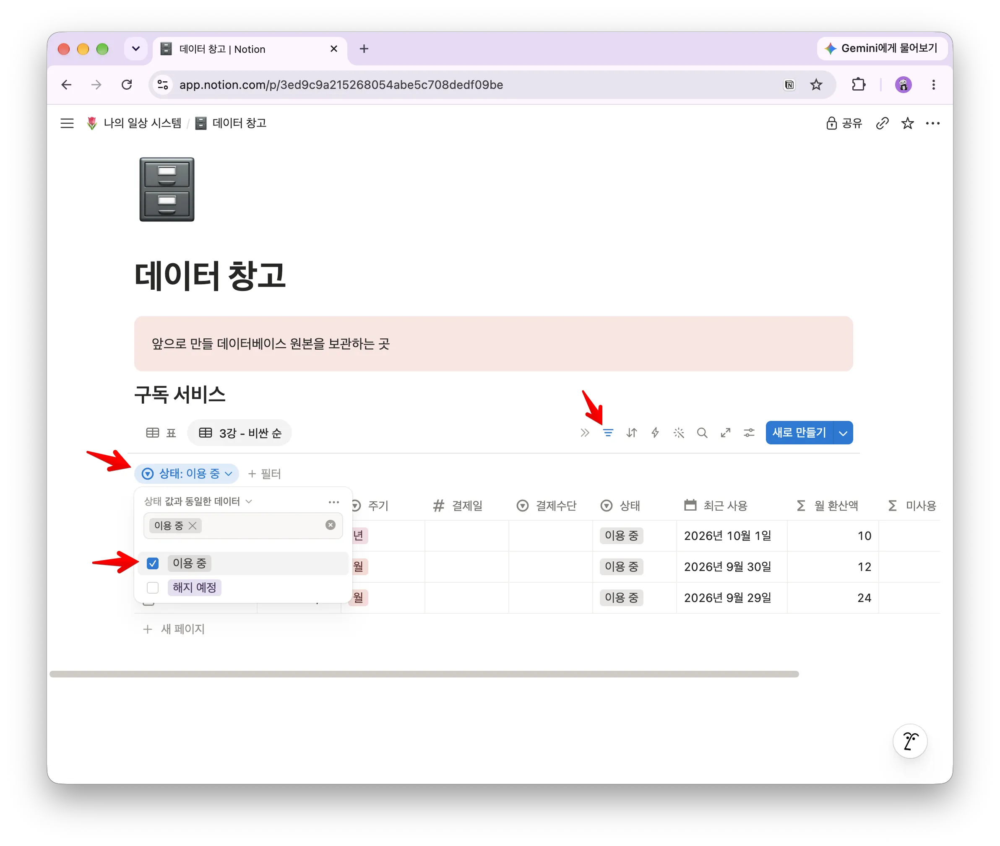

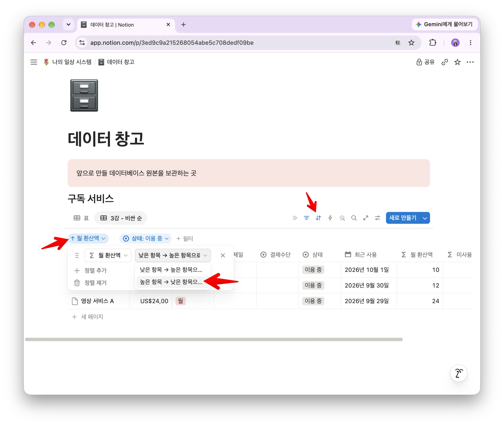

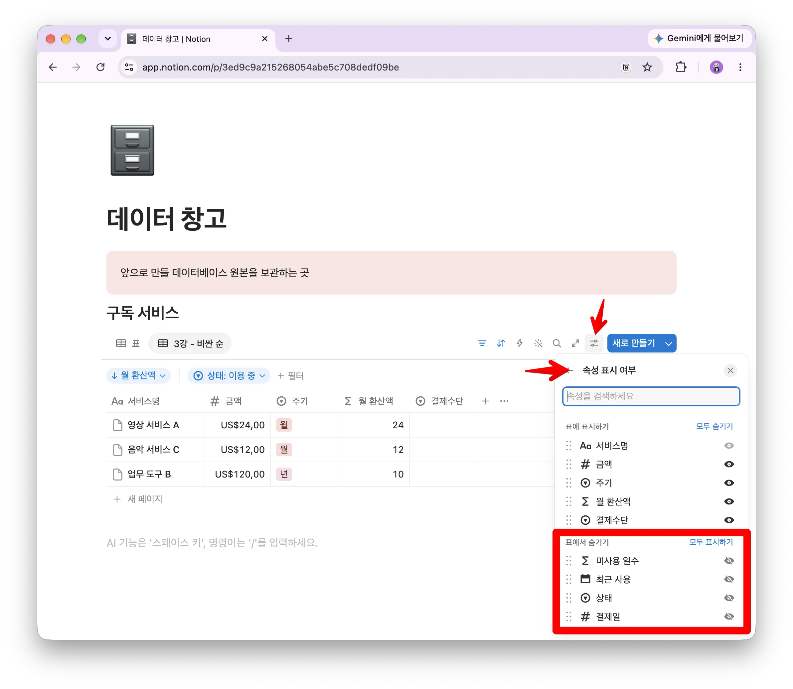

해지한 서비스까지 함께 표시되면 현재 지출을 파악하기 어렵습니다. 그래서 이용 중인 서비스만 남기고, 월 기준 비용이 큰 순서로 정렬합니다.

이 보기는 “현재 이용 중인 구독 가운데 무엇에 가장 많은 돈을 쓰고 있는가?”라는 질문에 답합니다.

## 2단계. ‘해지 후보’ 보기 만들기

보기를 하나 더 만들고 다음과 같이 이름을 지정합니다.

```
3강 · 🗑 해지 후보
```

이번에는 필터 조건을 두 개 사용합니다.

| 조건 | 설정 |
| --- | --- |
| 첫 번째 | 상태는 ‘이용 중’ |
| 두 번째 | 최근 사용이 지난 60일 이전(미사용 일수가 60보다 큰 것) |
| 조건 관계 | 그리고 |

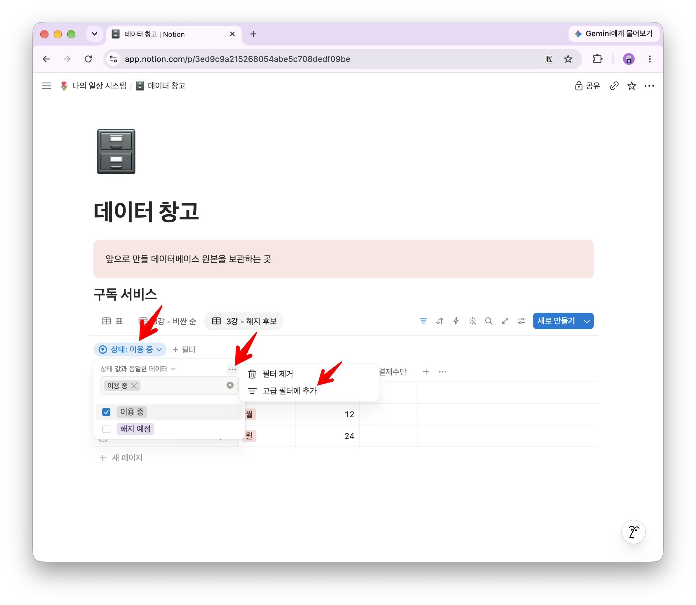

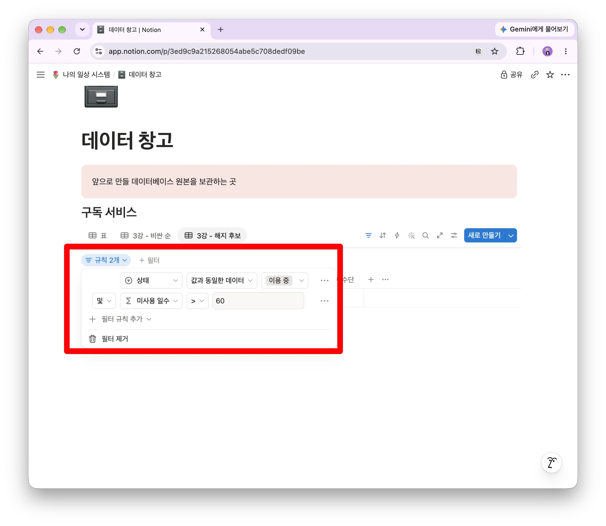

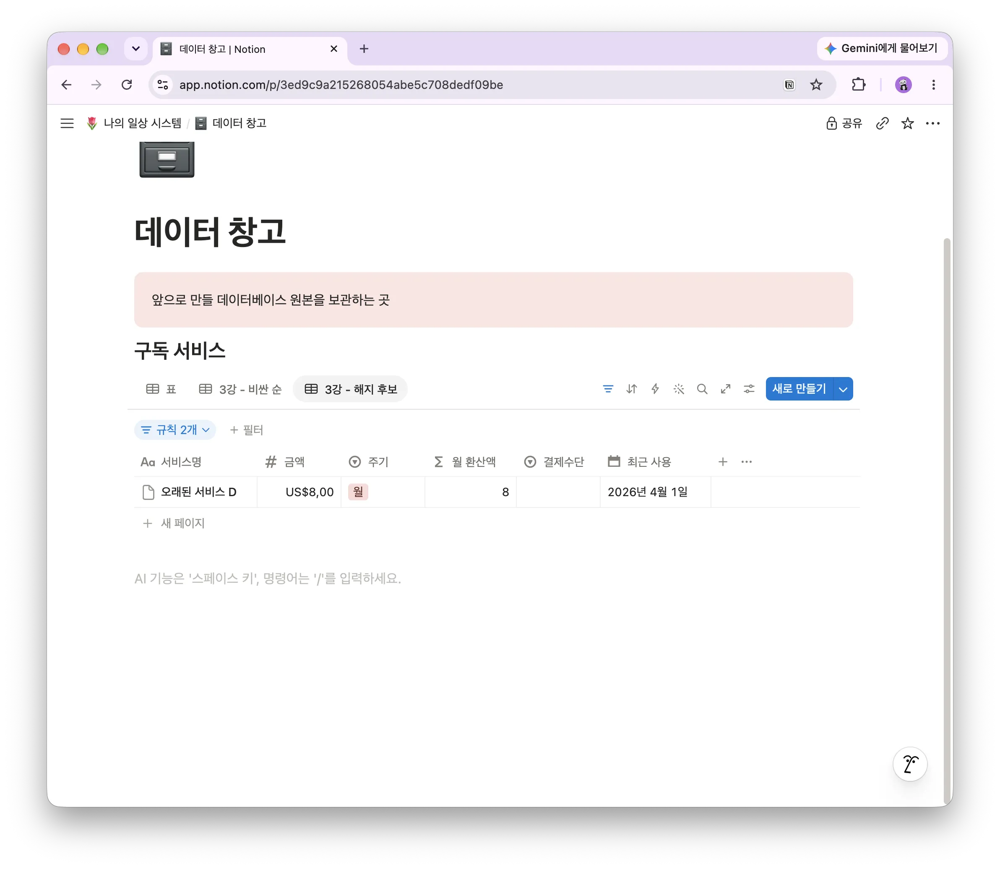

두 조건을 **그리고**로 연결해야 현재 이용 중이면서 오랫동안 사용하지 않은 서비스만 남습니다.

> ⏳ **특정 날짜보다 상대 날짜를 사용하세요.**
예를 들어 2026년 8월 1일처럼 날짜를 직접 입력하면 시간이 지나도 기준이 바뀌지 않습니다. ‘지난 60일 이전’처럼 오늘을 기준으로 움직이는 조건을 사용하면 다음 달에도 같은 목적의 보기가 유지됩니다. 화면에 보이는 표현은 노션 버전에 따라 조금 다를 수 있으므로 ‘오늘로부터 60일’이라는 의미인지 확인하세요.

‘비싼 순’이 현재 상황을 보여주는 화면이라면, ‘해지 후보’는 다음 행동을 찾는 화면입니다. 여기에 나타난 서비스가 있다면 실제 사용 여부와 해지 조건을 확인해 보세요.

## 3단계. 홈에 링크된 보기 추가하기

이제 1강에서 만든 **홈** 페이지를 엽니다. 빈 공간에 다음과 같이 입력합니다.

```
/보기
```

메뉴에서 **데이터베이스 보기 연결** 항목을 선택합니다. 노션 버전에 따라 ‘기존 데이터베이스 연결’이나 ‘Linked view of database’처럼 표시될 수 있습니다.

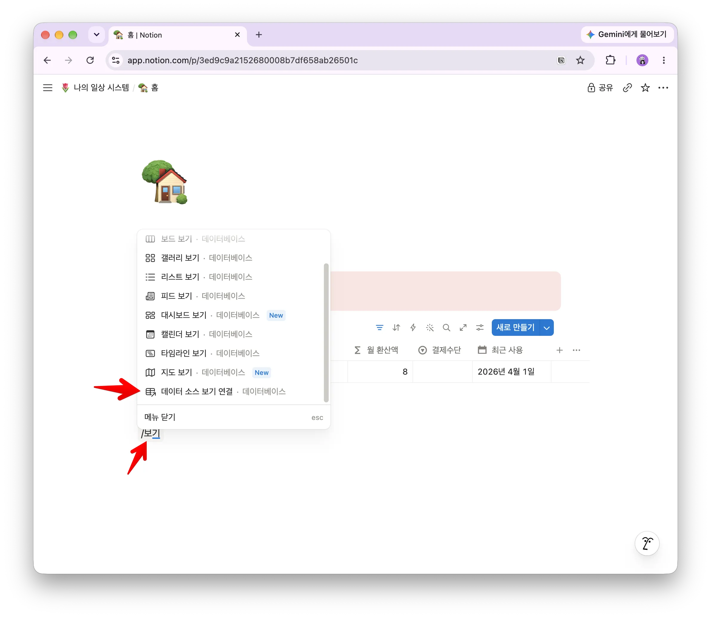

검색창에서 **구독 서비스** 데이터베이스를 선택하고, 사용할 보기로 다음 항목을 고릅니다.

```
3강 · 🗑 해지 후보
```

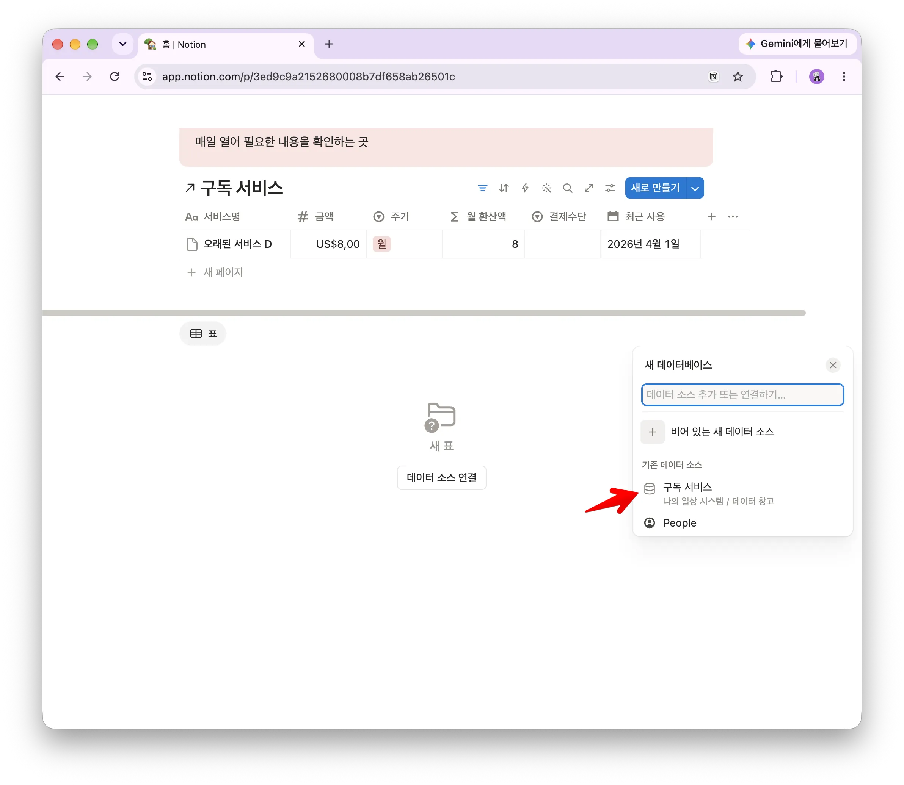

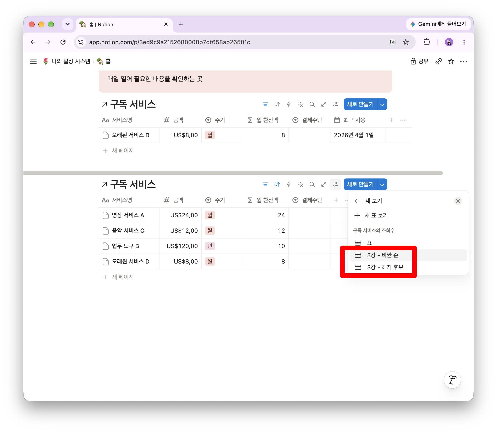

같은 방법으로 `3강 · 💸 비싼 순` 보기도 홈에 추가합니다.

**홈에 보이는 두 표는 새로운 데이터베이스가 아닙니다**. 데이터 창고의 같은 원본을 바라보는 화면입니다.
’구독 서비스’ 제목 옆에 화살표가 붙어 있는 것은 이것이 데이터베이스 원본이 아니라 링크된 데이터베이스 보기(View)임을 나타냅니다.

두 링크된 데이터베이스 뷰의 제목 옆 ‘…’ 버튼을 클릭하여 ‘제목 숨기기’를 선택하면 ‘탭’ 형태의 제목으로 ‘3강 - 해지 후보’, ‘3강 - 비싼 순’이 나타납니다.

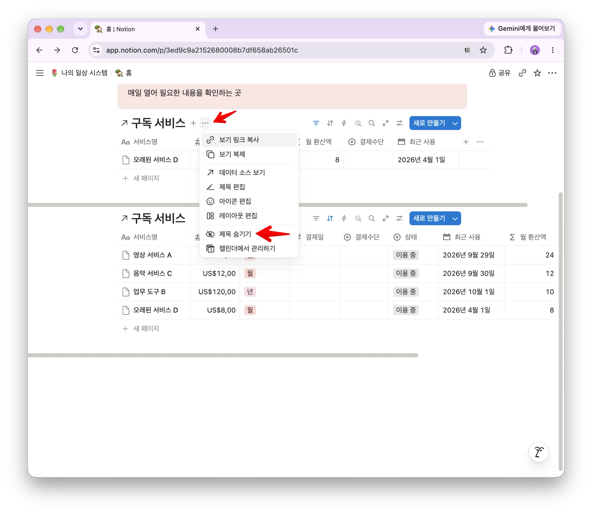

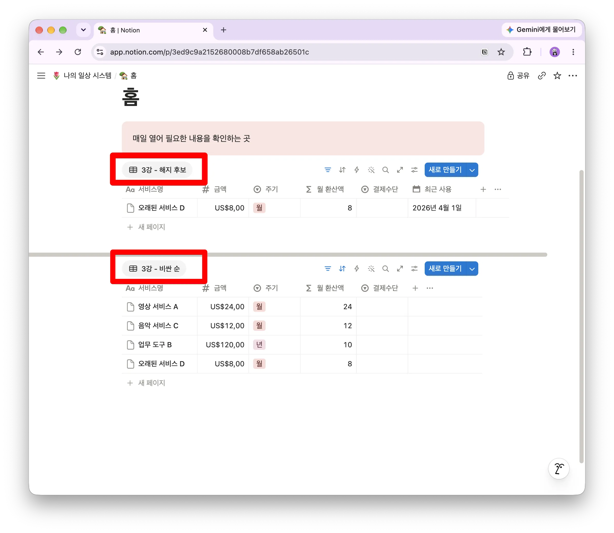

## 4단계. 두 보기를 한 화면에 배치하기

화면이 충분히 넓다면 두 링크된 보기를 좌우로 배치할 수 있습니다.

두 번째 보기 블록 왼쪽의 이동 손잡이를 잡고 첫 번째 보기의 오른쪽으로 드래그합니다. 파란 세로선이 나타날 때 놓으면 두 개의 열로 나뉩니다. 가운데 경계선을 드래그해 너비를 조절하세요.



화면이 좁거나 모바일 사용이 많다면 위아래로 배치해도 괜찮습니다. 중요한 것은 좌우 배치 자체가 아니라 홈을 열었을 때 필요한 정보가 바로 보이는 것입니다.

## 5단계. 홈의 역할을 적어두기

홈 맨 위에 콜아웃을 하나 추가합니다.

```
/콜아웃
```

다음과 같은 안내문을 적어두세요.

> 📌 매일 확인하는 화면입니다. 데이터베이스 원본은 데이터 창고에 있고, 이곳에는 필요한 링크된 보기만 둡니다.

이 한 문장은 시스템이 커졌을 때 홈의 역할을 잊지 않게 해줍니다.

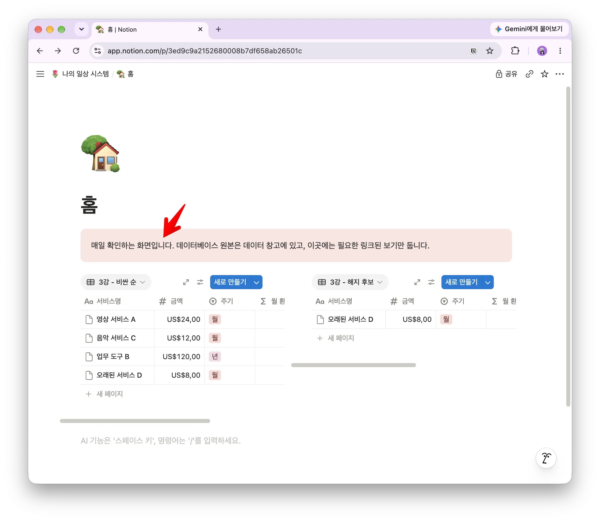

## 링크된 보기가 원본과 연결되어 있는지 확인하기

개념을 이해하는 가장 좋은 방법은 직접 수정해 보는 것입니다.

1. 홈의 ‘비싼 순’ 보기에서 구독 하나의 금액을 바꿉니다.
2. 데이터 창고의 구독 서비스 원본을 엽니다.
3. 같은 금액으로 바뀌었는지 확인합니다.
4. 원본에서 구독 하나의 상태를 ‘해지함’으로 바꿉니다.
5. 홈으로 돌아와 이용 중 목록에서 사라졌는지 확인합니다.

홈에서 값을 수정했는데 원본에도 반영되는 이유는 두 화면이 같은 데이터를 보고 있기 때문입니다. 상태를 바꾼 항목이 홈에서 사라진 것은 데이터가 삭제되어서가 아니라 필터 조건에 맞지 않게 되었기 때문입니다.

> 💡 **하나를 수정하면 연결된 모든 보기가 함께 바뀝니다.**
이것이 같은 내용을 여러 표에 복사하지 않고 원본 하나를 유지해야 하는 이유입니다.

## 좋은 홈 대시보드는 무엇이 다를까요?

대시보드는 많은 정보를 보여주는 화면이 아닙니다. 지금 확인하거나 행동해야 할 내용을 빠르게 보여주는 화면입니다.

### 한 화면에서 핵심을 파악합니다

자주 보는 정보는 스크롤을 많이 하지 않아도 확인할 수 있어야 합니다. 내용이 너무 많다면 덜 중요한 보기를 내리거나 접어두세요.

### 행동으로 이어지는 내용을 먼저 둡니다

‘구독이 모두 몇 개인가’보다 ‘오랫동안 사용하지 않은 구독은 무엇인가’가 다음 행동을 만들기 쉽습니다. 홈의 위쪽에는 확인 후 행동할 수 있는 내용을 배치합니다.

### 링크된 보기를 너무 많이 올리지 않습니다

처음에는 핵심 보기 두 개면 충분합니다. 홈이 복잡해지면 매일 열기 어려워지고, 필요한 정보도 찾기 힘들어집니다. 새로운 보기는 실제 필요가 생겼을 때 추가하세요.

### 홈을 링크 목록으로만 만들지 않습니다

페이지로 이동하는 링크만 늘어놓으면 홈을 열어도 현재 상태를 알 수 없습니다. 홈에는 이동 경로뿐 아니라 지금 확인해야 할 정보가 보여야 합니다.

## 잘되지 않을 때 확인하세요

### 원본 데이터베이스를 홈으로 옮겼습니다

원본은 데이터 창고로 되돌리고, 홈에는 링크된 보기를 추가하세요.

### 홈에 새 데이터베이스를 만들었습니다

새 데이터베이스에 내용을 다시 입력하면 데이터가 두 곳으로 나뉩니다. 새로 만든 데이터베이스는 제거하고 기존 구독 서비스 원본에 연결하세요.

### 해지 후보에 엉뚱한 항목이 많이 보입니다

필터 조건이 `또는`으로 연결되어 있는지 확인하세요. 두 조건은 `그리고`로 연결해야 합니다.

### 해지 후보가 다음 달에도 같은 항목만 보여줍니다

최근 사용 필터에 특정 날짜를 입력했는지 확인하세요. 오늘을 기준으로 움직이는 상대 날짜 조건으로 변경합니다.

### 모든 항목이 사라졌습니다

데이터가 삭제된 것이 아니라 필터 조건에 맞는 항목이 없는 경우가 많습니다. 필터를 하나씩 잠시 꺼보면서 어떤 조건에서 항목이 제외되는지 확인하세요.

### 홈에서 필요한 속성이 보이지 않습니다

링크된 보기의 속성 표시 설정을 확인하세요. 원본의 속성을 삭제하지 않고, 현재 보기에서 표시하거나 숨길 속성을 따로 선택할 수 있습니다.

## 완성 확인

아래 항목을 하나씩 확인해 보세요.

- [ ] ‘비싼 순’과 ‘해지 후보’ 보기 두 개를 만들었습니다.
- [ ] ‘비싼 순’에는 이용 중 필터와 월 환산액 정렬을 적용했습니다.
- [ ] ‘해지 후보’에는 이용 중과 최근 60일 조건을 ‘그리고’로 연결했습니다.
- [ ] 날짜 기준은 특정 날짜가 아닌 상대 날짜입니다.
- [ ] 홈에 두 개의 링크된 보기를 추가했습니다.
- [ ] 홈에서 수정한 값이 원본에도 반영되는 것을 확인했습니다.
- [ ] 상태를 바꾼 항목이 필터에 따라 사라지는 것을 확인했습니다.

## 오늘 만든 것은 데이터가 아니라 사용 화면입니다

2강에서는 구독 정보를 저장할 원본 데이터베이스를 만들었습니다. 오늘은 새로운 데이터를 만들지 않았습니다. 같은 원본을 목적에 따라 다르게 보여주는 화면을 만들었습니다.

```
원본은 하나
→ 비싼 순으로 보는 화면
→ 해지 후보를 찾는 화면
→ 홈에서 매일 확인하는 화면
```

데이터를 복사하지 않았기 때문에 어느 화면에서 수정해도 같은 원본에 반영됩니다. 보기를 없애거나 배치를 바꾸어도 원본 데이터는 그대로 남습니다. 그래서 화면은 생활에 맞게 부담 없이 바꿀 수 있습니다.

**원본은 하나, 화면은 여러 개.** 이 원칙은 앞으로 구독뿐 아니라 할 일, 지출, 독서 기록 등 다른 시스템을 만들 때도 계속 사용합니다.

## 다음 글에서는 입력을 더 쉽게 만듭니다

이제 홈을 열면 구독 현황을 바로 확인할 수 있습니다. 하지만 새로운 구독을 추가하려면 아직 데이터 창고를 열고 여러 속성을 직접 채워야 합니다.

다음 글에서는 필요한 항목만 보여주는 입력 화면을 만들어, 새로운 구독을 더 빠르고 부담 없이 기록하는 방법을 알아보겠습니다.

> 📝 **다음 글: 입력 과정을 줄이는 방법**
데이터베이스의 구조는 그대로 유지하면서, 새 항목을 더 쉽게 추가할 수 있는 입력 화면을 만듭니다.
