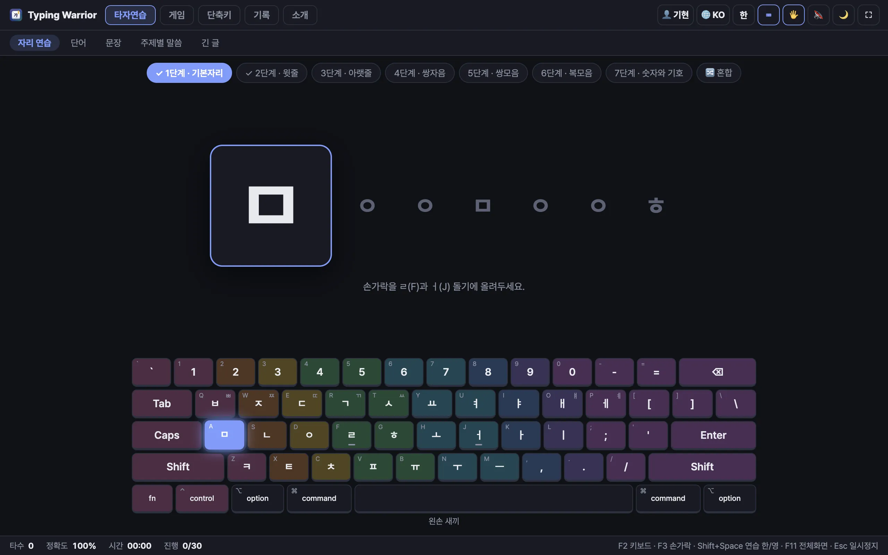
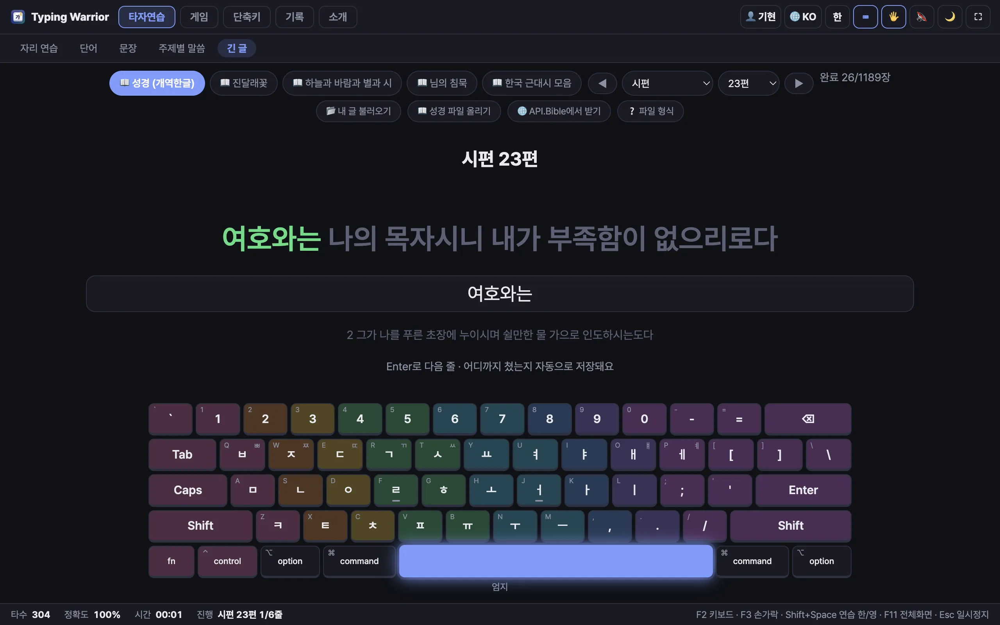
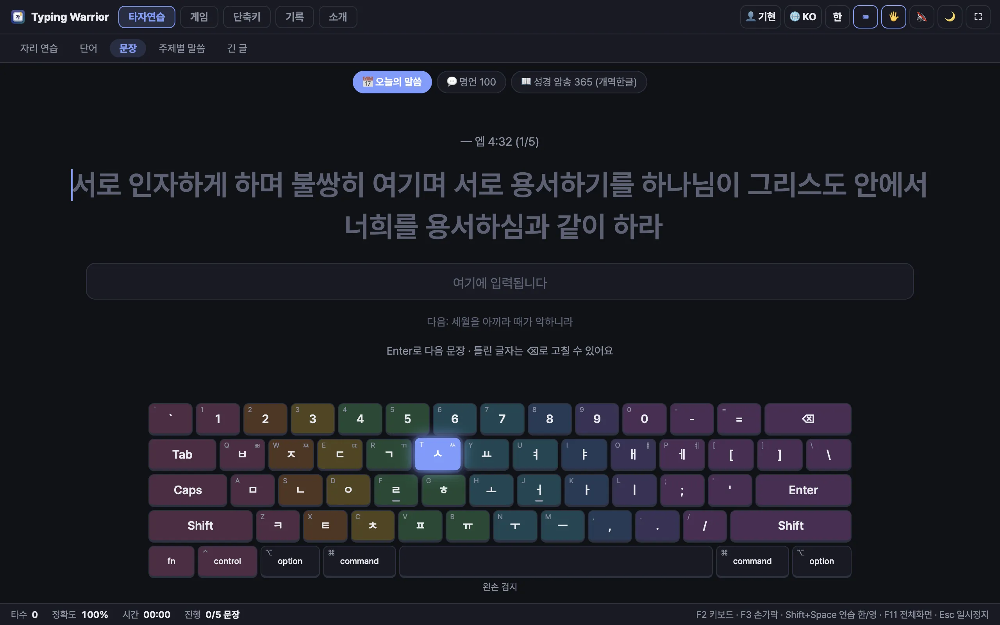
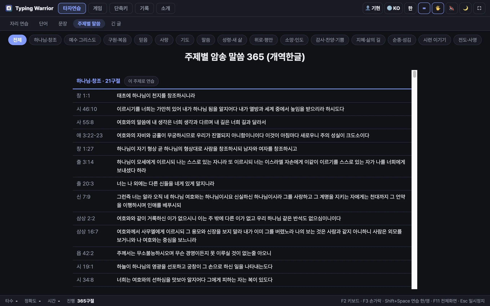
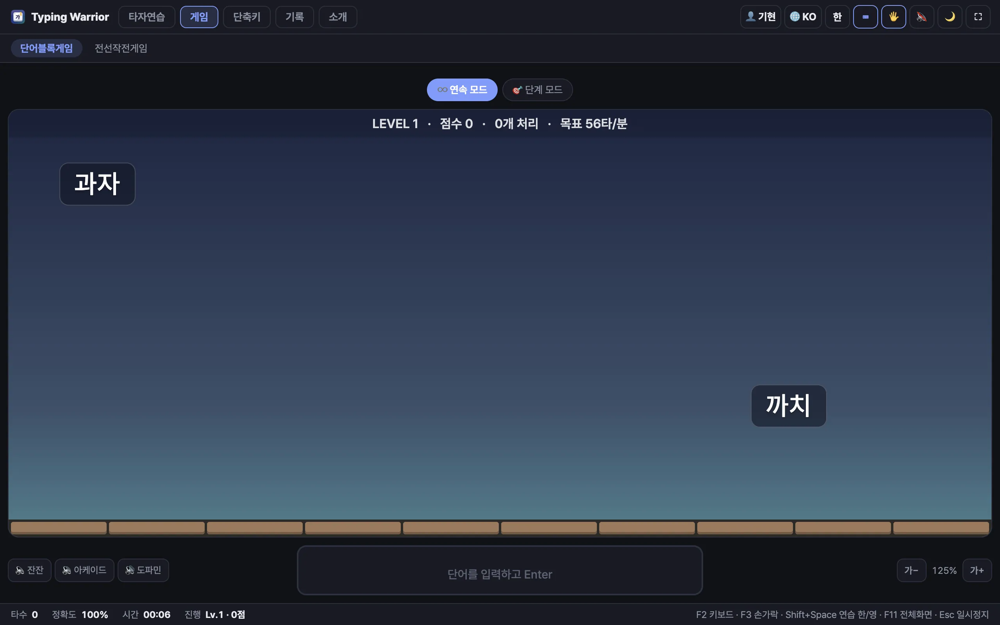
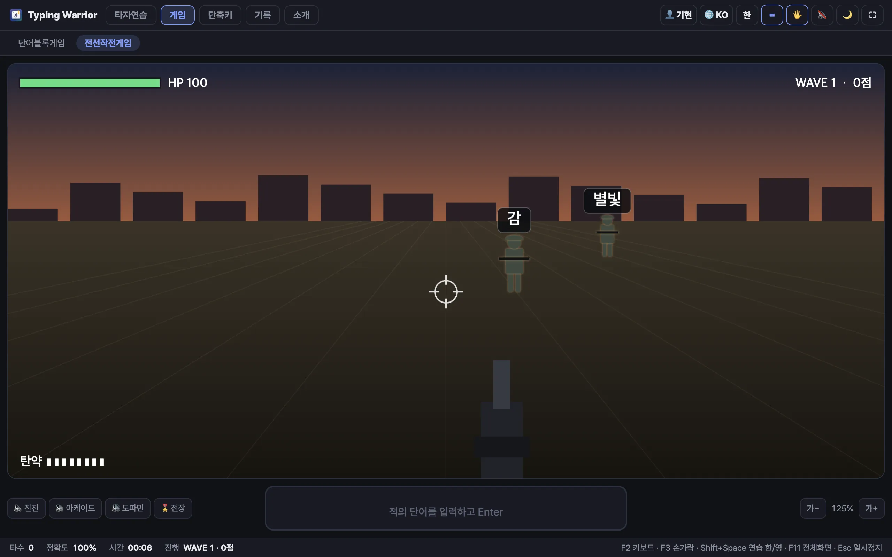
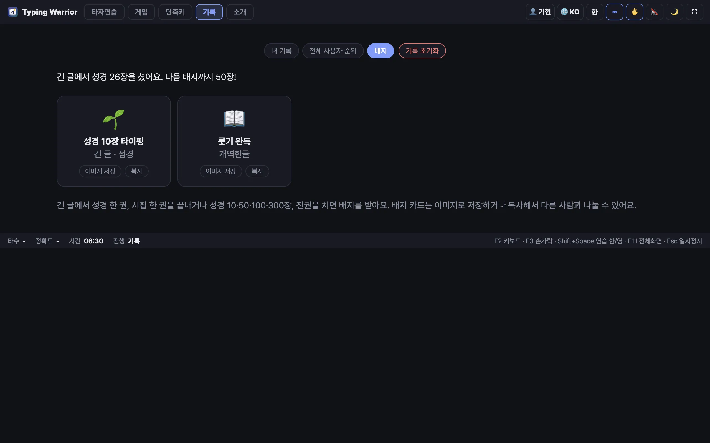

### 손끝으로 새기는 말씀과 시 — Typing Warrior

자판 위에 손을 올리고, 한 줄을 천천히 따라 칩니다.

> 여호와는 나의 목자시니 내가 부족함이 없으리로다

눈으로 읽을 때는 스쳐 지나가던 말씀이, 한 글자씩 손끝을 지나며 마음에 머뭅니다. **Typing Warrior**는 그렇게 말씀과 문학을 따라 쓰며 타자를 익히는 프로그램입니다.

**창세기부터 요한계시록까지, 성경 전권을 한 줄씩.**
개역한글과 KJV 성경 1,189장을 책과 장을 골라 이어서 칠 수 있습니다. 어디까지 쳤는지 기억해 두니, 오늘 한 장 내일 한 장 필사하듯 이어 가면 됩니다. 날마다 바뀌는 **오늘의 말씀**과, 사랑·믿음·기도·위로 같은 주제별로 정리한 **암송 말씀 365구절**도 있습니다.

**그리고 시가 있습니다.**
"나 보기가 역겨워 가실 때에는" — 김소월의 진달래꽃.
"죽는 날까지 하늘을 우러러" — 윤동주의 서시.
"님은 갔습니다" — 한용운의 님의 침묵.
영어로는 셰익스피어의 소네트와 에밀리 디킨슨의 시, 그리고 Amazing Grace와 Rock of Ages 같은 옛 찬송가를 원문 그대로 따라 칩니다. 오래 사랑받아 온 글들이 타자 연습의 교재가 됩니다.

**지칠 때는 게임으로.**
하늘에서 떨어지는 단어 블록을 땅에 닿기 전에 쳐서 없애는 **단어블록게임**, 다가오는 적 위의 단어를 쳐서 막아 내는 1인칭 **전선작전게임**. 레벨이 오를수록 손가락도 빨라집니다. 레벨 10이면 분당 200타입니다.

**누구나, 함께.**

- 한글 자리 연습부터 맥·윈도우 단축키까지 차근차근 배웁니다.
- 화면 언어와 연습 언어를 따로 고를 수 있어, 외국인 친구도 영어 화면으로 한글 타자를 배울 수 있습니다.
- 가족이 한 컴퓨터를 함께 써도 사용자마다 기록이 따로 남고, 순위도 볼 수 있습니다.
- 성경 한 권을 다 치면 배지를 받고, 배지 카드를 친구에게 나눌 수 있습니다.

맥과 윈도우에서 무료로 쓸 수 있고, 기록은 내 컴퓨터에만 저장됩니다.

📥 내려받기: [https://github.com/ccumgol/typing-warrior/releases](https://github.com/ccumgol/typing-warrior/releases)
🏠 홈페이지: [https://jesusiswith.us](https://jesusiswith.us/)
☕ 응원하기: [https://buymeacoffee.com/ccumgol](https://buymeacoffee.com/ccumgol)

